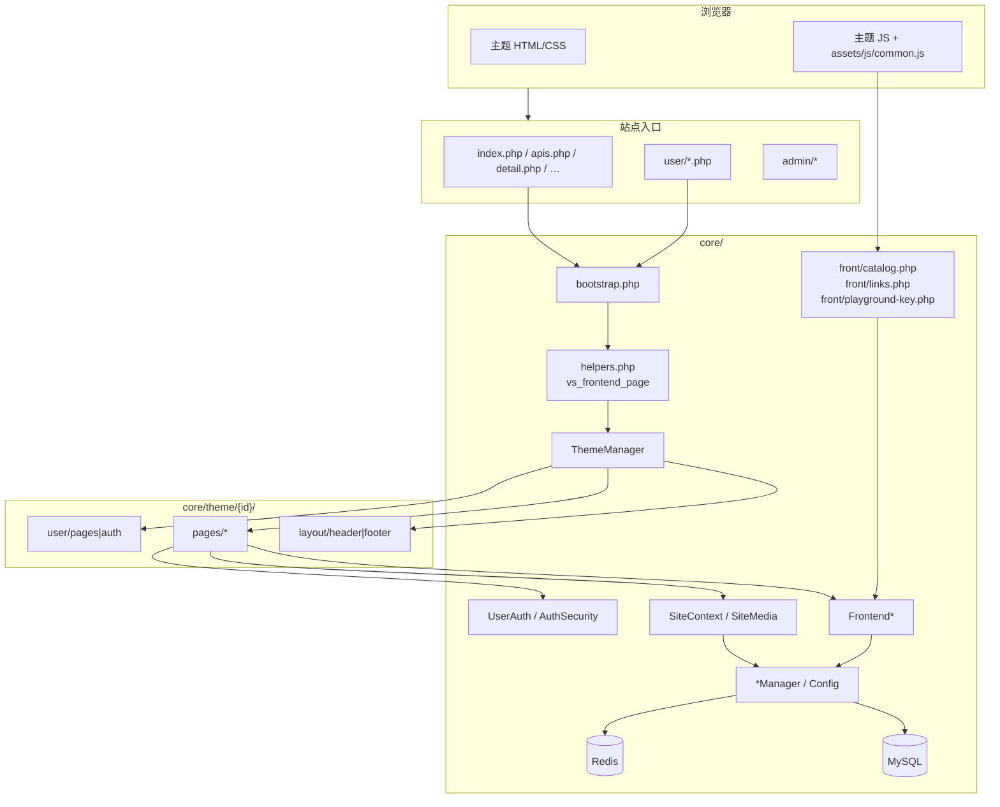
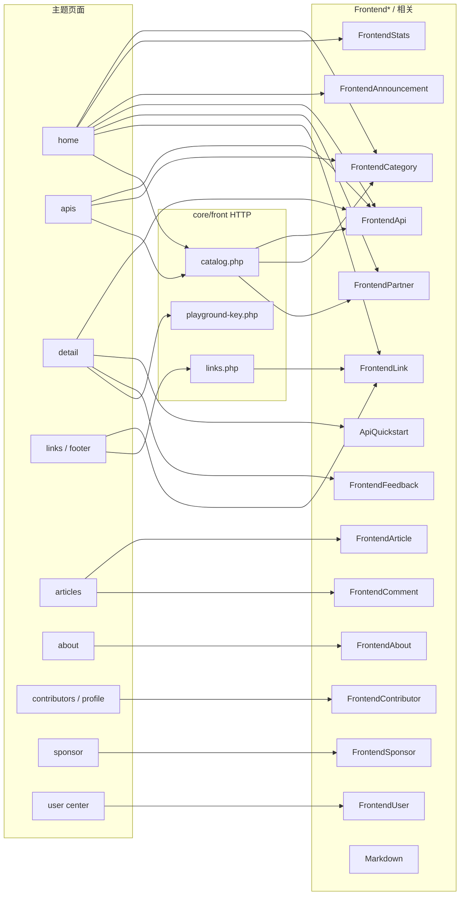
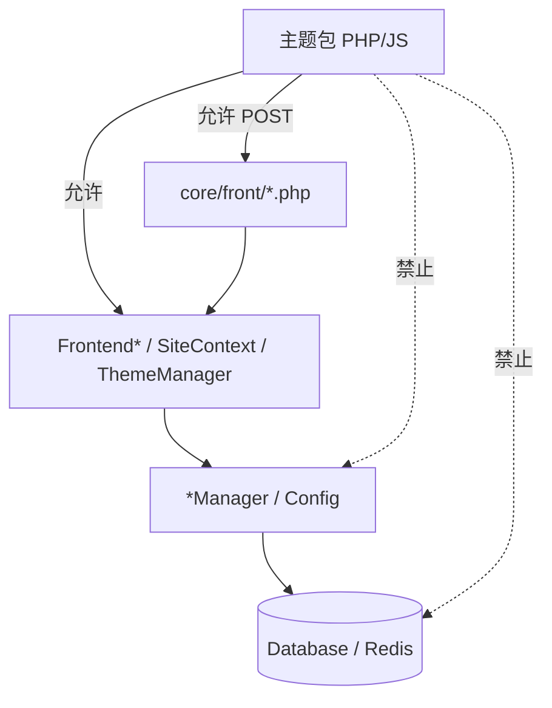
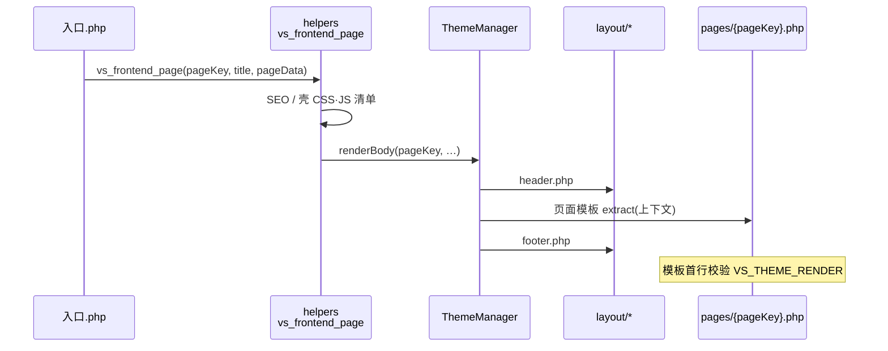
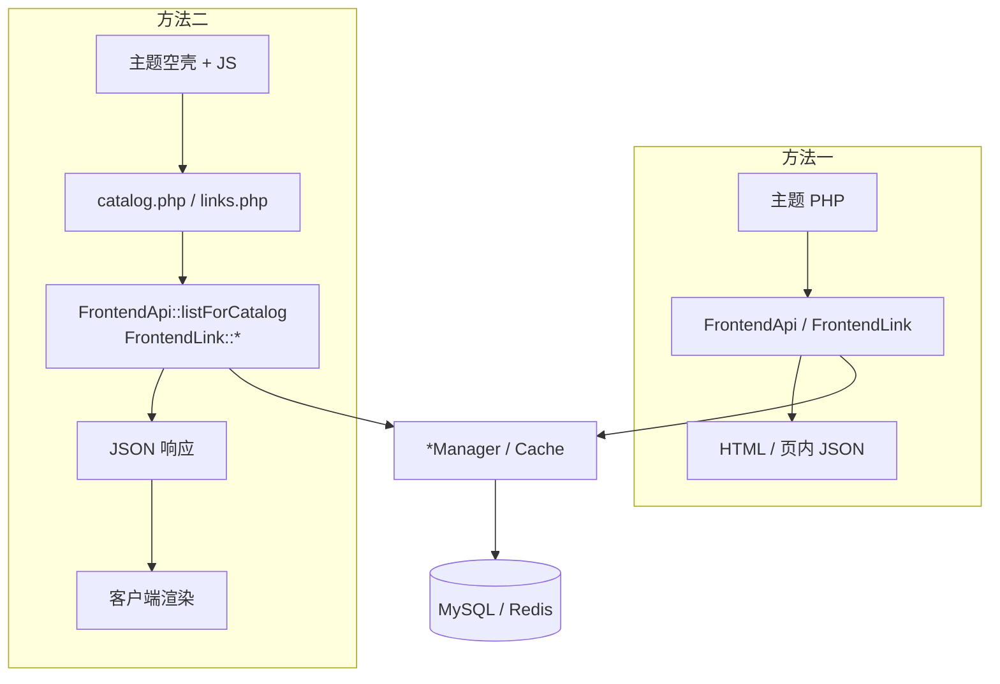
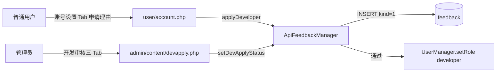
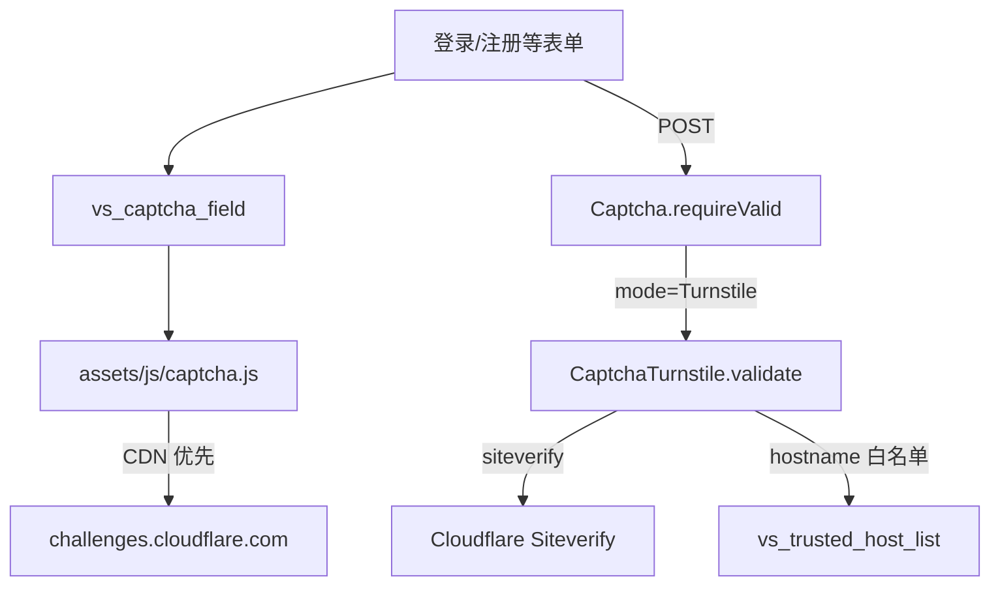
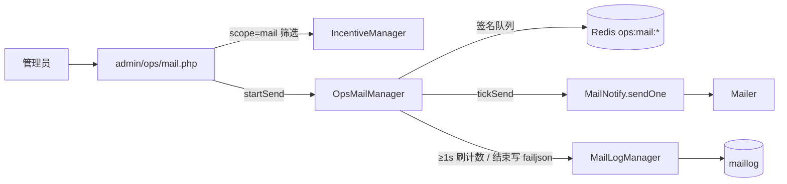

# ApiNexus · CORE 与主题包对接说明

> **路径：** 项目根目录 `CORE模块说明.md`  
> **性质：** 核心运行时（`core/`）模块说明，以及与主题包的**基础**对接边界  
> **版本：** **13.26.48**（与 `core/version.php` 中 `VS_VERSION` 一致）  
> **读者：** 核心维护者、二次开发；主题作者请**优先**读根目录 [`主题开发对接说明.md`](主题开发对接说明.md)  

### 怎么读（建议）

| 你想… | 去哪 |
|--------|------|
| **主题包怎么写、配置存在哪、取数例子** | 根目录 [`主题开发对接说明.md`](主题开发对接说明.md)（专题） |
| 主题能不能碰库 / 调谁 | 第 1～2 节铁律 + 分层表 |
| 某核心类有哪些方法 | **附录 A**（按分类）→ **附录 B**（一模块一表） |
| 普通用户申请开发者 | **第 16.1 节** + 模块「反馈与开发者申请服务」 |
| Cloudflare Turnstile | **第 16.2 节** + 模块「人机验证门面 / Turnstile 校验器」 |
| 架构关系 | 第 3 节 Mermaid 图 |

**书写约定：** 每个模块固定表格字段 = 模块代号 · 模块名（中文）· 类名 · 路径 · 分类 · 职责 · 主题可见 · 公开方法。

---

## 目录

1. [文档定位与铁律](#1-文档定位与铁律)
2. [系统分层与职责边界](#2-系统分层与职责边界)
3. [架构总图](#3-架构总图)
4. [请求与渲染链路](#4-请求与渲染链路)
5. [主题包结构与页面映射](#5-主题包结构与页面映射)
6. [主题可调用 API 速查](#6-主题可调用-api-速查)
7. [公开目录与友链：方法一 / 方法二](#7-公开目录与友链方法一--方法二)
8. [Frontend\* 模块说明](#8-frontend-模块说明)
9. [基础设施、认证与注册](#9-基础设施认证与注册)
10. [Manager 层与主题边界](#10-manager-层与主题边界)
11. [HTTP 入口（`core/front` 等）](#11-http-入口corefront-等)
12. [支付 / 验证码 / OAuth 摘要](#12-支付--验证码--oauth-摘要)
13. [升级与迁移（维护者）](#13-升级与迁移维护者)
14. [对接验收清单](#14-对接验收清单)
15. [相关文档](#15-相关文档)
16. [特色能力深描（开发者申请 / Turnstile）](#16-特色能力深描v132646)
17. [附录 A · 模块全景目录](#附录-a--模块全景目录分类索引)
18. [附录 B · 模块详表](#附录-b--模块详表一模块一表)

---

## 1. 文档定位与铁律

### 1.1 核心与主题的关系

| 组件 | 路径 | 职责 |
|------|------|------|
| **核心运行时** | `core/*.php` 及子目录 | 数据访问、业务规则、权限校验、缓存、安全头、公开 HTTP JSON 入口 |
| **主题包** | `core/theme/{主题id}/` | 视图（HTML/CSS/JS）：布局、排版、交互；通过核心已暴露的 API 取数并展示 |
| **站点入口** | 根目录 `index.php`、`apis.php`、`user/*`、`admin/*` 等 | `require bootstrap` 后调度到主题或后台 |

**一句话：** 核心提供可对接的 PHP API 与约定 HTTP 端点；主题是展示层客户端，不实现业务规则、不直连存储。

### 1.2 铁律：主题包禁止直连数据库

**条文：** 主题包内 **禁止** 出现 `Database::`、原始 SQL、表名、字段名、PDO / mysqli，以及任何绕过核心直接访问 MySQL / Redis 业务键的写法。

**原因（安全）：**

1. **注入面扩大。** 主题由站长或第三方编写，质量不可控。若主题内拼接 SQL / 直接读请求参数进查询，攻击者可通过前台页面参数完成 **SQL 注入**，直接读写业务库。
2. **权限与审核规则被绕过。** 核心 `Frontend*` 已统一过滤「仅已审核 / 已启用 / 字段脱敏」等规则。主题直连库等于绕过这层契约，可能泄漏未审核接口、上游密钥、内部路径等。
3. **缓存与一致性失控。** 列表、目录、友链等走 Redis 缓存与失效点；主题旁路读写会导致脏读、缓存击穿，并增加运维排查成本。
4. **正确扩展方式。** 缺能力时：先在 `core/` 增加或扩展 `Frontend*`（或约定 HTTP 入口）→ 再改主题调用。**禁止**在主题内「临时查一下库」。

**唯一合法数据路径：**

```text
主题 PHP / JS
  → Frontend* / SiteContext / ThemeManager / UserAuth / helpers / 约定 HTTP 入口
      →（仅 core 内部）*Manager / Config / Database / Redis
          → MySQL / Redis
```

### 1.3 其他硬性禁止（主题）

| 禁止项 | 说明 |
|--------|------|
| 调用 `*Manager` 取前台展示数据 | 展示一律走 `Frontend*`；统计走 `FrontendStats` |
| 自造 `/theme/api/*` 平行目录或友链接口 | 公开目录 / 友链统一 `core/front/catalog.php`、`links.php`，或主题内直调 `Frontend*` |
| Playground **API KEY 明文**写入 HTML | 仅下发上下文；密钥经 `POST core/front/playground-key.php` 按需拉取 |
| 引用其他主题资源或把根目录业务 CSS/JS 当皮肤 | 例外：系统固定加载 `assets/js/common.js`、认证页 `auth-csrf.js`、验证码 `captcha.js` |
| 调用后台专用类 | 如 `DashboardStats`、`GeoCityCoords`、`PanelMonitor`（前台主题不可用） |

---

## 2. 系统分层与职责边界

| 层级 | 典型文件 | 主题是否可调用 | 说明 |
|------|----------|----------------|------|
| L0 入口 | `index.php`、`detail.php`、`user/*.php` | 否（系统入口） | 定义 `VS_ROOT`，加载 `bootstrap.php`，注入页面数据 |
| L1 引导 | `bootstrap.php`、`version.php`、`helpers.php` | 间接（函数可用） | 按序加载类、Session/CSRF；主题勿重新引导 |
| L2 主题门面 | `ThemeManager`、`vs_frontend_page` | 是 | 渲染管道、导航、主题配置、资源 URL |
| L3 主题展示 API | `Frontend*`、`SiteContext`、`SiteMedia`、`UserAuth`、`UserAvatar`、`ApiQuickstart`、`Markdown`、`AjaxResponse`、`RegisterPolicy`（读） | **是（主接口）** | 主题日常取数面 |
| L4 业务实现 | `*Manager`、`Config`、`ApiProxy` 等 | **否** | 仅 core / admin / 网关内部 |
| L5 存储 | `Database`、`Redis*` | **否** | 仅 L4 使用 |
| L6 公开 HTTP | `core/front/*.php` | JS 可访问；主题勿复制逻辑 | POST + CSRF + 频控，内部再调 L3 |

---

## 3. 架构总图

### 3.1 分层总览



### 3.2 主题取数依赖图（Frontend\* ↔ 能力）



### 3.3 存储访问路径（强调禁止旁路）



### 3.4 入口文件 · 主题模板 · 核心模块关联总图

```mermaid
flowchart TB
  subgraph Roots["根目录入口"]
    I0["index.php"]
    I1["apis.php"]
    I2["detail.php"]
    I3["articles.php"]
    I4["about.php"]
    I5["links.php"]
    I6["applylink.php"]
    I7["sponsor.php"]
    I8["contributors.php"]
    I9["profile.php"]
    IU["user/*.php"]
  end

  subgraph Pipe["渲染管道"]
    BOOT["core/bootstrap.php"]
    VF["helpers::vs_frontend_page"]
    TM["ThemeManager::renderBody"]
  end

  subgraph Pack["core/theme/{id}"]
    HH["layout/header.php"]
    FF["layout/footer.php"]
    PH["pages/home.php"]
    PA["pages/apis.php"]
    PD["pages/detail.php"]
    PL["pages/links.php"]
    PART["pages/articles.php"]
    PAB["pages/about.php"]
    PSP["pages/sponsor.php"]
    PCO["pages/contributors.php"]
    PPR["pages/profile.php"]
    PAP["pages/applylink.php"]
    UP["user/pages|auth"]
  end

  subgraph Data["主题可调数据面"]
    FApi["FrontendApi"]
    FCat["FrontendCategory"]
    FSt["FrontendStats"]
    FLn["FrontendLink"]
    FPa["FrontendPartner"]
    FSp["FrontendSponsor"]
    FAr["FrontendArticle"]
    FAn["FrontendAnnouncement"]
    FAb["FrontendAbout"]
    FCn["FrontendContributor"]
    FUs["FrontendUser"]
    FCm["FrontendComment"]
    FFb["FrontendFeedback"]
    SC["SiteContext"]
    SM["SiteMedia"]
    UA["UserAuth / UserAvatar"]
    QS["ApiQuickstart"]
  end

  subgraph Http["方法二 HTTP"]
    CPHP["front/catalog.php"]
    LPHP["front/links.php"]
    KPHP["front/playground-key.php"]
  end

  I0 & I1 & I2 & I3 & I4 & I5 & I6 & I7 & I8 & I9 --> BOOT
  IU --> BOOT
  BOOT --> VF
  VF --> TM
  TM --> HH & FF
  I0 --> PH
  I1 --> PA
  I2 --> PD
  I5 --> PL
  I3 --> PART
  I4 --> PAB
  I7 --> PSP
  I8 --> PCO
  I9 --> PPR
  I6 --> PAP
  IU --> UP

  PH --> FCat & FSt & FAn & SC & SM
  PH --> CPHP
  PH --> LPHP
  PA --> CPHP & FCat
  PD --> FApi & QS & FFb & KPHP & UA
  PL --> LPHP
  PL --> FLn
  PART --> FAr & FCm
  PAB --> FAb
  PSP --> FSp
  PCO --> FCn
  PPR --> FCn
  PAP --> FLn
  UP --> FUs & UA & SC
  FF --> LPHP

  CPHP --> FApi & FCat & FPa
  LPHP --> FLn
```



> 读图方式：左侧入口进入 `bootstrap` → `vs_frontend_page` → `ThemeManager` → 对应 `pages/*`；页面节点连到右侧 `Frontend*` / HTTP，表示**可从该页调用出的数据面**。实线为允许路径；存储层仅出现在 `Frontend*` / Manager 之后（见 第3.3节），主题不得直连。

---

## 4. 请求与渲染链路

### 4.1 引导

任意入口：

```php
define('VS_ROOT', __DIR__); // 或 dirname(__DIR__)
require_once VS_ROOT . '/core/bootstrap.php';
```

`bootstrap.php`：按固定顺序加载核心类，启动 Session / CSRF。主题模板 **不要** 自行再 `require` 核心类文件。

加载顺序摘要：

```text
version → helpers → 时区
→ InstallChecker → Database* → SiteContext → RegisterPolicy → Config
→ Redis* → Auth / UserAuth → FrontendUser → …
→ Api* / Pay* / Link* / Content*
→ FrontendCategory → FrontendApi → FrontendStats
→ FrontendLink / Partner / Sponsor / Contributor
→ FrontendComment / Announcement / Article / About
→ ThemeManager → Sitemap → oauth/*
→ Session + CSRF
```

完整顺序见附录 B 中 `bootstrap.php` 卡片；排查「类不存在」时对照源码。

### 4.2 公开页渲染管道



模板首行必须：

```php
<?php
if (!defined('VS_THEME_RENDER')) {
    exit;
}
```

**用户中心：** `user/init.php` → `UserAuth::requireLogin()` → `vs_user_render_page` → `user/pages/{pageKey}.php`。  
**登录 / 注册 / 找回：** `ThemeManager::renderAuthPage` → `user/auth/{pageKey}.php`。

### 4.3 `renderBody` 注入的常用变量

| 变量 | 含义 |
|------|------|
| `$vsBase` | 同站**路径前缀**（非 `https://域名`） |
| `$siteName` / `$navName` / `$systemName` | 站点展示名 |
| `$navItems` / `$activeNav` / `$pageKey` / `$pageTitle` | 导航与页面键 |
| `$userLoggedIn` / `$authUrl` / `$authLabel` / `$authAvatarUrl` | 登录入口态 |
| `$themeId` | 当前主题 id |
| 以及 `$pageData` 展开字段 | 如详情页 `$api`、SEO 等 |

---

## 5. 主题包结构与页面映射

### 5.1 目录约定

```text
core/theme/{id}/
  theme.json                 ← 必须（id 与目录名一致）
  主题规范.md                ← 本包界面约定（开发本包时先读）
  preview.png                ← 推荐
  layout/header.php          ← 前台必须
  layout/footer.php          ← 强烈推荐
  pages/                     ← home / apis / detail / …
  assets/shell/              ← 样式与界面脚本；勿放 common.js
  assets/theme.css|js        ← 非 default 主资源
  user/layout.php
  user/auth/{login,register,forgot,bind}.php
  user/pages/...
  api/                       ← 可选；禁止替代 core/front 目录与友链
```

### 5.2 入口 → pageKey → 主题文件

| 入口脚本 | `$pageKey` | 主题文件 |
|----------|------------|----------|
| `index.php` | `home` | `pages/home.php` |
| `apis.php` | `apis` | `pages/apis.php` |
| `detail.php` | `detail` | `pages/detail.php` |
| `articles.php` | `articles` | `pages/articles.php` |
| `about.php` | `about` | `pages/about.php` |
| `links.php` | `links` | `pages/links.php` |
| `applylink.php` | `applylink` | `pages/applylink.php` |
| `sponsor.php` | `sponsor` | `pages/sponsor.php` |
| `contributors.php` | `contributors` | `pages/contributors.php` |
| `profile.php` | `profile` | `pages/profile.php` |

### 5.3 页面 → 推荐数据源

| 页面 | 推荐取数 |
|------|----------|
| 首页 | `FrontendCategory`、`FrontendStats`、`FrontendAnnouncement`；目录 / 伙伴见 第7节；页脚友链见 第7节；`ThemeManager::themeSetting*`、`SiteContext` |
| apis | 同目录 第7节 + 分类标签 |
| 详情 | 入口 `$api` 或 `FrontendApi::findForThemeById`；`ApiQuickstart`；`FrontendFeedback`；密钥走 `playground-key.php` |
| 文章 | `FrontendArticle` + `FrontendComment` |
| 关于 | `FrontendAbout::getBoundArticle()` |
| 友链 | 第7节；申请页可用 `FrontendLink::siteCard()` |
| 赞助 | `FrontendSponsor::*` |
| 贡献者 / 主页 | `FrontendContributor::*` |
| 用户中心 | `FrontendUser` + `UserDashHello` |
| 注册 | 入口注入的 `$registerOpen` / `$showRoleSegment` / `$registerRole` 等（见 第9.3节） |

---

## 6. 主题可调用 API 速查

| 需求 | 调用 | 禁止 |
|------|------|------|
| 公开接口目录（首页 / apis） | **方法二** `POST catalog.php` / `VS.fetchFrontCatalog`；或 **方法一** `FrontendApi::listForTheme()` | `ApiManager::*`；自造目录 HTTP |
| 接口详情单条 | 入口 `$api`，或 `FrontendApi::findForThemeById($id)` | 为详情再 POST 全站 catalog |
| 分类标签 | `FrontendCategory::listTags()` / `nameMap()` | `ApiCategoryManager::*` |
| 首页 KPI | `FrontendStats::*` | 主题内 COUNT SQL |
| 友链 / 页脚 | **方法二** `POST links.php` / `VS.fetchFrontLinks`；或 **方法一** `pickForFooter` / `listForThemePage` | `LinkManager::*`；自造友链 HTTP |
| 合作伙伴 | catalog `partners=1`，或 `FrontendPartner::listForTheme()` | SQL / `LinkManager` |
| 赞助 | `FrontendSponsor::paymentQrs()` + `listForTheme()` | 手写收款码磁盘路径 |
| 文章 / 公告 / 关于 | `FrontendArticle` / `FrontendAnnouncement` / `FrontendAbout` | `ContentManager::*` |
| 贡献者 | `FrontendContributor::*` | 直查用户表 |
| 当前用户展示 | `FrontendUser::current()` | 主题拼装 Session |
| 是否登录 | `UserAuth::check()` / `requireLogin()` | 自造 session key |
| 站点名 / Logo / 备案 | `SiteContext::*` | 主题直接拆 `Config::get` 当展示 |
| 主题配置 | `ThemeManager::themeSetting*()` | 读其他主题 settings |
| 内置图标 URL | `SiteMedia::imgUrl('xxx.svg')` | 手写 `/assets/img/...` |
| 详情快速上手 | `ApiQuickstart::qsBundleFromAidoc(...)` | 主题自解析 aidoc |
| Markdown | 优先已有 `body_html`；必要时 `Markdown::render()` | 主题自带 MD 引擎 |
| 评论 / 反馈提交 | `FrontendComment::submit` / `FrontendFeedback::submit` | 主题 INSERT |
| AJAX JSON | `AjaxResponse::*` + `vs_require_secure_post()` | 自造协议 |
| 壳层 CSS/JS | `ThemeManager::shellUrl` / `frontendShell*Hrefs` / `assetUrl` | 引用其他主题或根目录业务皮肤 |

---

## 7. 公开目录与友链：方法一 / 方法二

> **承诺：** 两种方法对应的 PHP API 与 HTTP 入口均 **长期保留、不删除**。官方内置主题采用方法二；自研主题可任选。无论何种方法，数据必须经 `Frontend*`，禁止 SQL / `*Manager` / 自造平行 URL。

### 7.1 对照

| | **方法一 · 服务端直出** | **方法二 · 异步 HTTP** |
|--|------------------------|------------------------|
| **用途** | 主题 PHP 在渲染阶段取列表并输出 HTML 或页内 JSON | 首屏输出空容器，浏览器再拉取 JSON 后渲染 |
| **目录怎么做** | `FrontendApi::listForTheme()`（可自行再瘦身） | `POST /core/front/catalog.php` + `VS.fetchFrontCatalog`（内部 `listForCatalog()`） |
| **友链怎么做** | `FrontendLink::pickForFooter` / `listForThemePage` | `POST /core/front/links.php` + `VS.fetchFrontLinks` / `mountFooterFriendLinks` / `mountLinksPage` |
| **优点** | 实现直观，无额外请求 | 首屏 HTML 更干净；窗口侧带 CSRF、IP 频控；catalog 默认瘦身（无 `doc`/`aidoc`/`response`） |
| **代价** | 源码体积与字段暴露由主题作者自负 | 需依赖页脚注入的 `VS_FRONT_CATALOG` / `VS_FRONT_LINKS` 与根目录 `common.js` |
| **官方主题** | 不作为默认路径 | **默认路径** |

### 7.2 为何同时保留类与 HTTP 入口

| 只保留 | 后果 |
|--------|------|
| 仅 `FrontendApi` / `FrontendLink` | 方法二下浏览器无法直接调用 PHP 类，必须另有 HTTP 入口 |
| 仅 HTTP 入口且把查库写在入口脚本 | 详情、推荐卡等规则重复，难维护 |
| **类 + HTTP** | 方法一 / 详情走类；方法二走入口；规则集中在 `Frontend*` |



### 7.3 `catalog.php`（方法二 · 目录）

| 项 | 内容 |
|----|------|
| 路径 | `{站点根}/core/front/catalog.php` |
| 方法 | **仅 POST** |
| 安全 | `vs_require_secure_post()`；IP 频控约 60 次 / 60 秒 |
| 内部 | `FrontendApi::listForCatalog()`、`FrontendCategory::nameMap()`；可选 `FrontendPartner::listForTheme()` |

**POST 参数：**

| 参数 | 必填 | 说明 |
|------|------|------|
| `action` | 是 | 必须为 `list` |
| `partners` | 否 | `1` 时响应附带伙伴数组 |

展示顺序由系统设置 `apiorder` 决定（`0` 随机临时打乱 / `1` 按分类权重）。不以客户端 `shuffle` 作为业务顺序权威。

**成功响应主要字段：** `code`、`msg`、`apiData`、`categoryNames`、`apiCount`、`apiorder`、可选 `partners`、可能刷新的 `csrf`。

方法二浏览器侧依赖：

1. `window.VS_FRONT_CATALOG`
2. 根目录 `assets/js/common.js` 中 `VS.fetchFrontCatalog`
3. 页面脚本负责渲染；有序模式下勿再客户端无意义重排

### 7.4 `links.php`（方法二 · 友链）

| 项 | 内容 |
|----|------|
| 路径 | `{站点根}/core/front/links.php` |
| 方法 | **仅 POST** + CSRF + IP 频控 |
| `action=footer` | `limit`：0＝按设置「全部」；1～10；返回 `items` / `has_more` / `total` |
| `action=page` | 友链页；硬上限见 `FrontendLink::PAGE_HARD_LIMIT` |
| DOM（挂载脚本） | `createElement` + `textContent`；`href` 仅 `http(s):`；禁止 `innerHTML` 拼接站名 |

方法一输出时同样须 `vs_e()`（或等价转义）。

### 7.5 详情与密钥

- 详情单条：入口注入或 `findForThemeById`，**不要**为详情拉取全站 catalog。
- Playground：SSR 仅下发上下文（无明文 KEY）；登录后 `POST core/front/playground-key.php`。

---

## 8. Frontend\* 模块说明

每节：**职责** / **主题用法** / **禁止** / **主要方法**。

### 8.1 `FrontendCategory`

| | |
|--|--|
| **职责** | 前台分类标签与名称映射 |
| **主题用法** | 首页 / apis 分类按钮；与卡片 `data-category` 对齐 |
| **禁止** | `ApiCategoryManager::*`；自造「全部」id |

| 方法 | 说明 |
|------|------|
| `orderMode()` / `isRandomOrder()` | `apiorder`：`0` 随机 / `1` 按分类权重 |
| `listTags()` | 启用分类 `[{id,name},…]`（随机模式可打乱副本） |
| `listTagsCanonical()` | 有序底稿（缓存，不打乱） |
| `nameMap()` / `nameToIdMap()` / `nameToSortMap()` | 映射表 |
| `resolveIdByName($name)` | id 或 `''` |
| `countEnabled()` | int |
| `tagVisibleLimit()` | **15**（超出由主题做「更多」） |

常量：`ALL_ID = 'all'`，`ALL_NAME = '全部'`，`CONFIG_KEY_ORDER = 'apiorder'`。

### 8.2 `FrontendApi`

| | |
|--|--|
| **职责** | 公开接口列表、详情、目录瘦身 |
| **主题用法** | 详情：`findForThemeById` / 入口 `$api`；列表：方法一 `listForTheme` 或方法二 catalog；KPI：`countForTheme` 或 `FrontendStats` |
| **禁止** | `ApiManager` 取展示数据；自造目录 HTTP。官方列表走方法二 |

| 方法 | 说明 | 调用方 |
|------|------|--------|
| `listForTheme()` | 完整公开列表（有序底稿缓存） | 方法一；core 内部；**长期保留** |
| `listForCatalog()` | 瘦身 + 按 `apiorder` 展示 | 主要为 `catalog.php` |
| `sortByCategoryWeight` / `applyCatalogDisplayOrder` / `slimForCatalog` | 排序与瘦身 | 目录链路 |
| `findForThemeById($id)` | 详情一条（可含文档、`author`） | 详情 |
| `countForTheme()` | 公开接口个数 | 主题可调 |
| `pickRandomRecommend($excludeId)` | 详情推荐一条 | 详情页 |
| `billingLabel` / `parseParamsList` / `prettyParamsJson` | 辅助 | — |

列表常用字段含：`id, name, desc, category, method, endpoint, call_path, needkey_label, qpm_label, billing_label, …`。详情另有 `author`、`openapi_json`（由 `OpenApiBuilder` 派生，不入库）。catalog 列表 **不含** `doc` / `aidoc` / `response` / `openapi_json`。

说明：`findForThemeById` 可展示「已审核且已禁用」接口（`disabled=1`，真实 endpoint 清空由主题占位）；`listForTheme` 仍排除禁用。`maintenance === 1` 时按维护态展示，勿引导真实调用。

### 8.3 `OpenApiBuilder`

| | |
|--|--|
| **职责** | 由 `api.params` + 元数据生成 OpenAPI 3.1.1 |
| **主题用法** | 读详情字段 `openapi_json`；禁止主题手写拼装；禁止直接 HTTP 访问本文件 |

### 8.4 `FrontendStats`

| 方法 | 含义 |
|------|------|
| `userCount()` | 注册用户数 |
| `todayCallCount()` | 今日调用 |
| `approvedApiCount()` | 审核通过接口数 |
| `totalCallCount()` | 全站累计调用 |

禁止主题内 COUNT SQL / 直调 `ApiManager::count*`。

### 8.5 `FrontendLink` / `FrontendPartner` / `FrontendSponsor`

友链方法一 / 方法二见 第7节。安全底线：只经本类；转义输出；`href` 仅 `http(s)`。

| 类 | 主要方法 |
|----|----------|
| `FrontendLink` | `formatForTheme` · `pickForFooter` · `listForThemePage` · `listForTheme` · `siteCard` |
| `FrontendPartner` | `formatForTheme` · `listForTheme` |
| `FrontendSponsor` | `paymentQrs` · `formatForTheme` · `listForTheme` |

### 8.6 `FrontendArticle` / `FrontendAnnouncement` / `FrontendAbout`

| 类 | 主要方法 |
|----|----------|
| `FrontendArticle` | `listForTheme` · `listPaged` · `findById`（含 `body_html`；列表置顶优先） |
| `FrontendAnnouncement` | `listForTheme` · `listPopups` · `findById` |
| `FrontendAbout` | `getBoundArticle()` |

禁止 `ContentManager::*`；禁止主题硬编码长文冒充关于页。

### 8.7 `FrontendComment` / `FrontendFeedback`

| 类 | 主要方法 |
|----|----------|
| `FrontendComment` | `tableReady` · `listByContentId` · `submit` |
| `FrontendFeedback` | `tableReady` · `submit`（**仅**接口反馈 kind=0） |

写入须走核心校验（含小票 / 冷却 / 可选人机验证等，见专项规范）。禁止主题直接 INSERT。

**开发者申请不在本表接口内**：普通用户在用户中心账号设置提交 → `ApiFeedbackManager::applyDeveloper`（见第 16.1 节）。

### 8.8 `FrontendUser` / `UserDashHello`

| | |
|--|--|
| **职责** | 当前用户展示、用户中心数据、签到横幅等 |
| **主题用法** | `FrontendUser::current()` / `format` / 日志分页等；问候文案可配合 `UserDashHello` |
| **禁止** | 主题直读 Session 拼装展示结构 |

### 8.9 `FrontendContributor`

| 方法 | 说明 |
|------|------|
| `listForTheme()` | 贡献者卡片列表 |
| `findProfile($uid)` | 公开主页 |
| `listApisForUser` / `wallpaperUrl` / `joinLabel` / `hostFromEndpoint` | 主页辅助 |

### 8.10 详情页：`ApiQuickstart` / `Markdown` / Playground

- 快速上手：`ApiQuickstart::qsBundleFromAidoc(...)`；语言图标可用 `langIconMap()`。
- Markdown：优先 `body_html`；必要时 `Markdown::render()`。
- `vs_playground_session_context()` → `{loggedIn, apiKeyCount, userCenterUrl, loginUrl, csrf, playUrl, keysUrl}`（**无** `apiKey`）。
- 取钥：`POST core/front/playground-key.php`（CSRF + 登录 + 频控）。

鉴权展示用 `$api['needkey_label']`、`$api['keyways']`、`$api['keyways_label']`、`$api['qpm_label']`；不要再调 `ApiManager::keywaysLabel()`。

### 8.11 最小首页示例（方法二 · 官方写法）

```php
<?php
if (!defined('VS_THEME_RENDER')) {
    exit;
}
$siteName     = SiteContext::siteName();
$tags         = FrontendCategory::listTags();
$apiCount     = FrontendStats::approvedApiCount();
$totalCalls   = FrontendStats::totalCallCount();
$announces    = FrontendAnnouncement::listForTheme();
$heroTitle    = ThemeManager::themeSettingStr('hero_title', '');
$qqIcon       = SiteMedia::imgUrl('QQ.svg');
$showPartners = ThemeManager::themeSettingBool('show_partners', true);
// 方法二：VS.fetchFrontCatalog({ partners: $showPartners })
// 方法一：$apiData = FrontendApi::listForTheme();
// 页脚友链方法二：空容器 + VS.fetchFrontLinks；方法一：FrontendLink::pickForFooter(8)
```

---

## 9. 基础设施、认证与注册

### 9.1 `helpers.php`（主题常用）

| 函数 | 用途 |
|------|------|
| `vs_e($v)` | HTML 转义 |
| `vs_base_url()` | 站点根**绝对** URL（SEO 等） |
| `vs_site_base_path()` / `vs_site_path($path)` | 同站路径前缀 / 根相对路径 |
| `vs_api_detail_url` / `vs_profile_url` | 详情 / 主页链接 |
| `vs_frontend_page(...)` | 公开页入口（根脚本用） |
| `vs_require_secure_post()` | AJAX：同源 + CSRF |
| `vs_playground_session_context()` | 调试条上下文（无明文 KEY） |
| `vs_page_seo_pack` / `vs_render_theme_seo_block` | SEO |
| `vs_console_brand_script()` | 控制台品牌脚本（须 `vs_site_path`，禁止绝对本域 URL） |
| `vs_site_mourning_on()` / `vs_mourning_boot()` | 全局哀悼（主题勿自写灰白 CSS） |

页脚 / `vs_render_foot` 注入：`VS_CSRF_TOKEN`、`VS_FRONT_CATALOG`、`VS_FRONT_LINKS` 等。  
验证码挂载：`vs_captcha_field` / `vs_captcha_js` 在 `core/captcha/helper.php`。

注意：`$vsBase` 是**路径前缀**，禁止对其做 `parse_url(..., PHP_URL_HOST)`。

### 9.2 `SiteContext` / `Config` / `ThemeManager`

- 展示信息：一律 `SiteContext::*`（`siteName`、`siteLogo`、备案、页脚区块、页脚二维码开关等）。
- 主题配置：`ThemeManager::themeSetting` / `themeSettingStr` / `themeSettingBool` / `themeSettingInt`（权威在 `core/data/{id}/theme.db`，v13.26.45+）。
- 导航：`ThemeManager::navItems()`（受 `nav_show_*` 过滤）；资源：`assetUrl` / `shellUrl` / `frontendShell*Hrefs` / `frontendPageJsHrefs`。
- 禁止主题 `Config::set`；禁止把后台内部键当 UI 文案源。

### 9.3 认证与注册

| 类 | 主题用法 |
|----|----------|
| `UserAuth` | `check` / `id` / `user` / `requireLogin` / `redirectIfLoggedIn` / `logout`；展示资料优先 `FrontendUser::current()` |
| `UserRole` | `ROLE_USER` / `ROLE_DEVELOPER`；`normalize` |
| `AuthSecurity` | CSRF 令牌；前台安全头 `private, no-store` + `Vary: Cookie`；CSP 本站双协议 origin（E373） |
| `Auth` | **管理员**会话；禁止混入前台主题 |

**`RegisterPolicy`（注册策略）：**

| 键 / 常量 | 含义 |
|-----------|------|
| `register_enabled` | 单键模式：`1` 全开 · `2` 全关 · `3` 仅用户 · `4` 仅开发者 |
| `register_email_verify` | 是否必须邮箱验证码 |
| `register_policy` | JSON（邮箱后缀等） |

重要方法：`isOpen()`、`shouldShowRoleSegment()`、`fixedRegisterRole()`、`allowsUserRole()` / `allowsDeveloperRole()`、`assertRoleAllowed($role)`、`validateEmailSuffix($email)` 等。

`user/register.php` 注入主题变量：`$registerOpen`、`$emailVerify`、`$formEnabled`、`$showRoleSegment`、`$registerRole`、`$fixedRole`、关闭文案、`$mailEnabled` 等。  
主题须尊重 `$showRoleSegment`；服务端在 `fixedRegisterRole()` 非空时覆盖客户端 `role`。禁止主题硬编码「永远可注册」。

### 9.4 存储与缓存类（主题禁用）

`Database*`、`InstallChecker`、`SchemaFullAligner`、`RedisService`、`RedisCache`、`RateLimitStore` —— 主题 **不得** 调用。

---

## 10. Manager 层与主题边界

| 能力 | 后台 / 内部类（主题勿用取数） | 主题类 |
|------|------------------------------|--------|
| 接口分类 | `ApiCategoryManager` | `FrontendCategory` |
| 接口 CRUD / 审核 | `ApiManager` | `FrontendApi` + `FrontendStats` |
| 用户管理 | `UserManager` | `UserAuth` + `FrontendUser` |
| 站点配置 | `Config` | `SiteContext` + `ThemeManager::themeSetting*` |
| 文章 / 公告 | `ContentManager` | `FrontendArticle` / `Announcement` / `About` |
| 友链 / 伙伴 / 赞助 | `LinkManager` | `FrontendLink` / `Partner` / `Sponsor` |
| 评论 | `CommentManager` | `FrontendComment` |
| 接口反馈（feedback.kind=0） | `ApiFeedbackManager` | `FrontendFeedback` |
| 开发者申请（feedback.kind=1） | `ApiFeedbackManager` | **禁止**主题直调；经 `user/account.php` → `applyDeveloper`；后台 `admin/content/devapply.php` |

网关、代理、出站消毒、日志归档、面板监控、AI 文档链等均属内部能力；主题只消费 `Frontend*` 或详情已注入字段。详见附录 B。

---

## 11. HTTP 入口（`core/front` 等）

下列文件为**独立 URL**，各自加载 bootstrap；不是主题内「随便 new」的类。

### 11.1 `core/front/`

| 文件 | 职责 | 主题用法 | 禁止 |
|------|------|----------|------|
| `catalog.php` | 公开目录 JSON（方法二） | `VS.fetchFrontCatalog`；方法一可不经此窗 | GET 打开；自造平行目录 URL |
| `links.php` | 友链 JSON（方法二） | `VS.fetchFrontLinks` / mount*；方法一可直调类 | GET 打开；自造 `/theme/api/links` |
| `playground-key.php` | 登录按需取 KEY | 详情调试条按需 POST | SSR 明文 KEY |

### 11.2 其他子目录（摘要）

| 路径 | 职责 | 主题 |
|------|------|------|
| `core/captcha/` | 本地图 / 极验3/4 / **Cloudflare Turnstile** | 用 helper 挂载；勿抄 SDK；Turnstile 见第 16.2 节 |
| `core/oauth/` | OAuth 协议实现 | 主题只出授权链；回调在 `user/oauth/` |
| `core/markdown/` | Markdown 渲染 | 优先 `body_html` |
| `core/play/codeplay/` | 码支付客户端与回调 | 主题勿直接当支付入口乱调 |
| `core/playground/` | 在线测试中继 / 媒体 | 按现有详情页约定 |
| `core/api/` | 系统级外部 API（商城/计划任务用系统密钥） | **主题禁止调用**；说明见 [`core/api/README.md`](core/api/README.md) |
| `core/ping.php` | 延迟检测 | 可按现成主题方式调用，须保留频控 |

---

## 12. 支付 / 验证码 / OAuth 摘要

| 模块 | 说明 |
|------|------|
| `PayConfig` / `OrderManager` / `PointsManager` / `CodePayClient` 等 | 支付与积分；用户中心充值页按既有主题对接；展示套餐可读 `PayConfig` 已暴露方法，禁止主题自算金额权威 |
| `Captcha` + `captcha/*` | **人机验证门面**：本地图 / 极验3 / 极验4 / **Cloudflare Turnstile**（`cfid`/`cfkey`）；表单经 `Captcha::requireValid`；主题只挂 helper + 系统 `captcha.js` |
| `oauth/*` | `OAuthService::authorizeUrl` / `enabledProviders`；聚合登录见专项规范 |

细则见《码支付开发规范》《极验验证码规范》《CloudflareTurnstile系统接入规范》《聚合登录开发规范》。 **开发者申请 / Turnstile 深描见第 16 节。**

---

## 13. 升级与迁移（维护者）

| 组件 | 职责 |
|------|------|
| `Updater` / `UpdateLog` | 云端更新与更新日志 |
| `DatabaseMigrator` / `SchemaFullAligner` | 版本 SQL 迁移；对照 `database.sql` 结构对齐（只补不删） |

新增前台能力时的顺序：

1. 在 `core/` 实现规则（Manager + `Frontend*` 或 HTTP 入口）  
2. 更新本文档与相关开发规范  
3. 再改官方主题调用  
4. 有库变更时同步 `install/migrations` 与 `database.sql`

---

## 14. 对接验收清单

### 14.1 包结构

- [ ] `core/theme/{id}/theme.json`（id 与目录名一致）  
- [ ] `layout/header.php` + `footer.php`  
- [ ] 公开 `pages/` 覆盖站点已启用页面  
- [ ] `assets/shell/` 不含自带 `common.js`（使用系统根目录 `assets/js/common.js`）  
- [ ] 非 default：提供 `theme.css` / `theme.js`  
- [ ] `user/layout.php` + `user/auth/*`（含 register 对注入变量的支持）+ `user/pages/*`  

### 14.2 数据与安全

- [ ] 展示数据全部来自 Frontend\* / SiteContext / ThemeManager / SiteMedia / UserAuth / 入口注入 / 约定 HTTP  
- [ ] **无** `Database` / SQL / 表名 / `*Manager` 取前台展示  
- [ ] 目录 / 友链：方法一或方法二二选一；官方包走方法二  
- [ ] 详情：入口 `$api`；方法二时壳含 `VS_FRONT_CATALOG` / `VS_FRONT_LINKS` + CSRF  
- [ ] 注册页尊重 `$registerOpen` / `$showRoleSegment` / `$registerRole`  
- [ ] 用户内容 `vs_e()`；写操作 CSRF + `vs_require_secure_post`  
- [ ] Playground：**无** KEY SSR；按需 `playground-key.php`  
- [ ] 不引用其他主题与根目录业务皮肤（系统级脚本除外）  

### 14.3 走查

- [ ] 后台切换该主题后，桌面 + 手机走通公开页与用户中心  
- [ ] 注册：仅用户 / 仅开发者 / 全开 / 全关四种策略 UI 正确  
- [ ] 登录页「立即注册」仅在 `RegisterPolicy::isOpen()` 时出现  

---

## 15. 相关文档

| 文档 | 用途 |
|------|------|
| `README.md` | 安装与总览 |
| [`主题开发对接说明.md`](主题开发对接说明.md) | **主题包专题**：目录、配置落盘、取数例子、检查清单 |
| `CORE模块说明.md`（本文） | 核心模块说明 + 与主题的基础边界 |
| 《前端页面渲染与源码规范》 | 首屏形态、方法一 / 方法二、路径约定 |
| 《主题通用规范》及主题一～六专项 | 全主题共用强制规则；各主题皮面见专项 |
| [`core/api/README.md`](core/api/README.md) | 系统级外部 API（商城/计划任务；**主题勿用**） |
| 《请求与表单规范》 | POST / CSRF / AJAX |
| 《Git提交规范》 | 提交说明中文、禁止 AI 署名 |
| 《邮箱发信规范》 | 业务邮件 E432 + 运营群发第4.12节（OpsMail / maillog；E442～E457）+ **全局英文占位符第4.13节 / E468**（验证码可绑 30～34） |
| 《用户激励规范》 | 运营激励；筛选 `scope=mail` 供群发复用 |
| `update-log.json` / `更新记录.md` | 版本变更（本文不按版本分章） |
| `修改流程记录/13.26.48.md` | 本机点位级改动（不进仓） |

**维护约定：** 新增模块时：① 给中文**模块名**并归入附录 A 分类；② 附录 B 按「一模块一表」补卡片；③ 主题可见能力同步第 6 / 8 节速查。特色能力（如申请开发者、Turnstile、运营群发）另在第 16 节留流程图。`SystemApi*` / `core/api/*` 细则只写 [`core/api/README.md`](core/api/README.md) 与《系统级外部API规范》。改完须同步本文件与《修改流程记录》。

**文档版本标注：** 13.26.48  

---

## 16. 特色能力深描（v13.26.46）

> 本节专门写清两块「容易在文档里漏掉」的能力：**普通用户转开发者**、**Cloudflare Turnstile**。

### 16.1 反馈与开发者申请服务（`ApiFeedbackManager`）

| 项 | 内容 |
|----|------|
| **模块名** | 反馈与开发者申请服务 |
| **类名** | `ApiFeedbackManager` |
| **表** | `{prefix}feedback` |
| **分流** | `kind=0` 接口反馈 · `kind=1` 开发者申请（E426） |
| **主题** | 接口反馈 → `FrontendFeedback::submit`；申请 → `user/account.php`（**勿**主题直调 Manager） |
| **后台** | 接口反馈 `/admin/api/feedback`；开发审核 `/admin/content/devapply` |



| `kind` | 状态机 | 红点方法 | 禁止 |
|--------|--------|----------|------|
| `0` 接口反馈 | 0 待处理 / 1 已处理 | `countPending()` | 把申请算进接口反馈红点 |
| `1` 开发者申请 | 0 待审 / 1 通过 / 2 拒绝 | `countPendingDevApply()` | 再写入 `link`；漏 `kind` 过滤；**删除申请**（E440：记录不支持删除，仅查看；降角色走用户管理） |

升级迁移：`ensureFeedbackKind46` → `migrateLinkDevApplyToFeedback46`（旧 `link.kind=3`）→ `dropLinkUserid46`。细则见《友情链接申请规范》第六节 / 6.1 · E426 / E440。`setDevApplyStatus` / `deleteDevApply` 须管理员 `Auth`。

**禁止事项 / 安全铁律（开发者申请 · E440）：**

| 铁律 | 必须 | 禁止 |
|------|------|------|
| 审核入口 | `setDevApplyStatus` 须后台管理员 `Auth::check()`；页经 `admin/init` + CSRF | 前台会话自审通过；无 Auth 直调 Manager |
| 终态操作 | 已通过 / 已拒绝：**仅「查看」** | 终态再点通过/拒绝（当前产品无反审）；任何「删除申请」按钮 |
| 删除 | HTTP `action=delete`、`deleteDevApply`、UI **三层恒拒** | 真删 `feedback` 行抹轨迹；靠删申请「撤销开发者」 |
| 降角色 | 走用户管理改 `role` | 用删除申请代替降级 |
| 种隔离 | 列表/红点严格 `kind` | 接口反馈与开发审核串数据 |

### 16.2 人机验证门面与 Cloudflare Turnstile

| 项 | 内容 |
|----|------|
| **模块名** | 人机验证门面 |
| **类名** | `Captcha` |
| **驱动** | 本地图 `CaptchaLocal` · 极验3 · 极验4 · **Cloudflare Turnstile** `CaptchaTurnstile` |
| **Turnstile 配置** | `cfid`（Site Key）· `cfkey`（Secret） |
| **主题挂载** | `vs_captcha_field` / `vs_captcha_js`（`core/captcha/helper.php`）+ 系统 `assets/js/captcha.js` |
| **校验** | 一律 `Captcha::requireValid` → 内部调 `CaptchaTurnstile::validate`（fail-closed） |



| 文件 | 模块名 | 说明 |
|------|--------|------|
| `core/Captcha.php` | 人机验证门面 | 分端模式、场景开关、`cfId`/`cfKey` |
| `core/captcha/cf/Turnstile.php` | Cloudflare Turnstile 校验器 | Siteverify + 本站 hostname |
| `core/captcha/local.php` | 本地图形验证码 | GD 出图 + HMAC pepper |
| `core/captcha/gt3/*` · `gt4/*` | 极验驱动 | 见附录 B |
| `assets/js/captcha.js` | （前端）验证码挂载脚本 | 系统级，主题禁止自备副本 |
| `assets/js/auth-csrf.js` | （前端）认证 CSRF 提交助手 | `isCsrfFail` **只认 msg**；禁止凭响应 `csrf` 字段静默重试（E429） |

规范：《CloudflareTurnstile系统接入规范》·《极验验证码规范》· E418 · **E429**（业务失败勿误报人机）。

### 16.3 运营邮件群发（`OpsMailManager` + `MailLogManager`）

| 项 | 内容 |
|----|------|
| **模块名** | 运营邮件群发 / 批次记录 |
| **类名** | `OpsMailManager` · `MailLogManager` |
| **表** | `{prefix}maillog`（含 `lastactivity`） |
| **后台** | `/admin/ops/mail.php`（筛选 Tab + 发送记录） |
| **主题** | **禁止**直调；主题包广告上传另见 `ad-upload.php`（须 `Auth::check`，E455） |



规范：《邮箱发信规范》第4.10～4.12节 · E442～E457 · 附录 B · M081b / M081c。

---

## 附录 A · 模块全景目录（分类索引）

> 每个模块有**中文模块名** + **类名** + **路径**。细节见附录 B 表格卡。标 ★ = 主题日常常用。

### A · 基础设施

| 模块名 | 类名 | 路径 |
|--------|------|------|
| JSON 响应约定 ★ | `AjaxResponse` | `core/AjaxResponse.php` |
| 系统引导装载 | `bootstrap` | `core/bootstrap.php` |
| 验证码挂载助手 | `helper` | `core/captcha/helper.php` |
| 系统配置键值 | `Config` | `core/Config.php` |
| 数据库连接与表前缀 | `Database` | `core/Database.php` |
| 全局助手函数集 | `helpers` | `core/helpers.php` |
| Redis 业务缓存 | `RedisCache` | `core/RedisCache.php` |
| 站点地图 | `Sitemap` | `core/Sitemap.php` |
| 版本号常量 | `version` | `core/version.php` |

### A · 主题引擎

| 模块名 | 类名 | 路径 |
|--------|------|------|
| 主题渲染与资源配置 ★ | `ThemeManager` | `core/ThemeManager.php` |
| 主题配置本地库 | `ThemeSettingsStore` | `core/ThemeSettingsStore.php` |

### A · 主题展示 API

| 模块名 | 类名 | 路径 |
|--------|------|------|
| 详情快速上手包 ★ | `ApiQuickstart` | `core/ApiQuickstart.php` |
| 关于页展示门面 ★ | `FrontendAbout` | `core/FrontendAbout.php` |
| 公告展示门面 ★ | `FrontendAnnouncement` | `core/FrontendAnnouncement.php` |
| 公开接口展示门面 ★ | `FrontendApi` | `core/FrontendApi.php` |
| 文章展示门面 ★ | `FrontendArticle` | `core/FrontendArticle.php` |
| 分类标签展示门面 ★ | `FrontendCategory` | `core/FrontendCategory.php` |
| 评论提交/列表门面 ★ | `FrontendComment` | `core/FrontendComment.php` |
| 贡献者展示门面 ★ | `FrontendContributor` | `core/FrontendContributor.php` |
| 接口反馈提交门面 ★ | `FrontendFeedback` | `core/FrontendFeedback.php` |
| 友情链接展示门面 ★ | `FrontendLink` | `core/FrontendLink.php` |
| 合作伙伴展示门面 ★ | `FrontendPartner` | `core/FrontendPartner.php` |
| 赞助展示门面 ★ | `FrontendSponsor` | `core/FrontendSponsor.php` |
| 首页 KPI 展示门面 ★ | `FrontendStats` | `core/FrontendStats.php` |
| 用户中心展示门面 ★ | `FrontendUser` | `core/FrontendUser.php` |
| Markdown 渲染 ★ | `Markdown` | `core/markdown/Markdown.php` |
| OpenAPI 派生构建 ★ | `OpenApiBuilder` | `core/OpenApiBuilder.php` |
| 站点展示上下文 ★ | `SiteContext` | `core/SiteContext.php` |
| 站点媒体 URL ★ | `SiteMedia` | `core/SiteMedia.php` |
| 用户头像解析 ★ | `UserAvatar` | `core/UserAvatar.php` |
| 用户中心问候文案 ★ | `UserDashHello` | `core/UserDashHello.php` |

### A · 认证安全

| 模块名 | 类名 | 路径 |
|--------|------|------|
| 管理端登录门禁 | `Auth` | `core/Auth.php` |
| 会话 / CSRF / CSP / 限流 | `AuthSecurity` | `core/AuthSecurity.php` |
| JSONP 回调消毒 | `JsonpGuard` | `core/JsonpGuard.php` |
| 聚合登录适配器 | `AggOAuth` | `core/oauth/agg/AggOAuth.php` |
| Gitee 登录适配器 | `GiteeOAuth` | `core/oauth/gitee/GiteeOAuth.php` |
| 第三方登录编排 | `OAuthService` | `core/oauth/OAuthService.php` |
| OAuth state 校验 | `OAuthState` | `core/oauth/OAuthState.php` |
| QQ 登录适配器 | `QQOAuth` | `core/oauth/qq/QQOAuth.php` |
| 注册开关与角色策略 ★ | `RegisterPolicy` | `core/RegisterPolicy.php` |
| 用户登录与会话 ★ | `UserAuth` | `core/UserAuth.php` |
| 用户账号管理 | `UserManager` | `core/UserManager.php` |
| 用户角色枚举 | `UserRole` | `core/UserRole.php` |

### A · 人机验证

| 模块名 | 类名 | 路径 |
|--------|------|------|
| 人机验证门面 | `Captcha` | `core/Captcha.php` |
| Cloudflare Turnstile 校验器 | `CaptchaTurnstile` | `core/captcha/cf/Turnstile.php` |
| 极验3云状态 | `CheckGeetestStatus` | `core/captcha/gt3/CheckGeetestStatus.php` |
| 极验3协议库 | `GeetestLib` | `core/captcha/gt3/GeetestLib.php` |
| 极验3结果对象 | `GeetestLibResult` | `core/captcha/gt3/GeetestLibResult.php` |
| 极验4二次校验 | `Geetest4Login` | `core/captcha/gt4/LoginController.php` |
| 本地图形验证码 | `CaptchaLocal` | `core/captcha/local.php` |

### A · 接口核心

| 模块名 | 类名 | 路径 |
|--------|------|------|
| 接口分类管理 | `ApiCategoryManager` | `core/ApiCategoryManager.php` |
| 业务失败码 | `ApiError` | `core/ApiError.php` |
| 调用令牌管理 | `ApiKeyManager` | `core/ApiKeyManager.php` |
| 接口资源管理 | `ApiManager` | `core/ApiManager.php` |

### A · 代理网关

| 模块名 | 类名 | 路径 |
|--------|------|------|
| 出站响应消毒 | `ApiOutboundSanitize` | `core/ApiOutboundSanitize.php` |
| 上游代理转发 | `ApiProxy` | `core/ApiProxy.php` |
| 在线测试中继 | `PlaygroundRelay` | `core/PlaygroundRelay.php` |
| 代理客户端画像 | `ProxyClientProfile` | `core/ProxyClientProfile.php` |
| 代理 JSON 改写 | `ProxyJsonRewrite` | `core/ProxyJsonRewrite.php` |
| 用户出口代理配置 | `UserIpProxy` | `core/UserIpProxy.php` |

### A · 观测与日志

| 模块名 | 类名 | 路径 |
|--------|------|------|
| 调用日志冷库归档 | `ApiLogArchive` | `core/ApiLogArchive.php` |
| 调用日志热库 | `ApiLogManager` | `core/ApiLogManager.php` |
| 接口调用统计写入 | `ApiStats` | `core/ApiStats.php` |
| 城市坐标辅助 | `GeoCityCoords` | `core/GeoCityCoords.php` |
| IP 归属地解析 | `IpLocator` | `core/IpLocator.php` |
| 按日调用聚合 | `StatDayManager` | `core/StatDayManager.php` |
| 用户调用统计 | `UserCallStats` | `core/UserCallStats.php` |
| 用户七日统计窗 | `UserStat7Manager` | `core/UserStat7Manager.php` |

### A · 内容运营

| 模块名 | 类名 | 路径 |
|--------|------|------|
| 关于页目录装载器 | `AboutCatalog` | `core/AboutCatalog.php` |
| 反馈与开发者申请服务 | `ApiFeedbackManager` | `core/ApiFeedbackManager.php` |
| 文章评论管理 | `CommentManager` | `core/CommentManager.php` |
| 公告与文章内容 | `ContentManager` | `core/ContentManager.php` |
| 外链资产管理（友链/伙伴/赞助） | `LinkManager` | `core/LinkManager.php` |
| 外站元数据抓取 | `LinkSiteMeta` | `core/LinkSiteMeta.php` |

### A · 积分支付

| 模块名 | 类名 | 路径 |
|--------|------|------|
| 积分卡密 | `CardKeyManager` | `core/CardKeyManager.php` |
| 每日签到 | `CheckinManager` | `core/CheckinManager.php` |
| 积分与支付订单 | `OrderManager` | `core/OrderManager.php` |
| 支付与套餐配置 | `PayConfig` | `core/PayConfig.php` |
| 待支付订单守望 | `PayPendingWatch` | `core/PayPendingWatch.php` |
| 码支付客户端 | `CodePayClient` | `core/play/codeplay/CodePayClient.php` |
| 积分流水与扣费 | `PointsManager` | `core/PointsManager.php` |
| 用户激励（积分赠送） | `IncentiveManager` | `core/IncentiveManager.php` |
| 运营邮件群发 | `OpsMailManager` | `core/OpsMailManager.php` |
| 邮件群发批次记录 | `MailLogManager` | `core/MailLogManager.php` |

### A · 通知

> **强制（E432 / v13.26.46；占位符 E468 / v13.26.47）：** 业务邮件主题、正文、`mail_notify_*` 开关与发信调用**只**在 `MailNotify`（`core/MailNotify.php`）。SMTP 传输为 `Mailer`。场景与占位符真相源为 `MailChannels`（全局英文短连写，见《邮箱发信规范》第4.13节）。站内待办 `AdminNotify` 不属业务邮件。旧分文件 `ApiNotify` / `LinkNotify` / `FeedbackNotify` / `CommentNotify` / `PointsNotify` / `DevApplyNotify` **已删除**；在线升级按 `install/obsolete-files.json` 清理旧站残留。主题**禁止**调用 `MailNotify` / `Mailer` / `OpsMailManager` / `MailLogManager` / `MailChannels`（邮件由系统内部或后台运营触发）。运营群发细则见《邮箱发信规范》第4.12节 / E442～E457；占位符见第4.13节 / E468。

| 模块名 | 类名 | 路径 |
|--------|------|------|
| **业务邮件通知** | `MailNotify` | `core/MailNotify.php` |
| 邮件发信（SMTP） | `Mailer` | `core/Mailer.php` |
| 运营邮件群发 | `OpsMailManager` | `core/OpsMailManager.php` |
| 邮件群发批次记录 | `MailLogManager` | `core/MailLogManager.php` |

### A · 管理后台

| 模块名 | 类名 | 路径 |
|--------|------|------|
| 管理端待办收件箱 | `AdminNotify` | `core/AdminNotify.php` |
| 管理员前台身份绑定 | `AdminUserBinding` | `core/AdminUserBinding.php` |
| 管理端仪表盘统计 | `DashboardStats` | `core/DashboardStats.php` |
| 服务器面板监控 | `PanelMonitor` | `core/PanelMonitor.php` |
| 系统运行信息 | `SystemInfo` | `core/SystemInfo.php` |

### A · 升级安装

| 模块名 | 类名 | 路径 |
|--------|------|------|
| 新装建库执行器 | `DatabaseInstaller` | `core/DatabaseInstaller.php` |
| 版本迁移与结构探测 | `DatabaseMigrator` | `core/DatabaseMigrator.php` |
| 安装完成探测 | `InstallChecker` | `core/InstallChecker.php` |
| 全量结构对齐 | `SchemaFullAligner` | `core/SchemaFullAligner.php` |
| 云端在线更新 | `Updater` | `core/Updater.php` |

### A · AI 辅助

| 模块名 | 类名 | 路径 |
|--------|------|------|
| AI 接口文档生成 | `AiApiDoc` | `core/AiApiDoc.php` |
| AI 会话状态 | `AiChatSession` | `core/AiChatSession.php` |
| AI 出站客户端 | `AiClient` | `core/AiClient.php` |
| AI 配置读取 | `AiConfig` | `core/AiConfig.php` |
| AI SSE 流式输出 | `AiSse` | `core/AiSse.php` |

### A · HTTP 入口

| 模块名 | 类名 | 路径 |
|--------|------|------|
| 本地验证码出图入口 | `image` | `core/captcha/image.php` |
| 极验注册入口 | `register` | `core/captcha/register.php` |
| 公开目录 JSON 入口 | `catalog` | `core/front/catalog.php` |
| 友链 JSON 入口 | `links` | `core/front/links.php` |
| Playground 取钥入口 | `playground-key` | `core/front/playground-key.php` |
| 延迟探测入口 | `ping` | `core/ping.php` |
| 码支付回跳 | `return` | `core/play/codeplay/return.php` |
| 在线测试媒体预览 | `media` | `core/playground/media.php` |
| 在线测试中继入口 | `relay` | `core/playground/relay.php` |

### A · 其他

| 模块名 | 类名 | 路径 |
|--------|------|------|
| 见源码文件头 | `Parsedown` | `core/markdown/Parsedown.php` |
| OAuth 相关 HTTP 请求 | `OAuthHttpClient` | `core/oauth/HttpClient.php` |
| OAuth 配置读写 | `OAuthConfig` | `core/oauth/OAuthConfig.php` |
| 码支付异步回调 | `notify` | `core/play/codeplay/notify.php` |
| 发信/操作频率限制 | `RateLimitStore` | `core/RateLimitStore.php` |
| Redis 连接、业务缓存监控与 ApiNexu | `RedisService` | `core/RedisService.php` |
| 用户调用 IP 白名单 | `UserIpAllow` | `core/UserIpAllow.php` |

合计 **118** 个模块条目。

---
## 附录 B · 模块详表（一模块一表）

> 统一字段：**模块代号 / 模块名 / 类名 / 路径 / 分类 / 职责 / 主题可见 / 公开方法**。长文补充放在折叠块内。

### M001 · JSON 响应约定

| 项 | 内容 |
|----|------|
| **模块代号** | `M001` |
| **模块名** | JSON 响应约定 |
| **类名** | `AjaxResponse` |
| **路径** | `core/AjaxResponse.php` |
| **分类** | 基础设施 |
| **职责** | 后台/安装 AJAX JSON 响应 |
| **主题可见** | 禁止（后台 / 内部） |
| **公开方法 / 入口** | `json` · `success` · `error` |

---

### M002 · 系统引导装载

| 项 | 内容 |
|----|------|
| **模块代号** | `M002` |
| **模块名** | 系统引导装载 |
| **类名** | `bootstrap` |
| **路径** | `core/bootstrap.php` |
| **分类** | 基础设施 |
| **职责** | 见源码文件头 |
| **主题可见** | 禁止（后台 / 内部） |
| **公开方法 / 入口** | （HTTP 入口脚本） |

---

### M003 · 验证码挂载助手

| 项 | 内容 |
|----|------|
| **模块代号** | `M003` |
| **模块名** | 验证码挂载助手 |
| **类名** | `helper` |
| **路径** | `core/captcha/helper.php` |
| **分类** | 基础设施 |
| **职责** | 认证页验证码挂载与脚本输出 |
| **主题可见** | 禁止（后台 / 内部） |
| **公开方法 / 入口** | （HTTP 入口脚本） |

---

### M004 · 系统配置键值

| 项 | 内容 |
|----|------|
| **模块代号** | `M004` |
| **模块名** | 系统配置键值 |
| **类名** | `Config` |
| **路径** | `core/Config.php` |
| **分类** | 基础设施 |
| **职责** | 系统配置读写（vs_config 表，初始数据见 database.sql） |
| **主题可见** | 禁止（后台 / 内部） |
| **公开方法 / 入口** | `all` · `get` · `set` · `setMany` · `isMailEnabled` · `sessionTimeout` · `clearCache` |

---

### M005 · 数据库连接与表前缀

| 项 | 内容 |
|----|------|
| **模块代号** | `M005` |
| **模块名** | 数据库连接与表前缀 |
| **类名** | `Database` |
| **路径** | `core/Database.php` |
| **分类** | 基础设施 |
| **职责** | PDO 数据库连接与操作封装 |
| **主题可见** | 禁止（后台 / 内部） |
| **公开方法 / 入口** | `loadConfig` · `connect` · `connectWithConfig` · `testConnection` · `prefix` · `table` · `reset` |

---

### M006 · 全局助手函数集

| 项 | 内容 |
|----|------|
| **模块代号** | `M006` |
| **模块名** | 全局助手函数集 |
| **类名** | `helpers` |
| **路径** | `core/helpers.php` |
| **分类** | 基础设施 |
| **职责** | 全局辅助函数（转义、路径、SEO、前台渲染管道、安全 POST、Playground 上下文等） |
| **主题可见** | 允许（按 第9.1节 常用函数表；勿在主题内复制引导逻辑） |

<details>
<summary>补充说明（展开）</summary>

**常用符号：** `vs_e` · `vs_site_path` · `vs_base_url` · `vs_redirect` · `vs_flash_set` · `vs_flash_take` · `vs_redirect_flash` · `vs_frontend_page` · `vs_require_secure_post` · `vs_playground_session_context` · `vs_page_seo_pack` · `vs_console_brand_script` 等

> **Flash（E367 / P16）：** 换页后的成功/失败提示必须 `vs_flash_*`，禁止把文案拼进 URL Query（见《请求与表单规范》第3.1节、《开发规范与功能优化》第2.4节）。

</details>

---

### M007 · Redis 业务缓存

| 项 | 内容 |
|----|------|
| **模块代号** | `M007` |
| **模块名** | Redis 业务缓存 |
| **类名** | `RedisCache` |
| **路径** | `core/RedisCache.php` |
| **分类** | 基础设施 |
| **职责** | ApiNexus 业务数据 Redis 缓存（读写分离 MySQL，降低高频查询与限流写入压力） |
| **主题可见** | 禁止（后台 / 内部） |
| **公开方法 / 入口** | `enabled` · `remember` · `get` · `put` · `set` · `forget` · `invalidateFrontend` · `apilogPageKey` · `apilogRangeTotalKey` · `ordersRangeTotalKey` · `apilogFilterTotalKey` · `apilogTodayKey` · `ttlUntilEndOfDay` · `bumpApiLogToday` · `putApiLogToday` · `forgetApiLogToday` · `invalidateOrders` · `invalidateApiLog` · `maintainKeyspace` · `appStats` · `inspectEntries` |

<details>
<summary>补充说明（展开）</summary>

**约定（E485）：** 前台内容/接口列表 TTL **10 秒**，后台保存仍须 `invalidateFrontend` 或针对性 `forget`；今日调用键 TTL **10 秒**，写入 `bumpApiLogToday`（键不存在则跳过，留给 `remember` 回源）；用户中心日志刷新 **禁止** `invalidateApiLog`，仅 `skip_cache` + 回第 1 页。详见《Redis缓存键前缀规范》第八节。

</details>

---

### M008 · 站点地图

| 项 | 内容 |
|----|------|
| **模块代号** | `M008` |
| **模块名** | 站点地图 |
| **类名** | `Sitemap` |
| **路径** | `core/Sitemap.php` |
| **分类** | 基础设施 |
| **职责** | 生成前台 SEO 用 sitemap.xml（静态页 + 公开接口详情 + 已发布文章） |
| **主题可见** | 禁止（后台 / 内部） |
| **公开方法 / 入口** | `emit` · `buildXml` · `collectUrls` |

---

### M009 · 版本号常量

| 项 | 内容 |
|----|------|
| **模块代号** | `M009` |
| **模块名** | 版本号常量 |
| **类名** | `version` |
| **路径** | `core/version.php` |
| **分类** | 基础设施 |
| **职责** | 定义当前系统版本号（云端更新比对用） |
| **主题可见** | 禁止（后台 / 内部） |
| **公开方法 / 入口** | （HTTP 入口脚本） |

---

### M010 · 主题渲染与资源配置

| 项 | 内容 |
|----|------|
| **模块代号** | `M010` |
| **模块名** | 主题渲染与资源配置 |
| **类名** | `ThemeManager` |
| **路径** | `core/ThemeManager.php` |
| **分类** | 主题引擎 |
| **职责** | 前台主题发现、切换与模板渲染。主导航由 `navItems()` 统一产出，按当前主题 settings 的 `nav_show_{id}`（首页/全部接口/文章/贡献者/友情链接/赞助/关于）过滤，**默认全开**；仅隐藏入口链接，**不改** sitemap / canonical / 页面直达（SEO 不受影响，E354）。主题展示配置权威在 `core/data/{themeId}/theme.db`（`ThemeSettingsStore`；v13.26.45+），**不再**写入 MySQL `themesettings` 分桶；`frontend_theme` 仍在 MySQL。 |
| **主题可见** | 允许（按正文约定） |
| **公开方法 / 入口** | `themesRoot` · `activeId` · `themeDir` · `isValidTheme` · `listThemes` · `readMeta` · `previewUrl` · `setActive` · `isThemeEnabled` · `themeDataFile` · `readAllThemesettings` · `writeAllThemesettings` · `syncThemesettingsEntries` · `readThemeData` · `writeThemeData` · `clearThemeSettingCache` · `themeSetting` · `themeSettingStr` · `themeSettingBool` · `themeSettingInt` · `getSettingsSchema` · `sanitizeThemeSettingsInput` · `navItems` · `navShowSettingDefs` · `userMenuGroups` · `resolveActiveThemeFile` · `resolveThemeFile` · `userStylesheetHrefs` · `authStylesheetHrefs` · `authScriptHref` · `userScriptHref` · `ensureAuthLayoutLoaded` · `renderThemeAuthHead` · `renderThemeAuthFoot` · `renderUserLayoutStart` · `renderUserLayoutEnd` · `renderAuthPage` · `renderUserPage` · `assetUrl` · `shellUrl` · `pageScriptUrl` · `frontendShellCssHrefs` · `frontendShellJsHrefs` · `userShellCssHrefs` · `userShellJsHrefs` · `defaultFrontendAssets` · `activeStylesheetHref` · `activeScriptHref` · `frontendPageJsHrefs` · `renderBody` |

---

### M011 · 主题配置本地库

| 项 | 内容 |
|----|------|
| **模块代号** | `M011` |
| **模块名** | 主题配置本地库 |
| **类名** | `ThemeSettingsStore` |
| **路径** | `core/ThemeSettingsStore.php` |
| **分类** | 主题引擎 |
| **职责** | 主题展示配置本地 SQLite（`core/data/{themeId}/theme.db`）；升级时从 MySQL `themesettings` 强制覆盖迁入并清空库内桶；禁直链目录保障。 |
| **主题可见** | 禁止（经 ThemeManager 门面；主题不得直连） |
| **公开方法 / 入口** | `builtinThemeIds` · `dataRoot` · `themeDir` · `dbPath` · `sqliteAvailable` · `isMigratedToLocal` · `ensureLocalDir` · `ensureBuiltinDirs` · `read` · `write` · `removeThemeLocal` · `listLocalThemeIds` · `migrateFromMysql` · `readLegacyMysqlBuckets` |

---

### M012 · 详情快速上手包

| 项 | 内容 |
|----|------|
| **模块代号** | `M012` |
| **模块名** | 详情快速上手包 |
| **类名** | `ApiQuickstart` |
| **路径** | `core/ApiQuickstart.php` |
| **分类** | 主题展示 API |
| **职责** | 默认主题 API 详情「快速上手」——从 aidoc 的 :::qs 短码解析多语言示例 |
| **主题可见** | 允许（按正文约定） |
| **公开方法 / 入口** | `langMeta` · `langMap` · `authLabels` · `authLabel` · `iconUrl` · `langIconMap` · `samplesFromAidoc` · `qsBundleFromAidoc` · `normalizeAidocBlocks` · `parseQsBlocks` · `parseQsAttrs` · `parseFenceBlocksAsQs` · `normalizeLangId` · `normalizeAuthId` · `syntaxLang` · `scrubHighlightLeak` · `stripEmoji` |

---

### M013 · 关于页展示门面

| 项 | 内容 |
|----|------|
| **模块代号** | `M013` |
| **模块名** | 关于页展示门面 |
| **类名** | `FrontendAbout` |
| **路径** | `core/FrontendAbout.php` |
| **分类** | 主题展示 API |
| **职责** | 前台主题 · 关于页内容（由绑定文章驱动；主题禁止直读库） |
| **主题可见** | 允许（按正文约定） |
| **公开方法 / 入口** | `getBoundArticle` |

---

### M014 · 公告展示门面

| 项 | 内容 |
|----|------|
| **模块代号** | `M014` |
| **模块名** | 公告展示门面 |
| **类名** | `FrontendAnnouncement` |
| **路径** | `core/FrontendAnnouncement.php` |
| **分类** | 主题展示 API |
| **职责** | 前台主题 · 已发布公告与弹窗（主题只调用本类） |
| **主题可见** | 允许（按正文约定） |
| **公开方法 / 入口** | `formatForTheme` · `listForTheme` · `listPopups` · `findById` |

---

### M015 · 公开接口展示门面

| 项 | 内容 |
|----|------|
| **模块代号** | `M015` |
| **模块名** | 公开接口展示门面 |
| **类名** | `FrontendApi` |
| **路径** | `core/FrontendApi.php` |
| **分类** | 主题展示 API |
| **职责** | 前台主题 · 公开接口列表与详情（统一调度，主题只调用本类） |
| **主题可见** | 允许（按正文约定） |
| **公开方法 / 入口** | `formatForTheme` · `bindRequestHost` · `bindRequestHostToList` · `billingLabel` · `parseParamsList` · `prettyParamsJson` · `listForTheme` · `sortByCategoryWeight` · `applyCatalogDisplayOrder` · `slimForCatalog` · `listForCatalog` · `findForThemeById` · `countForTheme` · `pickRandomRecommend` |

---

### M016 · 文章展示门面

| 项 | 内容 |
|----|------|
| **模块代号** | `M016` |
| **模块名** | 文章展示门面 |
| **类名** | `FrontendArticle` |
| **路径** | `core/FrontendArticle.php` |
| **分类** | 主题展示 API |
| **职责** | 前台主题 · 已发布文章列表与详情（主题只调用本类） |
| **主题可见** | 允许（按正文约定） |
| **公开方法 / 入口** | `formatForTheme` · `listForTheme` · `listPaged` · `findById` |

---

### M017 · 分类标签展示门面

| 项 | 内容 |
|----|------|
| **模块代号** | `M017` |
| **模块名** | 分类标签展示门面 |
| **类名** | `FrontendCategory` |
| **路径** | `core/FrontendCategory.php` |
| **分类** | 主题展示 API |
| **职责** | 前台主题 · 接口分类数据（统一调度，主题只调用本类，不直接访问数据库表/字段） |
| **主题可见** | 允许（按正文约定） |
| **公开方法 / 入口** | `tagVisibleLimit` · `orderMode` · `isRandomOrder` · `countEnabled` · `listTags` · `listTagsCanonical` · `nameToSortMap` · `nameMap` · `nameToIdMap` · `resolveIdByName` |

---

### M018 · 评论提交/列表门面

| 项 | 内容 |
|----|------|
| **模块代号** | `M018` |
| **模块名** | 评论提交/列表门面 |
| **类名** | `FrontendComment` |
| **路径** | `core/FrontendComment.php` |
| **分类** | 主题展示 API |
| **职责** | 前台主题 · 文章评论（主题只调用本类，禁止直读库） |
| **主题可见** | 允许（按正文约定） |
| **公开方法 / 入口** | `tableReady` · `listByContentId` · `submit` |

---

### M019 · 贡献者展示门面

| 项 | 内容 |
|----|------|
| **模块代号** | `M019` |
| **模块名** | 贡献者展示门面 |
| **类名** | `FrontendContributor` |
| **路径** | `core/FrontendContributor.php` |
| **分类** | 主题展示 API |
| **职责** | 前台贡献者列表与公开个人主页（主题只调本类，禁止直读库） |
| **主题可见** | 允许（按正文约定） |
| **公开方法 / 入口** | `listForTheme` · `findProfile` · `listApisForUser` · `wallpaperUrl` · `joinLabel` · `hostFromEndpoint` |

---

### M020 · 接口反馈提交门面

| 项 | 内容 |
|----|------|
| **模块代号** | `M020` |
| **模块名** | 接口反馈提交门面 |
| **类名** | `FrontendFeedback` |
| **路径** | `core/FrontendFeedback.php` |
| **分类** | 主题展示 API |
| **职责** | 前台主题 · 接口反馈提交（主题只调用本类，禁止直读库） |
| **主题可见** | 允许（按正文约定） |
| **公开方法 / 入口** | `tableReady` · `submit` |

---

### M021 · 友情链接展示门面

| 项 | 内容 |
|----|------|
| **模块代号** | `M021` |
| **模块名** | 友情链接展示门面 |
| **类名** | `FrontendLink` |
| **路径** | `core/FrontendLink.php` |
| **分类** | 主题展示 API |
| **职责** | 前台主题 · 已通过友情链接列表。友链展示 API。方法一：主题 PHP 直调；方法二：经 `core/front/links.php` 异步下发（官方主题用方法二）。方法与窗口均长期保留。 |
| **主题可见** | 允许（按正文约定） |
| **公开方法 / 入口** | `formatForTheme` · `pickForFooter` · `listForThemePage` · `listForTheme` · `siteCard` |

---

### M022 · 合作伙伴展示门面

| 项 | 内容 |
|----|------|
| **模块代号** | `M022` |
| **模块名** | 合作伙伴展示门面 |
| **类名** | `FrontendPartner` |
| **路径** | `core/FrontendPartner.php` |
| **分类** | 主题展示 API |
| **职责** | 前台主题 · 已启用合作伙伴列表（主题只调用本类） |
| **主题可见** | 允许（按正文约定） |
| **公开方法 / 入口** | `formatForTheme` · `listForTheme` |

---

### M023 · 赞助展示门面

| 项 | 内容 |
|----|------|
| **模块代号** | `M023` |
| **模块名** | 赞助展示门面 |
| **类名** | `FrontendSponsor` |
| **路径** | `core/FrontendSponsor.php` |
| **分类** | 主题展示 API |
| **职责** | 前台主题 · 赞助收款码与赞助名单（主题只调用本类） |
| **主题可见** | 允许（按正文约定） |
| **公开方法 / 入口** | `paymentQrs` · `formatForTheme` · `listForTheme` |

---

### M024 · 首页 KPI 展示门面

| 项 | 内容 |
|----|------|
| **模块代号** | `M024` |
| **模块名** | 首页 KPI 展示门面 |
| **类名** | `FrontendStats` |
| **路径** | `core/FrontendStats.php` |
| **分类** | 主题展示 API |
| **职责** | 前台主题可展示的统计数据（无 SQL 进主题） |
| **主题可见** | 允许（按正文约定） |
| **公开方法 / 入口** | `userCount` · `todayCallCount` · `approvedApiCount` · `totalCallCount` |

---

### M025 · 用户中心展示门面

| 项 | 内容 |
|----|------|
| **模块代号** | `M025` |
| **模块名** | 用户中心展示门面 |
| **类名** | `FrontendUser` |
| **路径** | `core/FrontendUser.php` |
| **分类** | 主题展示 API |
| **职责** | 前台/用户中心统一用户信息调度（主题与布局通过本类获取用户资料，禁止直读数据库） |
| **主题可见** | 允许（按正文约定） |
| **公开方法 / 入口** | `current` · `format` · `checkinBanner` · `doCheckin` · `dashboardStats` · `myLogsPaged` · `myLogDetail` |

---

### M026 · Markdown 渲染

| 项 | 内容 |
|----|------|
| **模块代号** | `M026` |
| **模块名** | Markdown 渲染 |
| **类名** | `Markdown` |
| **路径** | `core/markdown/Markdown.php` |
| **分类** | 主题展示 API |
| **职责** | Markdown + 扩展短码渲染（公告/文章/API 文档共用） |
| **主题可见** | 允许（优先使用 Frontend* 已提供的 `body_html`；必要时可调用 `render`） |
| **公开方法 / 入口** | `render` · `assetPaths` · `renderAssetsHtml` |

---

### M027 · OpenAPI 派生构建

| 项 | 内容 |
|----|------|
| **模块代号** | `M027` |
| **模块名** | OpenAPI 派生构建 |
| **类名** | `OpenApiBuilder` |
| **路径** | `core/OpenApiBuilder.php` |
| **分类** | 主题展示 API |
| **职责** | 由 `api.params` + 接口元数据派生 OpenAPI 3.1.1（不入库）；直访 403 |
| **主题可见** | 允许（只读详情字段 `openapi_json`；禁止手写拼装） |
| **公开方法 / 入口** | `documentForApiRow` · `jsonForApiRow` · `documentFromPreviewRequest` · `jsonFromPreviewRequest` · `assertPreviewRateLimit` |

---

### M028 · 站点展示上下文

| 项 | 内容 |
|----|------|
| **模块代号** | `M028` |
| **模块名** | 站点展示上下文 |
| **类名** | `SiteContext` |
| **路径** | `core/SiteContext.php` |
| **分类** | 主题展示 API |
| **职责** | 站点展示信息（读取系统配置；备案号按访问 Host 匹配，最多两槽） |
| **主题可见** | 允许（按正文约定） |
| **公开方法 / 入口** | `clearCache` · `normalizeHost` · `normalizeDomainInput` · `currentHost` · `resolve` · `siteName` · `systemName` · `navName` · `copyrightName` · `copyrightUrl` · `siteDescription` · `siteKeywords` · `siteFavicon` · `siteLogo` · `siteRuntimeStart` · `footerHtmlLeft` · `footerHtmlCenter` · `footerHtmlRight` · `footerQr1Enabled` · `footerQr1Name` · `footerQr1Url` · `footerQr2Enabled` · `footerQr2Name` · `footerQr2Url` · `icpLink` · `gonganLink` · `beianInfo` |

---

### M029 · 站点媒体 URL

| 项 | 内容 |
|----|------|
| **模块代号** | `M029` |
| **模块名** | 站点媒体 URL |
| **类名** | `SiteMedia` |
| **路径** | `core/SiteMedia.php` |
| **分类** | 主题展示 API |
| **职责** | 站点内置图片（分类图标、语言图标、头像、支付/备案图标等）统一经此类解析出站 URL |
| **主题可见** | 允许（按正文约定） |
| **公开方法 / 入口** | `imgUrl` · `imgWebPath` · `resolve` |

---

### M030 · 用户头像解析

| 项 | 内容 |
|----|------|
| **模块代号** | `M030` |
| **模块名** | 用户头像解析 |
| **类名** | `UserAvatar` |
| **路径** | `core/UserAvatar.php` |
| **分类** | 主题展示 API |
| **职责** | 用户头像解析（QQ 邮箱 / 自定义链接 / 本地随机） |
| **主题可见** | 允许（按正文约定） |
| **公开方法 / 入口** | `resolve` · `resolveByEmail` · `extractQqFromEmail` · `localRandomAvatar` · `defaultAvatar` · `localAvatarFiles` |

---

### M031 · 用户中心问候文案

| 项 | 内容 |
|----|------|
| **模块代号** | `M031` |
| **模块名** | 用户中心问候文案 |
| **类名** | `UserDashHello` |
| **路径** | `core/UserDashHello.php` |
| **分类** | 主题展示 API |
| **职责** | 用户控制台按时段问候（双主题共用；按小时 24 槽；每次随机一条） |
| **主题可见** | 允许（按正文约定） |
| **公开方法 / 入口** | `pick` |

---

### M032 · 管理端登录门禁

| 项 | 内容 |
|----|------|
| **模块代号** | `M032` |
| **模块名** | 管理端登录门禁 |
| **类名** | `Auth` |
| **路径** | `core/Auth.php` |
| **分类** | 认证安全 |
| **职责** | 管理员认证、登录态管理、会话超时 |
| **主题可见** | 禁止（后台 / 内部） |
| **公开方法 / 入口** | `login` · `loginById` · `logout` · `touchActivity` · `isSessionExpired` · `check` · `id` · `requireLogin` · `redirectIfLoggedIn` · `user` · `updateAccount` · `resetPasswordById` |

---

### M033 · 会话 / CSRF / CSP / 限流

| 项 | 内容 |
|----|------|
| **模块代号** | `M033` |
| **模块名** | 会话 / CSRF / CSP / 限流 |
| **类名** | `AuthSecurity` |
| **路径** | `core/AuthSecurity.php` |
| **分类** | 认证安全 |
| **职责** | 认证页安全防护（CSRF、频率限制、登录防暴力）；全站 CSP（可信本站 http+https 动态 origin，E373）；同源校验（Origin/Referer 须可信主机）；反向代理双锁 `proxyon` + `proxyips`（E482） |
| **主题可见** | 禁止（后台 / 内部） |
| **公开方法 / 入口** | `sessionCookieSecure` · `detectSessionRealm` · `currentSessionRealm` · `configureSessionCookies` · `expireNamedSessionCookie` · `clearSessionCookie` · `isHttps` · `sendSecurityHeaders` · `sendFrontendSecurityHeaders` · `ensureCsrfToken` · `rotateCsrfToken` · `csrfToken` · `validateCsrf` · `validateSameOrigin` · `clientIp` · `trustForwardedHeaders` · `mayTrustForwardedClientHints` · `isTrustedProxyAddress` · `normalizeProxyIpList` · `rateLimitAllow` · `secondsSinceLastHit` · `issueMailTicket` · `validateAndConsumeMailTicket` · `withMailTicket` · `checkLoginAllowed` · `recordLoginFailure` · `checkMailCodeAllowed` · `recordMailCodeAttempt` · `recordMailCodeSent` · `checkResetSubmitAllowed` · `recordResetSubmit` · `recordOtpFailure` · `clearOtpSession` · `resetOtpFailCount` · `checkOAuthStartAllowed` · `recordOAuthStart` · `checkOAuthCallbackAllowed` · `recordOAuthCallback` · `requireAuthPost` |

<details>
<summary>补充说明（展开）</summary>

**CSP（v13.26.46）：** `sendContentSecurityPolicy` 经 `cspSameSiteOriginList()` 把 **`vs_trusted_host_list()`**（`SERVER_NAME` + 绑定域 + www 孪生）写成 `http://主机` + `https://主机`，写入 `script-src` / `style-src` / `connect-src`；`form-action` **仅** `'self'`。**禁止** Origin / Referer / HTTP_HOST 入名单，禁止全网 `http:`。`validateSameOrigin`：有 Origin/Referer 则主机须可信；无头仅 `Sec-Fetch-Site=same-origin` 且当前 Host 可信。**禁止** `same-site` 单独放行。

**反向代理（v13.26.48 / E482）：** `trustForwardedHeaders` 读 `proxyon`；`isTrustedProxyAddress` 读 `proxyips`。默认关闭；空名单 fail-closed。后台「系统设置 → 运维与性能 → 反向代理」经 `normalizeProxyIpList` 保存。主题勿读这两键。

</details>

---

### M034 · JSONP 回调消毒

| 项 | 内容 |
|----|------|
| **模块代号** | `M034` |
| **模块名** | JSONP 回调消毒 |
| **类名** | `JsonpGuard` |
| **路径** | `core/JsonpGuard.php` |
| **分类** | 认证安全 |
| **职责** | JSONP callback 白名单校验；剥离危险回调参数（防反射型 XSS） |
| **主题可见** | 禁止（后台 / 内部） |
| **公开方法 / 入口** | `paramNames` · `isJsonpParamName` · `isSafeCallbackName` · `sanitizeCallbackName` · `stripCallbackParams` · `wrapJsonIfSafe` |

---

### M035 · 聚合登录适配器

| 项 | 内容 |
|----|------|
| **模块代号** | `M035` |
| **模块名** | 聚合登录适配器 |
| **类名** | `AggOAuth` |
| **路径** | `core/oauth/agg/AggOAuth.php` |
| **分类** | 认证安全 |
| **职责** | 第三方聚合登录（彩虹系 connect.php；网关地址可配置） |
| **主题可见** | 禁止（后台 / 内部） |
| **公开方法 / 入口** | `authorizeUrl` · `fetchIdentity` · `connectEndpoint` |

---

### M036 · Gitee 登录适配器

| 项 | 内容 |
|----|------|
| **模块代号** | `M036` |
| **模块名** | Gitee 登录适配器 |
| **类名** | `GiteeOAuth` |
| **路径** | `core/oauth/gitee/GiteeOAuth.php` |
| **分类** | 认证安全 |
| **职责** | Gitee OAuth2.0 |
| **主题可见** | 禁止（后台 / 内部） |
| **公开方法 / 入口** | `authorizeUrl` · `fetchIdentity` |

---

### M037 · 第三方登录编排

| 项 | 内容 |
|----|------|
| **模块代号** | `M037` |
| **模块名** | 第三方登录编排 |
| **类名** | `OAuthService` |
| **路径** | `core/oauth/OAuthService.php` |
| **分类** | 认证安全 |
| **职责** | OAuth 登录编排（QQ / Gitee / 聚合；仅已注册用户可绑定/登录） |
| **主题可见** | 允许（登录页使用入口注入的 `loginButtons` / `accountButtons`；勿直调协议内部类） |
| **公开方法 / 入口** | `authorizeUrl` · `enabledProviders` · `loginButtons` · `accountButtons` · `handleCallback` · `bindPendingToAccount` · `bindUser` · `findUserByIdentity` · `bindingsForUser` · `unbindUser` · `validateBindStart` · `providerDisplayLabel` · `identityDisplayName` · `getBindPending` · `clearBindPending` |

<details>
<summary>补充说明（展开）</summary>

> **铁律（E367）：** 回调结果用 Session Flash 跳干净路径；绑定页标题用 `providerDisplayLabel`（禁止非 QQ 一律 Gitee）；解绑须清空并回读校验。见《聚合登录开发规范》第6节。

</details>

---

### M038 · OAuth state 校验

| 项 | 内容 |
|----|------|
| **模块代号** | `M038` |
| **模块名** | OAuth state 校验 |
| **类名** | `OAuthState` |
| **路径** | `core/oauth/OAuthState.php` |
| **分类** | 认证安全 |
| **职责** | OAuth state 防 CSRF（HMAC 签名，不依赖 Session 存取；可带聚合方式 `item_id`） |
| **主题可见** | 禁止（后台 / 内部） |
| **公开方法 / 入口** | `create` · `peek` · `consume` |

---

### M039 · QQ 登录适配器

| 项 | 内容 |
|----|------|
| **模块代号** | `M039` |
| **模块名** | QQ 登录适配器 |
| **类名** | `QQOAuth` |
| **路径** | `core/oauth/qq/QQOAuth.php` |
| **分类** | 认证安全 |
| **职责** | QQ 互联 OAuth2.0（网站应用） |
| **主题可见** | 禁止（后台 / 内部） |
| **公开方法 / 入口** | `authorizeUrl` · `fetchIdentity` |

---

### M040 · 注册开关与角色策略

| 项 | 内容 |
|----|------|
| **模块代号** | `M040` |
| **模块名** | 注册开关与角色策略 |
| **类名** | `RegisterPolicy` |
| **路径** | `core/RegisterPolicy.php` |
| **分类** | 认证安全 |
| **职责** | 用户注册策略（总闸全选、按身份开放、邮箱验证、邮箱后缀限制） |
| **主题可见** | 禁止（后台 / 内部） |
| **公开方法 / 入口** | `getMode` · `isOpen` · `isFullyOpen` · `allowsUserRole` · `allowsDeveloperRole` · `allowsRole` · `shouldShowRoleSegment` · `fixedRegisterRole` · `requiresEmailVerify` · `closedMessage` · `roleClosedMessage` · `assertOpen` · `assertRoleAllowed` · `saveRoleAllows` · `modeFromAllows` · `getPolicy` · `saveEmailSuffixes` · `hasEmailSuffixRestriction` · `validateEmailSuffix` · `parseSuffixInput` · `formatSuffixInput` |

---

### M041 · 用户登录与会话

| 项 | 内容 |
|----|------|
| **模块代号** | `M041` |
| **模块名** | 用户登录与会话 |
| **类名** | `UserAuth` |
| **路径** | `core/UserAuth.php` |
| **分类** | 认证安全 |
| **职责** | 用户认证、登录态管理、注册与密码重置 |
| **主题可见** | 允许（按正文约定） |
| **公开方法 / 入口** | `login` · `logout` · `touchActivity` · `isSessionExpired` · `check` · `id` · `requireLogin` · `redirectIfLoggedIn` · `user` · `verifyCredentials` · `isBannedAccount` · `loginById` · `register` · `resetPasswordById` · `findByEmail` · `checkRegisterDuplicate` · `updateAccount` |

---

### M042 · 用户账号管理

| 项 | 内容 |
|----|------|
| **模块代号** | `M042` |
| **模块名** | 用户账号管理 |
| **类名** | `UserManager` |
| **路径** | `core/UserManager.php` |
| **分类** | 认证安全 |
| **职责** | 管理员用户列表查询；用户订阅开关 `user.subjson`（`subscribeSiteOn` / `wantsApiStatus` / `setApiStatus` / `apiStatusSubscribers`） |
| **主题可见** | 禁止（后台 / 内部；账号页由 `user/account.php` 注入） |
| **公开方法 / 入口** | `all` · `attachListStats` · `findByAccount` · `findById` · `count` · `setStatus` · `setRole` · `delete` · `exists` · `subscribeSiteOn` · `wantsApiStatus` · `setApiStatus` · `apiStatusSubscribers` |

---

### M043 · 用户角色枚举

| 项 | 内容 |
|----|------|
| **模块代号** | `M043` |
| **模块名** | 用户角色枚举 |
| **类名** | `UserRole` |
| **路径** | `core/UserRole.php` |
| **分类** | 认证安全 |
| **职责** | 用户角色常量、校验与权限判断 |
| **主题可见** | 禁止（后台 / 内部） |
| **公开方法 / 入口** | `normalize` · `label` · `canPublishApi` · `currentCanPublishApi` · `allLabels` |

---

### M044 · 人机验证门面

| 项 | 内容 |
|----|------|
| **模块代号** | `M044` |
| **模块名** | 人机验证门面 |
| **类名** | `Captcha` |
| **路径** | `core/Captcha.php` |
| **分类** | 人机验证 |
| **职责** | 系统级验证码门面（本地图 / 极验3 / 极验4 / Cloudflare Turnstile；管理员与用户可分别选方式；Turnstile 配置键 `cfid`/`cfkey`） |
| **主题可见** | 禁止（后台 / 内部） |
| **公开方法 / 入口** | `normalizeMode` · `modeAdmin` · `modeUser` · `isAdminScene` · `mode` · `sideUsesMode` · `credentialsReadyForMode` · `credentialsReady` · `sceneConfiguredOn` · `sceneEnabled` · `gt3Id` · `gt3Key` · `gt4Id` · `gt4Key` · `gt4Api` · `cfId` · `cfKey` · `publicBoot` · `registerGt3` · `requireValid` · `scenes` · `forAdminForm` |
| **关联** | `core/captcha/cf/Turnstile.php` · 《CloudflareTurnstile系统接入规范》· 《极验验证码规范》· E418 |

---

### M045 · Cloudflare Turnstile 校验器

| 项 | 内容 |
|----|------|
| **模块代号** | `M045` |
| **模块名** | Cloudflare Turnstile 校验器 |
| **类名** | `CaptchaTurnstile` |
| **路径** | `core/captcha/cf/Turnstile.php` |
| **分类** | 人机验证 |
| **职责** | Cloudflare Turnstile Siteverify 二次校验（fail-closed；校验 hostname 须属本站可信主机） |
| **主题可见** | 禁止（仅经 `Captcha::requireValid`） |
| **公开方法 / 入口** | `validate` · 常量 `SITEVERIFY` / `TOKEN_MAX` |
| **配置键** | `cfid`（Site Key）· `cfkey`（Secret）；见《CloudflareTurnstile系统接入规范》· E418 |
| **关联** | 根目录 `assets/js/captcha.js`（CDN `challenges.cloudflare.com` 优先；可选本地 `assets/js/turnstile/api.js`） |

---

### M046 · 极验3云状态

| 项 | 内容 |
|----|------|
| **模块代号** | `M046` |
| **模块名** | 极验3云状态 |
| **类名** | `CheckGeetestStatus` |
| **路径** | `core/captcha/gt3/CheckGeetestStatus.php` |
| **分类** | 人机验证 |
| **职责** | 极验 3 代云状态检测（官方 bypass；无 Redis 时用 session 缓存） |
| **主题可见** | 禁止（后台 / 内部） |
| **公开方法 / 入口** | `getGeetestStatus` |

---

### M047 · 极验3协议库

| 项 | 内容 |
|----|------|
| **模块代号** | `M047` |
| **模块名** | 极验3协议库 |
| **类名** | `GeetestLib` |
| **路径** | `core/captcha/gt3/GeetestLib.php` |
| **分类** | 人机验证 |
| **职责** | 见源码文件头 |
| **主题可见** | 禁止（后台 / 内部） |
| **公开方法 / 入口** | `gtlog` · `localInit` · `register` · `successValidate` · `failValidate` · `sha256_encode` |

---

### M048 · 极验3结果对象

| 项 | 内容 |
|----|------|
| **模块代号** | `M048` |
| **模块名** | 极验3结果对象 |
| **类名** | `GeetestLibResult` |
| **路径** | `core/captcha/gt3/GeetestLibResult.php` |
| **分类** | 人机验证 |
| **职责** | 见源码文件头 |
| **主题可见** | 禁止（后台 / 内部） |
| **公开方法 / 入口** | `getStatus` · `setStatus` · `getData` · `setData` · `getMsg` · `setMsg` · `setAll` · `__toString` |

---

### M049 · 极验4二次校验

| 项 | 内容 |
|----|------|
| **模块代号** | `M049` |
| **模块名** | 极验4二次校验 |
| **类名** | `Geetest4Login` |
| **路径** | `core/captcha/gt4/LoginController.php` |
| **分类** | 人机验证 |
| **职责** | 极验 4 代二次校验（官方流程 + 本站安全加固：fail-closed / HTTPS / 域名白名单） |
| **主题可见** | 禁止（后台 / 内部） |
| **公开方法 / 入口** | `validate` · `normalizeApiServer` |

---

### M050 · 本地图形验证码

| 项 | 内容 |
|----|------|
| **模块代号** | `M050` |
| **模块名** | 本地图形验证码 |
| **类名** | `CaptchaLocal` |
| **路径** | `core/captcha/local.php` |
| **分类** | 人机验证 |
| **职责** | 本地图形验证码（GD；session 存场景绑定哈希；含基础强度） |
| **主题可见** | 禁止（后台 / 内部） |
| **公开方法 / 入口** | `makeCode` · `outputPng` · `verify` |

---

### M051 · 接口分类管理

| 项 | 内容 |
|----|------|
| **模块代号** | `M051` |
| **模块名** | 接口分类管理 |
| **类名** | `ApiCategoryManager` |
| **路径** | `core/ApiCategoryManager.php` |
| **分类** | 接口核心 |
| **职责** | API 接口分类管理 |
| **主题可见** | 禁止（后台 / 内部） |
| **公开方法 / 入口** | `table` · `tableReady` · `iconLibraryDir` · `isValidIconLibraryName` · `defaultIconPaths` · `defaultIcons` · `resolveIconUrl` · `formatRow` · `listAll` · `listEnabled` · `findById` · `findByName` · `create` · `update` · `setStatus` · `listOthers` · `deleteAndMove` · `delete` · `countApisByName` · `normalizeIconInput` |

<details>
<summary>补充说明（展开）</summary>

**图标库：** 扫描 `assets/img/category-icons/` 下全部合法 `.svg`（字母/数字/`.`/`_`/`-` 文件名，防路径穿越）；不限纯数字名（E366）

</details>

---

### M052 · 业务失败码

| 项 | 内容 |
|----|------|
| **模块代号** | `M052` |
| **模块名** | 业务失败码 |
| **类名** | `ApiError` |
| **路径** | `core/ApiError.php` |
| **分类** | 接口核心 |
| **职责** | 公开 API 业务错误码（与 HTTP 网络状态码分离，避免 401/403/503 等重合） |
| **主题可见** | 禁止（后台 / 内部） |
| **公开方法 / 入口** | `businessLabelMap` · `label` · `aiDetailDocErrcodeClause` · `isKnown` · `isBusinessFailure` · `looksLikeBusinessErrorPayload` |

---

### M053 · 调用令牌管理

| 项 | 内容 |
|----|------|
| **模块代号** | `M053` |
| **模块名** | 调用令牌管理 |
| **类名** | `ApiKeyManager` |
| **路径** | `core/ApiKeyManager.php` |
| **分类** | 接口核心 |
| **职责** | 用户 API 调用密钥 CRUD（每用户上限由系统设置 `apikey_max`，默认 3、最大 20）；含 `pointsspent`、配额、到期、**接口范围 `scopejson`**。 |
| **主题可见** | 禁止（后台 / 内部） |
| **公开方法 / 入口** | `maxPerUser` · `normalizeMaxPerUser` · `canCreateMore` · `tableReady` · `statusLabel` · `generateSecret` · `countByUser` · `listByUser` · `listAll` · `listPaged` · `findById` · `findBySecret` · `formatRow` · `expireLabel` · `isExpired` · `create` · `saveSettings` · `updateRemark` · `resetSecret` · `setStatus` · `delete` · `incrementCalls` · `userHasKeycallsColumn` · `userKeyCallsTotal` · `hasPointsspentColumn` · `resetPointsspentColumnCache` · `hasQuotaColumns` · `resetQuotaColumnCache` · `hasScopeColumn` · `resetScopeColumnCache` · `parseScope` · `normalizeScopeInput` · `allowsApi` · `scopeLabelFromParsed` · `resolveCategoryIdByName` · `prepareCharge` · `adjustQuotaused` · `clearQuotaNoticeFlag` · `adjustPointsspent` |
| **常量** | `SCOPE_MAX_C` / `SCOPE_MAX_A` / `SCOPE_MAX_BYTES` / `SCOPE_POST_MAX_BYTES` / `SCOPE_PARSE_MAX_C` / `SCOPE_PARSE_MAX_A` / `COLUMN_PROBE_TTL` / `SCOPE_LOG_INTERVAL` |
| **关联** | 《令牌规范》·《失败代码规范》11025 · E378 / E379 · `ApiManager::listPublicLiteAll` |

<details>
<summary>补充说明（展开）</summary>

**接口范围（v13.26.46，须对照《令牌规范》）：**

| 点 | 约定 |
|----|------|
| 库列 | `scopejson` text NULL；`NULL`/空 = **不限制**；合法 `{"c":[分类ID],"a":[接口ID]}` = 受限 |
| 非法 | 读侧全拒 → 公开 API **11025** `KEY_SCOPE` |
| 写入口 | 仅 `normalizeScopeInput`（经 `create` / `saveSettings`）；`scope_mode=all` 或真满勾 → NULL |
| 满勾对照 | `ApiManager::listPublicLiteAll()`（无 LIMIT；**禁止**用首页 `listPublic` 的 500） |
| 写侧白名单 | `a` ∈ 公开全集；`c` 启用可新勾、**本钥已有停用可保留**；满勾：启用进 `c`、停用分类下接口进 `a`；读侧仍含停用 |
| 列探测 | `hasScopeColumn` / `hasQuotaColumns` / `hasPointsspentColumn`：**TTL 60s** + `reset*ColumnCache`；禁止无列永久缓存 / 无列一刀拒调 |
| 守卫 | `allowsApi($keyRow,$apiRow)`：缺 `scopejson` 键或缺 `api.id` 均 fail-closed |
| UI | 用户中心可写；管理端只读摘要；`user-keys.js` 六份同步；`escapeHtml` 须转义 `'` |
| 日志 | 坏 JSON / 空形态按 key+原因限频（`SCOPE_LOG_INTERVAL`） |
| 产品口径 | 默认新建 = 不限；显式「不限制」或真满勾 → NULL；多密钥语义 PASS（平台不管） |

**怎么用（最短路径）：**

1. 写范围：`normalizeScopeInput($mode, $rawJson, null, $err)` → `'__keep__'` / `null` / JSON 字符串 / `false`  
2. 调接口前：`allowsApi($keyRow, $apiRow)`（`$apiRow` 至少含 `id`，分类命中再加 `category`）  
3. 展示：`parseScope` → `scopeLabelFromParsed`  
4. 加列后本进程：`resetScopeColumnCache()`；全站请 reload PHP-FPM

</details>

---

### M054 · 接口资源管理

| 项 | 内容 |
|----|------|
| **模块代号** | `M054` |
| **模块名** | 接口资源管理 |
| **类名** | `ApiManager` |
| **路径** | `core/ApiManager.php` |
| **分类** | 接口核心 |
| **职责** | API 接口数据管理（后台接口列表 CRUD、用户投稿）。状态订阅待发写 Redis，由 `flushStatusSubscribe` 消费，不建表、不另建文件 |
| **主题可见** | 禁止（后台 / 内部） |
| **公开方法 / 入口** | `table` · `tableReady` · `hasAuditColumn` · `hasRejectReasonColumn` · `hasProxyColumns` · `hasChargeColumns` · `hasQpmColumn` · `hasKeywaysColumn` · `hasUpstreamAuthColumns` · `hasProxyClientColumns` · `hasUpmethodColumn` · `normalizeUpmethod` · `upmethodLabel` · `upmethodHttp` · `normalizeUpauth` · `normalizeUpkeyvia` · `normalizeUpkeyname` · `normalizeUpkey` · `upauthLabel` · `normalizeQpm` · `qpmLabel` · `normalizeKeyways` · `keywaysToStorage` · `keywaysLabel` · `normalizeCharge` · `normalizePrice` · `chargeLabel` · `listPublic` · `listPublicLiteAll` · `countPublic` · `countApproved` · `totalCallCount` · `categoriesFromList` · `listAll` · `listByAudit` · `listForReview` · `countPendingReview` · `listPendingReviewBrief` · `listByUser` · `attachUserIdIfOrphan` · `listFiltered` · `findById` · `create` · `update` · `updateDocsContent` · `setStatus` · `setAuditStatus` · `normalizeRejectReason` · `delete` · `incrementCallCount` · `normalizeStatus` · `statusLabel` · `isValidStatus` · `normalizeAuditStatus` · `isValidAuditStatus` · `auditStatusLabel` · `auditStatusClass` · `formatRow` · `formatRowSummary` · `normalizeApiType` · `apiTypeLabel` · `apiTypeBadge` · `requireKeyBadge` · `resolveCallPath` · `resolveCallUrl` · `normalizeMethods` · `methodsToStorage` · `methodsLabel` · `normalizeRequireKey` · `requireKeyLabel` · `flushStatusSubscribe` |

<details>
<summary>补充说明（展开）</summary>

**公开列表分工（勿混用）：**

| 方法 | 用途 | LIMIT |
|------|------|-------|
| `listPublic` | 首页/目录卡片 | **500** 硬顶 |
| `listPublicLiteAll` | 令牌选接口目录、满勾对照、写侧 `a` 白名单 | **无**；仅 id/name/category；请求内缓存 |

</details>

---

### M055 · 出站响应消毒

| 项 | 内容 |
|----|------|
| **模块代号** | `M055` |
| **模块名** | 出站响应消毒 |
| **类名** | `ApiOutboundSanitize` |
| **路径** | `core/ApiOutboundSanitize.php` |
| **分类** | 代理网关 |
| **职责** | 公开 API / 代理出站 JSON 消毒 —— 去掉后台路径与配置敏感串 |
| **主题可见** | 禁止（后台 / 内部） |
| **公开方法 / 入口** | `stringLooksSensitive` · `isAllowedRewriteValue` · `keyLooksCredential` · `scrubNode` · `narrowBusinessErrorBody` · `scrubJsonBody` |

---

### M056 · 上游代理转发

| 项 | 内容 |
|----|------|
| **模块代号** | `M056` |
| **模块名** | 上游代理转发 |
| **类名** | `ApiProxy` |
| **路径** | `core/ApiProxy.php` |
| **分类** | 代理网关 |
| **职责** | 代理外链网关 —— 公开地址转发上游 |
| **主题可见** | 禁止（后台 / 内部） |
| **公开方法 / 入口** | `findBySlug` · `findCallableBySlug` · `requestPathInfo` · `resolveSlugFromRequest` · `isGatewayRequest` · `handleRequest` · `buildUpstreamRequest` · `publicPath` · `publicUrl` · `normalizeSlug` · `generateUniqueSlug` · `slugExists` · `isPlatformKeyFieldName` · `stripPlatformKeyFieldsFromArray` · `stripPlatformKeyFieldsFromBody` · `mergeQuery` |

---

### M057 · 在线测试中继

| 项 | 内容 |
|----|------|
| **模块代号** | `M057` |
| **模块名** | 在线测试中继 |
| **类名** | `PlaygroundRelay` |
| **路径** | `core/PlaygroundRelay.php` |
| **分类** | 代理网关 |
| **职责** | 可选同源中继（兼容旧主题）。默认主题 v4.8.0+ 用浏览器直连公开 endpoint，勿在此写 apilog。 |
| **主题可见** | 禁止（后台 / 内部） |
| **公开方法 / 入口** | `execute` |

---

### M058 · 代理客户端画像

| 项 | 内容 |
|----|------|
| **模块代号** | `M058` |
| **模块名** | 代理客户端画像 |
| **类名** | `ProxyClientProfile` |
| **路径** | `core/ProxyClientProfile.php` |
| **分类** | 代理网关 |
| **职责** | 出站身份（User-Agent / Referer）内置预设与解析 |
| **主题可见** | 禁止（后台 / 内部） |
| **公开方法 / 入口** | `presets` · `presetOptions` · `normalizeUaMode` · `normalizeRefererMode` · `normalizePresetKey` · `normalizeUa` · `normalizeReferer` · `resolveUa` · `resolveReferer` · `buildClientHeaders` |

---

### M059 · 代理 JSON 改写

| 项 | 内容 |
|----|------|
| **模块代号** | `M059` |
| **模块名** | 代理 JSON 改写 |
| **类名** | `ProxyJsonRewrite` |
| **路径** | `core/ProxyJsonRewrite.php` |
| **分类** | 代理网关 |
| **职责** | 代理接口返回 JSON 的字段级改写（仅 JSON；设置 / 删除 / 覆盖） |
| **主题可见** | 禁止（后台 / 内部） |
| **公开方法 / 入口** | `hasColumn` · `normalizeConfig` · `parseConfig` · `parsePath` · `looksLikeJson` · `apply` · `applyToData` |

---

### M060 · 用户出口代理配置

| 项 | 内容 |
|----|------|
| **模块代号** | `M060` |
| **模块名** | 用户出口代理配置 |
| **类名** | `UserIpProxy` |
| **路径** | `core/UserIpProxy.php` |
| **分类** | 代理网关 |
| **职责** | 用户自备出口 IP 代理（隧道 / 提取）；每用户最多 5 条 |
| **主题可见** | 禁止（后台 / 内部） |
| **公开方法 / 入口** | `publicTestUrls` · `parseVsproxyValue` · `noteRequestFlags` · `normalizeProxyCode` · `generateProxyCode` · `backfillMissingProxyCodes` · `regenerateLegacyProxyCodesToFive` · `tableReady` · `strategyColumnReady` · `requestWantsEgress` · `requestProxyCode` · `requestStrategy` · `requestProxyId` · `truthyFlag` · `strategyForUser` · `saveStrategy` · `listForUser` · `adminFlatList` · `findForUser` · `formatPublicRow` · `protoLabel` · `modeLabel` · `strategyLabel` · `save` · `delete` · `sanitizeJsonPath` · `resolveJsonPath` · `isValidProxyHost` · `pinProxyEndpoint` · `isAllowedProxyEndpoint` · `resolveEndpoint` · `materializeEndpoint` · `pullFromExtract` · `detectExtractVendorFailure` · `parseExtractBody` · `applyEndpointToCurl` · `applyToCurl` · `armRequestEgress` · `disarmRequestEgress` · `isRequestEgressArmed` · `requestEgressHostPort` · `setStatus` · `testConnectivity` |

---

### M061 · 调用日志冷库归档

| 项 | 内容 |
|----|------|
| **模块代号** | `M061` |
| **模块名** | 调用日志冷库归档 |
| **类名** | `ApiLogArchive` |
| **路径** | `core/ApiLogArchive.php` |
| **分类** | 观测与日志 |
| **职责** | 调用日志冷热分层——热数据留 MySQL；冷数据三层索引 + SQLite 分片。对外由 API `action` 选模式：`archive` 写冷库后删在线库；`purge` 只删在线库；`mirror` 写冷库且保留在线库（`mirror_state` 增量水位）。系统级清理闸见 `sysapion.apilogarchive`（E383/E403；细则 `core/api/README.md`）。列表检索：日期缩窗、`apiids` 日剪枝、分片检索索引（E390）。 |
| **主题可见** | 禁止（后台 / 内部） |
| **公开方法 / 入口** | `rootDir` · `catalogPath` · `dayIndexPath` · `shardDir` · `isApiEnabled` · `mirrorStatePath` · `mirrorLastId` · `setMirrorLastId` · `sqliteAvailable` · `shardRows` · `clampShardRows` · `hotDays` · `cronKey` · `generateCronKey` · `validateCronKey` · `cronUrl` · `ensureStorage` · `runAction` · `run` · `runOnce` · `runPurge` · `normalizeDay` · `countInQueryWindow` · `listInQueryWindow` · `findById` · `readCatalog` |

---

### M062 · 调用日志热库

| 项 | 内容 |
|----|------|
| **模块代号** | `M062` |
| **模块名** | 调用日志热库 |
| **类名** | `ApiLogManager` |
| **路径** | `core/ApiLogManager.php` |
| **分类** | 观测与日志 |
| **职责** | API 调用日志查询（keyset 热冷合并 / 日期缩窗 / 短 TTL；冷数据见 ApiLogArchive；E390） |
| **主题可见** | 禁止（后台 / 内部） |
| **公开方法 / 入口** | `table` · `tableReady` · `detailEnabled` · `hasEgressColumn` · `queryDaysDefault` · `keepDays` · `clampQueryDays` · `methodClass` · `maskApikey` · `httpClass` · `httpcodeLabel` · `formatRow` · `findById` · `countToday` · `listPaged` · `resolveSearchApiIds` · `normalizeQField` · `normalizeQFieldForUser` · `formatUserSafeRow` · `formatUserDetailRow` · `findByIdForUser` · `recentForUser` · `listForUser` |

---

### M063 · 接口调用统计写入

| 项 | 内容 |
|----|------|
| **模块代号** | `M063` |
| **模块名** | 接口调用统计写入 |
| **类名** | `ApiStats` |
| **路径** | `core/ApiStats.php` |
| **分类** | 观测与日志 |
| **职责** | 本地/代理接口调用统计（次数 + 调用日志） |
| **主题可见** | 禁止（后台 / 内部） |
| **公开方法 / 入口** | `keyContext` · `hit` · `outboundHeaders` · `outboundUa` · `outboundReferer` · `captureEgressProxyFlags` · `applyOutboundProxy` · `applyOutboundProxyForProxy` · `hitProxy` · `chargeProxyUpfront` · `guardAccess` · `tableReady` |

---

### M064 · 城市坐标辅助

| 项 | 内容 |
|----|------|
| **模块代号** | `M064` |
| **模块名** | 城市坐标辅助 |
| **类名** | `GeoCityCoords` |
| **路径** | `core/GeoCityCoords.php` |
| **分类** | 观测与日志 |
| **职责** | 数据大屏飞线城市经纬度全量库（国内至县级加强 + 全球城市 + 中英别名）；数据文件在 `core/geo/`，本类负责加载与归属解析（E484） |
| **主题可见** | 禁止（后台 / 内部） |
| **公开方法 / 入口** | `china` · `world` · `aliases` · `regionHints` · `matchNamesSorted` · `provinceOf` · `resolveCityName` |

---

### M065 · IP 归属地解析

| 项 | 内容 |
|----|------|
| **模块代号** | `M065` |
| **模块名** | IP 归属地解析 |
| **类名** | `IpLocator` |
| **路径** | `core/IpLocator.php` |
| **分类** | 观测与日志 |
| **职责** | IP 归属地解析（系统内置或自定义接口），结果写入 apilog.iploc 供数据大屏飞线使用 |
| **主题可见** | 禁止（后台 / 内部） |
| **公开方法 / 入口** | `enabled` · `provider` · `requestMethod` · `lookup` · `probe` · `assertPublicHttpUrl` · `parseExtras` |

---

### M066 · 按日调用聚合

| 项 | 内容 |
|----|------|
| **模块代号** | `M066` |
| **模块名** | 按日调用聚合 |
| **类名** | `StatDayManager` |
| **路径** | `core/StatDayManager.php` |
| **分类** | 观测与日志 |
| **职责** | 控制台按日调用聚合（statday，滚动固定 30 天；含 `pointscost` 当日积分消耗合计） |
| **主题可见** | 禁止（后台 / 内部） |
| **公开方法 / 入口** | `table` · `tableReady` · `resetReadyCache` · `recordHit` · `ensureDay` · `pruneOld` · `backfillLastDays` · `getDay` · `todayRow` · `todayCalls` · `todayOkFail` · `mapLastDays` · `sumCallsBetween` · `topListFromJson` |

---

### M067 · 用户调用统计

| 项 | 内容 |
|----|------|
| **模块代号** | `M067` |
| **模块名** | 用户调用统计 |
| **类名** | `UserCallStats` |
| **路径** | `core/UserCallStats.php` |
| **分类** | 观测与日志 |
| **职责** | 公开「个人调用/积分」只读查询（供 api/index.php 等本地接口） |
| **主题可见** | 禁止（后台 / 内部） |
| **公开方法 / 入口** | `allFieldKeys` · `codeMap` · `parseFromRequest` · `parseFields` · `resolveUserFromRequest` · `query` |

---

### M068 · 用户七日统计窗

| 项 | 内容 |
|----|------|
| **模块代号** | `M068` |
| **模块名** | 用户七日统计窗 |
| **类名** | `UserStat7Manager` |
| **路径** | `core/UserStat7Manager.php` |
| **分类** | 观测与日志 |
| **职责** | 用户近 7 日调用聚合（user.stat7 JSON，按日分桶） |
| **主题可见** | 禁止（后台 / 内部） |
| **公开方法 / 入口** | `hasColumn` · `resetColumnCache` · `recordHit` · `dashboardSlice` |

---

### M069 · 关于页目录装载器

| 项 | 内容 |
|----|------|
| **模块代号** | `M069` |
| **模块名** | 关于页目录装载器 |
| **类名** | `AboutCatalog` |
| **路径** | `core/AboutCatalog.php` |
| **分类** | 内容运营 |
| **职责** | 管理员关于页「开发与维护 / 相关链接 / 技术栈」目录加载 |
| **主题可见** | 禁止（后台 / 内部） |
| **公开方法 / 入口** | `load` |

---

### M070 · 反馈与开发者申请服务

| 项 | 内容 |
|----|------|
| **模块代号** | `M070` |
| **模块名** | 反馈与开发者申请服务 |
| **类名** | `ApiFeedbackManager` |
| **路径** | `core/ApiFeedbackManager.php` |
| **分类** | 内容运营 |
| **职责** | 接口反馈（`kind=0`）与开发者申请（`kind=1`）共用表 `feedback`；列表/红点必须带 `kind` 过滤（E426） |
| **主题可见** | 禁止（后台 / 内部；主题经 `FrontendFeedback` 只提交接口反馈；申请经 `user/account.php`） |
| **公开方法 / 入口** | `tableReady` · `hasKindColumn` · `statusLabel` · `countPending` · `listPendingBrief` · `listAll` · `listPaged` · `findById` · `formatRow` · `formatDevApplyRow` · `setStatus` · `setReply` · `delete` · `create` · `countPendingDevApply` · `pendingDevApplyForUser` · `latestDevApplyForUser` · `listDevApplyPaged` · `applyDeveloper` · `setDevApplyStatus` · `deleteDevApply` · `closeDevAppliesOnDemote` · `deleteDevAppliesForUser` |
| **常量** | `KIND_API` / `KIND_DEVAPPLY`；`STATUS_PENDING` / `STATUS_DONE`(=`STATUS_APPROVED`) / `STATUS_REJECTED` |

---

### M071 · 文章评论管理

| 项 | 内容 |
|----|------|
| **模块代号** | `M071` |
| **模块名** | 文章评论管理 |
| **类名** | `CommentManager` |
| **路径** | `core/CommentManager.php` |
| **分类** | 内容运营 |
| **职责** | 文章评论 CRUD（管理员处理；邮箱必填；支持引用回复与个人网址） |
| **主题可见** | 禁止（后台 / 内部） |
| **公开方法 / 入口** | `table` · `tableReady` · `hasParentColumn` · `hasWebsiteColumn` · `normalizeStatus` · `statusLabel` · `normalizeFlag` · `normalizeWebsite` · `excerptBody` · `formatRow` · `countPending` · `listPendingBrief` · `listAll` · `findById` · `create` · `setReply` · `setPinned` · `setStatus` · `delete` · `listApprovedByContent` |

---

### M072 · 公告与文章内容

| 项 | 内容 |
|----|------|
| **模块代号** | `M072` |
| **模块名** | 公告与文章内容 |
| **类名** | `ContentManager` |
| **路径** | `core/ContentManager.php` |
| **分类** | 内容运营 |
| **职责** | 公告 / 文章 / 站内公告 / **邮箱模板**共用管理（表 content；kind：0 站外公告 / 1 文章 / 2 站内公告 / **3 邮箱模板**；站内用 audmode；模板入库 `sanitizeMailHtml`，见 E441 / E442） |
| **主题可见** | 禁止（后台 / 内部；站内公告仅用户中心：弹窗+控制台；铃铛列表不可看；邮箱模板勿进主题） |
| **公开方法 / 入口** | `table` · `tableReady` · `hasBindPageColumn` · `hasAudModeColumn` · `normalizeKind` · `normalizeStatus` · `normalizeFlag` · `normalizeAudMode` · `normalizeMessageAudMode` · `audModeLabel` · `userMatchesAudMode` · `kindLabel` · `statusLabel` · `normalizeBindPage` · `bindPageLabel` · `normalizeCoverLayout` · `coverLayoutLabel` · `plainTextPreview` · `formatRow` · `findById` · `listAll` · `listPaged` · `listAdminPaged` · `create` · `update` · `delete` · `findBoundAboutId` · `isAboutBound` · `findBoundAboutRow` · `setStatus` · `setPinned` · `setPopup` · `incrementViews` · `userListMessages` · `userListMessagesPaged` · `userListPopups` · `userMessageDetail` · `sanitizeUserMessageHtml` |

---

### M073 · 外链资产管理（友链/伙伴/赞助）

| 项 | 内容 |
|----|------|
| **模块代号** | `M073` |
| **模块名** | 外链资产管理（友链/伙伴/赞助） |
| **类名** | `LinkManager` |
| **路径** | `core/LinkManager.php` |
| **分类** | 内容运营 |
| **职责** | 友情链接 / 合作伙伴 / 赞助共用管理（表 link；kind 0/1/2）。开发者申请**不在**本表（E426 → `ApiFeedbackManager`） |
| **主题可见** | 禁止（后台 / 内部） |
| **公开方法 / 入口** | `table` · `tableReady` · `hasUseridColumn`（弃用探测） · `resetUseridColumnCache` · `normalizeStatus` · `normalizeKind` · `kindLabel` · `normalizeEnabled` · `statusLabel` · `enabledLabel` · `normalizeUrl` · `normalizeIcon` · `upgradeInsecureUrl` · `formatRow` · `findById` · `countPendingFriend` · `listPendingFriendBrief` · `tabFilterSql` · `countTabs` · `listPaged` · `listAll` · `listApproved` · `listPartnersEnabled` · `listSponsorsEnabled` · `urlExists` · `create` · `apply` · `update` · `setStatus` · `setEnabled` · `delete` · `invalidateCache` |

---

### M074 · 外站元数据抓取

| 项 | 内容 |
|----|------|
| **模块代号** | `M074` |
| **模块名** | 外站元数据抓取 |
| **类名** | `LinkSiteMeta` |
| **路径** | `core/LinkSiteMeta.php` |
| **分类** | 内容运营 |
| **职责** | 抓取外站 HTML，解析 title / description / favicon（友链一键填充） |
| **主题可见** | 禁止（后台 / 内部） |
| **公开方法 / 入口** | `fetch` · `isAllowedFetchUrl` · `pinPublicFetchTarget` · `curlPreparePinnedUrl` · `isPublicRoutableIp` |

---

### M075 · 积分卡密

| 项 | 内容 |
|----|------|
| **模块代号** | `M075` |
| **模块名** | 积分卡密 |
| **类名** | `CardKeyManager` |
| **路径** | `core/CardKeyManager.php` |
| **分类** | 积分支付 |
| **职责** | 积分卡密生成、库存查询、出库（已发放）、列表（keyset）、统计、作废、兑换（事务锁行防并发双兑） |
| **主题可见** | 允许（只渲染入口注入的充值 UI；POST 由 `user/recharge.php` 处理；勿直调内部履约方法） |
| **公开方法 / 入口** | `table` · `tableReady` · `statusLabel` · `isRedeemableStatus` · `isValidCodeFormat` · `formatRow` · `generate` · `stats` · `stock` · `takeFromStock` · `listPaged` · `redeem` · `voidUnused` · `voidUnusedByCodes` · `findByCode` |

---

### M076 · 每日签到

| 项 | 内容 |
|----|------|
| **模块代号** | `M076` |
| **模块名** | 每日签到 |
| **类名** | `CheckinManager` |
| **路径** | `core/CheckinManager.php` |
| **分类** | 积分支付 |
| **职责** | 每日签到占位与状态（`user.lastcheckin` 为 JSON：`days` 最多 7 日、`streak` 不封顶；断签清空后从 1 计；主题经 FrontendUser / PointsManager 调用）。`streak>=7` 且后台开启时每天加发。积分流水在 `orders.kind=3`，**无**独立签到表（v13.26.45 起 DROP `checkin`）。系统级签到 HTTP 见 [`core/api/README.md`](core/api/README.md)。 |
| **主题可见** | 禁止（后台 / 内部；主题只渲染入口注入的签到 UI） |
| **公开方法 / 入口** | `tableReady` · `today` · `present` · `bonusAmount` · `bonusConfig` · `hasCheckedInToday` · `record` · `occupyMeta` · `deleteToday` · `bannerState` · `pointsRange` · `systemApiConfig` · `statusForSystemApi` |

<details>
<summary>补充说明（展开）</summary>

**判定：** 今日已签 ⇔ JSON 里 `days` 的最后一天等于服务器当日。第几天看 `streak`，不看 `days` 的个数。入账失败须还原占位前的整段 JSON。

</details>

---

### M077 · 积分与支付订单

| 项 | 内容 |
|----|------|
| **模块代号** | `M077` |
| **模块名** | 积分与支付订单 |
| **类名** | `OrderManager` |
| **路径** | `core/OrderManager.php` |
| **分类** | 积分支付 |
| **职责** | 积分变动与支付订单（表 orders） |
| **主题可见** | 禁止（后台 / 内部） |
| **公开方法 / 入口** | `table` · `tableReady` · `genOrderNo` · `kindLabel` · `kindClass` · `statusLabel` · `formatRow` · `statusClass` · `findByOrderNo` · `insert` · `sumUserSpent` · `listPaged` |

---

### M078 · 支付与套餐配置

| 项 | 内容 |
|----|------|
| **模块代号** | `M078` |
| **模块名** | 支付与套餐配置 |
| **类名** | `PayConfig` |
| **路径** | `core/PayConfig.php` |
| **分类** | 积分支付 |
| **职责** | 码支付与积分充值相关系统配置读写。管理端支付配置页（`admin/finance/payment.php`）：三 Tab「积分与套餐 / 支付接口 / 充值说明」（对齐审核/反馈 Tab 外观，同一表单保存）；Tab1 顺序「兑换比例 → 充值套餐 → 自定义充值优惠」；「添加套餐 / 添加一档」主按钮与「保存配置」同为 primary；套餐/优惠弹窗脚栏取消/确定同高（v13.26.45 / E347 / E353）。充值说明键：`pay_tip_package` / `pay_tip_custom` / `pay_tip_cardkey`（Markdown 明文，空则用户端不展示）；自定义说明可「按优惠档位生成说明」。套餐「赠 xx%」= `giftPercent` 向下取整（E352）。自定义金额阶梯：`pay_custom_bonus`（`customBonus` / `matchCustomBonus` / `customPoints`）。 |
| **主题可见** | 禁止（后台 / 内部）。用户充值自定义金额弹窗「预计到账」用 tip notice（各主题 `recharge.php` + `user-recharge.js`）；命中阶梯时追加「（含赠 N%）」文案（仅 `textContent`）。用户充值双 Tab（`.vs-recharge-tabs`）须 `overflow-x:auto` + `overflow-y:hidden`，禁止竖滚动条（v13.26.45 / E351 / 《Tab页面规范》）。底部说明区三块与卡密 Tab 顺序见 E352。 |
| **公开方法 / 入口** | `all` · `isReady` · `rate` · `channels` · `methods` · `packages` · `customBonus` · `matchCustomBonus` · `customPoints` · `parseCustomBonusList` · `giftPercent` · `tip` · `save` · `fmtPoints` · `methodLabel` · `iconPath` · `iconUrl` · `iconHtml` |

---

### M079 · 待支付订单守望

| 项 | 内容 |
|----|------|
| **模块代号** | `M079` |
| **模块名** | 待支付订单守望 |
| **类名** | `PayPendingWatch` |
| **路径** | `core/PayPendingWatch.php` |
| **分类** | 积分支付 |
| **职责** | 充值待支付单超时自动取消（惰性过期 + Redis ZSET 顺带弹出；无计划任务、无全表扫） |
| **主题可见** | 禁止（后台 / 内部） |
| **公开方法 / 入口** | `ttlSeconds` · `track` · `untrack` · `expireIfDue` · `expireUserPending` · `drainExpired` · `onRequest` · `applyLazyToRow` · `isRechargePending` · `rowIsOverdue` |

---

### M080 · 码支付客户端

| 项 | 内容 |
|----|------|
| **模块代号** | `M080` |
| **模块名** | 码支付客户端 |
| **类名** | `CodePayClient` |
| **路径** | `core/play/codeplay/CodePayClient.php` |
| **分类** | 积分支付 |
| **职责** | 码支付（易支付协议）签名、下单、验签；下单成功后对 `qrcode`/`payurl` 做 `normalizeQrPayload`（区分 `image` / `content`，清理 B64 空白/补 data URI） |
| **主题可见** | 禁止（后台 / 内部） |
| **公开方法 / 入口** | `sign` · `verify` · `create` · `normalizeQrPayload` |

<details>
<summary>补充说明（展开）</summary>

**下单成功 data 关键字段：** `trade_no` · `money` · `qrcode` · `qr_kind`（`image`|`content`）· `payurl` · `urlscheme` · `raw`  
充值接口经 `PointsManager::createRecharge` 把 `qrcode` / `qr_kind` 交给前端；展示逻辑见《码支付开发规范》第9节。

</details>

---

### M081 · 积分流水与扣费

| 项 | 内容 |
|----|------|
| **模块代号** | `M081` |
| **模块名** | 积分流水与扣费 |
| **类名** | `PointsManager` |
| **路径** | `core/PointsManager.php` |
| **分类** | 积分支付 |
| **职责** | 用户积分余额增减与充值履约 |
| **主题可见** | 禁止（后台 / 内部） |
| **公开方法 / 入口** | `balance` · `hasPointsColumn` · `hasSpentColumn` · `spentTotal` · `deductApiCall` · `refundApiCall` · `adminAdjust`（须管理员 Auth，E440）· `opsGift`（须管理员 Auth，E440；**非**公网 URL）· `creditCardKey` · `createRecharge` · `completeRecharge` · `cancelPending` · `giftOnRegister` · `checkinRemark` · `checkin`（`$via=web|api`，流水备注区分来源） |

**安全铁律（E440）：** `opsGift` / `adminAdjust` 入口须 `requireAdminSession`（`Auth::check()` 且管理员 ID>0）。`opsGift` 是内部方法，不是公网 HTTP；公网仍走 `admin/ops/incentive.php`（登录+CSRF），方法层再验为纵深。

---

### M081a · 用户激励（积分赠送 + 全站优惠）

| 项 | 内容 |
|----|------|
| **模块代号** | `M081a` |
| **模块名** | 用户激励（积分赠送 + 全站优惠） |
| **类名** | `IncentiveManager` |
| **路径** | `core/IncentiveManager.php` |
| **分类** | 积分支付 / 运营 |
| **职责** | ① 批量积分赠送：筛选分片 → Redis 队列（gift 项 `uid:hmac` + meta.`sig`，E438）→ `PointsManager::opsGift` 入账 `orders`（须管理员 Auth，E440）。无独立业务表。② 全站优惠：`vs_config.ops_site_promo` 权威；折扣实扣 `discountEffectivePrice`（禁 round→0，E439）；全免可 0；**不改** `api.price`。③ **筛选复用**：`scope=mail` 时 Redis 键与激励隔离，供 `OpsMailManager` 群发选人（E443）。禁止扫 apilog；禁止再拆 Filter/Job/Notify。 |
| **主题可见** | 禁止直调 Manager；展示叠优惠走系统 `FrontendApi` / 计费走 `ApiStats` |
| **公开方法 / 入口** | `normalizeFilter` · `startFilter` · `tickFilter` · `startGift` · `tickGift` · `snapshotFilterIds` · `consumeFilterSnapshot` · `filterSummaryForToken` · `sitePromoResolve` · `sitePromoEffectivePrice` · `discountEffectivePrice` · `saveSitePromoDiscount` · `saveSitePromoFree` · `clearSitePromo` · `requireAdminCaller`（私有） |

**禁止事项 / 安全铁律（M081a · E438 / E439 / E440）：**

| 铁律 | 必须 | 禁止 |
|------|------|------|
| 队列完整性（E438） | gift LIST=`uid:hmac`；meta.`sig`；密钥 `incentive_gift_secret`；验签失败立即终止 | 明文 uid 当可信队列；签名失败仍 `done++`；`done≥total` 静默丢赠 |
| 批内封顶（E438） | `batchLimit=min(TICK_SIZE,total-done)`；结束以队列空为准 | 先整批入账再判 total |
| 折扣实扣（E439） | `discountEffectivePrice` 向上对齐 0.0001；正数≥0.0001 | `round`/`normalizePrice` 舍成 0；主题自算折扣 |
| 全免（E439/E437） | 仅 `mode=free` 实扣可为 0；KEY/配额仍看库表 | 用实扣=0 放宽 KEY；免扣顺带免配额 |
| 会话纵深（E440） | 写操作 `requireAdminCaller`；入账 `opsGift` 再验 Auth | 无管理员会话写积分/开优惠；把激励挂到前台 `/api/` |
| 权威配置 | 优惠只认 `ops_site_promo`；Redis 仅镜像 | 只信 Redis 镜像计费 |
| 不修项 | P4/P6 单管理员；P7 暂无活动级防重复赠送 | 勿当漏修改坏产品语义 |

细则：《用户激励规范》第3～6节；《Redis缓存键前缀规范》六点六；易错点 E438～E440。

---

### M081b · 运营邮件群发

| 项 | 内容 |
|----|------|
| **模块代号** | `M081b` |
| **模块名** | 运营邮件群发 |
| **类名** | `OpsMailManager` |
| **路径** | `core/OpsMailManager.php` |
| **分类** | 积分支付 / 运营 · 通知 |
| **职责** | 后台运营中心群发：复用激励筛选（`scope=mail`）→ Redis 队列（`ops:mail:*:{adminId}`，条目 `uid:ts:hmac`）→ tick 分片发信（`MailNotify::sendOne`）→ 进度先 Redis 再刷 `maillog`。须管理员 Auth；须 Redis。 |
| **主题可见** | **禁止**（仅 `admin/ops/mail.php`） |
| **公开方法 / 入口** | `startSend` · `tickSend` · `cancelSend` · `isSendActiveForLog` |

**禁止事项 / 安全铁律（M081b · E442～E457）：**

| 铁律 | 必须 | 禁止 |
|------|------|------|
| 完成判定（E452） | 队列空 **且** `(ok+fail)≥total` 才 DONE；pop 后 `expire` 续期 | 只看队列空假完成 |
| 签名（E449/E453） | `uid:ts:hmac`，年龄≤86400s | 无时间戳永久签名；3600 墙卡死慢任务 |
| 进度（E448） | ≥1s `addProgressCounters`；结束 `setFailJson` | 每 tick 重写整行 failjson |
| 在途（E456） | unshift 失败保留 inflight | unshift 失败后仍 clearInflight |
| 收件（E454） | 群发 `Mailer::isValidRecipient($e,true)` | 把严格规则套到注册发信 |
| 模板 | 仅自定义已发布/临时撰写；sanitize | 系统通知场景模板用于群发 |

细则：《邮箱发信规范》第4.12节；易错点 E442～E457。

---

### M081c · 邮件群发批次记录

| 项 | 内容 |
|----|------|
| **模块代号** | `M081c` |
| **模块名** | 邮件群发批次记录 |
| **类名** | `MailLogManager` |
| **路径** | `core/MailLogManager.php` |
| **分类** | 积分支付 / 运营 · 通知 |
| **职责** | 表 `maillog` 一批一行：建批、计数 CAS、`failjson` 结束时写入、`lastactivity` 收尸、明细分页。收尸须避让 Redis 仍活跃任务（E445）。 |
| **主题可见** | **禁止** |
| **公开方法 / 入口** | `createBatch` · `addProgress` · `addProgressCounters` · `setFailJson` · `finish` · `touchActivity` · `abortStaleRunning` · `listPaged` · `listUsersPaged` · `findById` · `formatRow` |

---

### M082 · 接口审核邮件通知

| 项 | 内容 |
|----|------|
| **模块代号** | `M082` |
| **模块名** | 接口审核邮件通知 |
| **类名** | 已并入 `MailNotify`（E432） |
| **路径** | `core/MailNotify.php` |
| **分类** | 通知 |
| **职责** | 接口投稿 / 审核结果的邮件通知（依赖 Mailer，发信失败不阻断主流程） |
| **主题可见** | 禁止（后台 / 内部） |
| **公开方法 / 入口** | `MailNotify::notifyAdminsApiPending` · `notifyUserApiAuditResult` |

---

### M083 · 评论邮件通知

| 项 | 内容 |
|----|------|
| **模块代号** | `M083` |
| **模块名** | 评论邮件通知 |
| **类名** | 已并入 `MailNotify`（E432） |
| **路径** | `core/MailNotify.php` |
| **分类** | 通知 |
| **职责** | 文章评论邮件通知（新评论/引用通知管理员；被引用与管理员回复通知评论者；失败不阻断主流程） |
| **主题可见** | 禁止（后台 / 内部） |
| **公开方法 / 入口** | `MailNotify::notifyAdminsCommentNew` · `notifyParentQuoted` · `notifyUserAdminReply` |

---

### M084 · 接口反馈邮件通知

| 项 | 内容 |
|----|------|
| **模块代号** | `M084` |
| **模块名** | 接口反馈邮件通知 |
| **类名** | 已并入 `MailNotify`（E432） |
| **路径** | `core/MailNotify.php` |
| **分类** | 通知 |
| **职责** | 接口反馈邮件通知（新反馈通知管理员 / 处理结果通知用户；失败不阻断主流程） |
| **主题可见** | 禁止（后台 / 内部） |
| **公开方法 / 入口** | `MailNotify::notifyAdminsFeedbackPending` · `notifyUserFeedbackHandled` |

---

### M085 · 友链邮件通知

| 项 | 内容 |
|----|------|
| **模块代号** | `M085` |
| **模块名** | 友链邮件通知 |
| **类名** | 已并入 `MailNotify`（E432） |
| **路径** | `core/MailNotify.php` |
| **分类** | 通知 |
| **职责** | 友情链接申请 / 审核通过的邮件通知（失败不阻断主流程） |
| **主题可见** | 禁止（后台 / 内部） |
| **公开方法 / 入口** | `MailNotify::notifyAdminsLinkPending` · `notifyLinkApplicantApproved` |

---

### M086 · 邮件发信

| 项 | 内容 |
|----|------|
| **模块代号** | `M086` |
| **模块名** | 邮件发信 |
| **类名** | `Mailer` |
| **路径** | `core/Mailer.php` |
| **分类** | 通知 |
| **职责** | 系统邮件发送（SMTP 传输；业务模板见 `MailNotify` / E432）。收件校验 `isValidRecipient($email,$strict)`：业务默认宽松，群发严格（E450/E454）。EHLO/SSL 显式加固（E446）。 |
| **主题可见** | 禁止（后台 / 内部） |
| **公开方法 / 入口** | `send` · `isValidRecipient` · `otpMailBody` |

---

### M087 · 积分变动邮件

| 项 | 内容 |
|----|------|
| **模块代号** | `M087` |
| **模块名** | 积分变动邮件 |
| **类名** | 已并入 `MailNotify`（E432） |
| **路径** | `core/MailNotify.php` |
| **分类** | 通知 |
| **职责** | 积分相关邮件通知（余额归零 / 不足调用 / 充值成功通知用户 / 充值订单成功通知管理员；失败不阻断主流程） |
| **主题可见** | 禁止（后台 / 内部） |
| **公开方法 / 入口** | `MailNotify::notifyBalanceZero` · `notifyPointsInsufficient` · `notifyRechargeSuccess` · `notifyAdminsOrderPaid` · `notifyKeyQuotaExhausted` |

<details>
<summary>补充说明（展开）</summary>

**约定（v13.26.45）：** 业务邮件正文默认不带站内 URL/路径（见《邮箱发信规范》第4.6a节）；管理员订单通知开关 `mail_notify_order_admin`。

</details>

---

### M088 · 管理端待办收件箱

| 项 | 内容 |
|----|------|
| **模块代号** | `M088` |
| **模块名** | 管理端待办收件箱 |
| **类名** | `AdminNotify` |
| **路径** | `core/AdminNotify.php` |
| **分类** | 管理后台 |
| **职责** | 管理后台顶栏待办通知汇总（审核/反馈/友链/评论/升级） |
| **主题可见** | 禁止（后台 / 内部） |
| **公开方法 / 入口** | `inbox` |

---

### M089 · 管理员前台身份绑定

| 项 | 内容 |
|----|------|
| **模块代号** | `M089` |
| **模块名** | 管理员前台身份绑定 |
| **类名** | `AdminUserBinding` |
| **路径** | `core/AdminUserBinding.php` |
| **分类** | 管理后台 |
| **职责** | 管理员账号与用户账号绑定（后台发布内容身份） |
| **主题可见** | 禁止（后台 / 内部） |
| **公开方法 / 入口** | `isUserBoundToAdmin` · `getBoundUser` · `publishUserId` · `bind` · `unbind` · `activeBindUserCount` · `userOwnsApi` · `sqlApiOwnedByUser` |

---

### M090 · 管理端仪表盘统计

| 项 | 内容 |
|----|------|
| **模块代号** | `M090` |
| **模块名** | 管理端仪表盘统计 |
| **类名** | `DashboardStats` |
| **路径** | `core/DashboardStats.php` |
| **分类** | 管理后台 |
| **职责** | 管理员控制台 / 数据大屏统计聚合（分层 TTL 缓存，避免大表反复扫） |
| **主题可见** | 禁止（后台 / 内部） |
| **公开方法 / 入口** | `assertAjaxRateLimit` · `bootAttrJson` · `consoleBootShell` · `consoleSnapshot` · `screenBootShell` · `liveIntervalChoices` · `liveIntervalSeconds` · `consoleLiveTick` · `screenSnapshot` · `screenLiveTick` |

---

### M091 · 服务器面板监控

| 项 | 内容 |
|----|------|
| **模块代号** | `M091` |
| **模块名** | 服务器面板监控 |
| **类名** | `PanelMonitor` |
| **路径** | `core/PanelMonitor.php` |
| **分类** | 管理后台 |
| **职责** | 对接宝塔 / 1Panel 面板接口，汇总控制台「服务器」卡片数据 |
| **主题可见** | 禁止（后台 / 内部） |
| **公开方法 / 入口** | `emptySnapshot` · `isEnabled` · `isConfigured` · `isDisplayReady` · `clearCache` · `persistConfig` · `snapshot` · `testConnection` · `publishSuccessSnapshot` · `configOnlySnapshot` · `normalizeProvider` · `providerLabel` · `assertSafePanelUrl` |

---

### M092 · 系统运行信息

| 项 | 内容 |
|----|------|
| **模块代号** | `M092` |
| **模块名** | 系统运行信息 |
| **类名** | `SystemInfo` |
| **路径** | `core/SystemInfo.php` |
| **分类** | 管理后台 |
| **职责** | 服务器与运行环境信息（关于页面） |
| **主题可见** | 禁止（后台 / 内部） |
| **公开方法 / 入口** | `collect` |

---

### M093 · 新装建库执行器

| 项 | 内容 |
|----|------|
| **模块代号** | `M093` |
| **模块名** | 新装建库执行器 |
| **类名** | `DatabaseInstaller` |
| **路径** | `core/DatabaseInstaller.php` |
| **分类** | 升级安装 |
| **职责** | 读取 install/database.sql 并执行建表 |
| **主题可见** | 禁止（后台 / 内部） |
| **公开方法 / 入口** | `sqlFile` · `sqlFileExists` · `install` · `dropExistingTables` · `getExistingTables` · `parseSqlStatements` |

---

### M094 · 版本迁移与结构探测

| 项 | 内容 |
|----|------|
| **模块代号** | `M094` |
| **模块名** | 版本迁移与结构探测 |
| **类名** | `DatabaseMigrator` |
| **路径** | `core/DatabaseMigrator.php` |
| **分类** | 升级安装 |
| **职责** | 版本更新时执行 install/migrations 下的增量 SQL（数据库结构更新） |
| **主题可见** | 禁止（后台 / 内部） |
| **公开方法 / 入口** | `migrationsDir` · `normalizeVersionToken` · `runPending` · `reconcileSchemaState` · `ensureIpProxyCodeFive` · `tableIndexExists` · `purgeLegacyArtifacts` · `getPendingFiles` · `hasPendingMigrations` · `isMigrationPending` · `getAppliedVersions` · `markApplied` · `unmarkApplied` · `pruneAppliedAboveCodeVersion` · `forceMigrateRange` · `hasSchemaProbe` · `isMigrationObsolete` · `seedAppliedUpTo` · `tableColumnExists` · `tableExists` · `executeFile` · `assertPrefixedTables` · `applyAdminAvatarUrlColumn` · `applyMailCodeRateLogMigration` · `execStatement` · `backfillOrphanAdminApis` · `applyContentTable` · `applyContentCoverLayoutColumn` · `versionSchemaReady` · `ensureVersionSchema` · `isIgnorableSqlError` |

---

### M095 · 安装完成探测

| 项 | 内容 |
|----|------|
| **模块代号** | `M095` |
| **模块名** | 安装完成探测 |
| **类名** | `InstallChecker` |
| **路径** | `core/InstallChecker.php` |
| **分类** | 升级安装 |
| **职责** | 检测系统是否已完成安装（文件锁 + 库标记双保险） |
| **主题可见** | 禁止（后台 / 内部） |
| **公开方法 / 入口** | `lockFile` · `configFile` · `isInstalled` · `probeDbInstallFlag` · `dbInstallFlagSet` · `markInstalledInConfig` · `requireInstalled` · `requireNotInstalled` |

---

### M096 · 全量结构对齐

| 项 | 内容 |
|----|------|
| **模块代号** | `M096` |
| **模块名** | 全量结构对齐 |
| **类名** | `SchemaFullAligner` |
| **路径** | `core/SchemaFullAligner.php` |
| **分类** | 升级安装 |
| **职责** | 对照 install/database.sql 终态结构，对线上库做「只补不删」的全量结构对齐 |
| **主题可见** | 禁止（后台 / 内部） |
| **公开方法 / 入口** | `align` |

---

### M097 · 云端在线更新

| 项 | 内容 |
|----|------|
| **模块代号** | `M097` |
| **模块名** | 云端在线更新 |
| **类名** | `Updater` |
| **路径** | `core/Updater.php` |
| **分类** | 升级安装 |
| **职责** | ApiNexus 在线更新（云端版本检测与更新包应用） |
| **主题可见** | 禁止（后台 / 内部） |
| **公开方法 / 入口** | `localVersion` · `updateDir` · `writeDenyHtaccess` · `checkForUpdate` · `clearCheckCache` · `applyUpdateStep` · `schemaMaintainInfo` · `runSchemaFullAlignNow` · `runSchemaMigrateNow` · `applyUpdate` · `databaseConfigPath` · `databaseConfigFingerprint` · `assertDatabaseConfigUnchanged` · `updateMirrors` · `fetchRemoteManifest` · `buildUpdatePackageUrls` · `buildReleasePackageUrl` · `isTrustedUpdateUrl` · `isValidZipFile` · `getLastError` · `configureCurlSsl` · `httpGet` · `downloadFile` · `protectedRelativePaths` · `loadObsoleteRelativePaths` · `isSafeZipEntryName` · `sanitizeObsoletePaths` · `removeObsoleteFiles` · `isImmutablePath` · `detectExtractRoot` · `looksLikeProjectRoot` · `isOptionalUpdatePath` · `copyFileSafe` · `copyTree` · `isProtectedPath` · `cleanupUpdateWorkspace` · `cleanupPaths` · `removeDir` |

---

### M098 · AI 接口文档生成

| 项 | 内容 |
|----|------|
| **模块代号** | `M098` |
| **模块名** | AI 接口文档生成 |
| **类名** | `AiApiDoc` |
| **路径** | `core/AiApiDoc.php` |
| **分类** | AI 辅助 |
| **职责** | 根据接口资料生成详细文档（Markdown）与快速上手代码示例（:::qs 短码） |
| **主题可见** | 禁止（后台 / 内部） |
| **公开方法 / 入口** | `detailDocSections` · `detailDocSectionsForClient` · `generateDetailDoc` · `generateDetailDocSectionStream` · `generateDetailDocStream` · `generateCodeSamplePiece` · `generateCodeSamplePieceStream` · `generateCodeSamples` · `safeContext` |

---

### M099 · AI 会话状态

| 项 | 内容 |
|----|------|
| **模块代号** | `M099` |
| **模块名** | AI 会话状态 |
| **类名** | `AiChatSession` |
| **路径** | `core/AiChatSession.php` |
| **分类** | AI 辅助 |
| **职责** | AI 短时效多轮对话（Redis；无 Redis 则本进程无跨请求历史） |
| **主题可见** | 禁止（后台 / 内部） |
| **公开方法 / 入口** | `key` · `topicFromApi` · `load` · `save` · `clear` · `clearAllForActor` · `buildMessages` · `appendTurn` · `savePartial` · `historyAvailable` |

---

### M100 · AI 出站客户端

| 项 | 内容 |
|----|------|
| **模块代号** | `M100` |
| **模块名** | AI 出站客户端 |
| **类名** | `AiClient` |
| **路径** | `core/AiClient.php` |
| **分类** | AI 辅助 |
| **职责** | OpenAI 兼容客户端（Chat Completions + Responses API；模型列表；连通测试） |
| **主题可见** | 禁止（后台 / 内部） |
| **公开方法 / 入口** | `chat` · `testConnection` · `listModels` · `chatWithConfig` · `chatStreamWithConfig` · `extractAssistantText` · `normalizeBaseUrl` · `assertSafeBaseUrl` · `normalizeApiMode` · `chatCompletionsUrl` · `responsesUrl` · `modelsUrl` |

---

### M101 · AI 配置读取

| 项 | 内容 |
|----|------|
| **模块代号** | `M101` |
| **模块名** | AI 配置读取 |
| **类名** | `AiConfig` |
| **路径** | `core/AiConfig.php` |
| **分类** | AI 辅助 |
| **职责** | 站点 AI 对接配置（仅管理员后台使用） |
| **主题可见** | 禁止（后台 / 内部） |
| **公开方法 / 入口** | `providerPresets` · `get` · `codeMode` · `codeConcurrency` · `codeClientOptions` · `apiMode` · `isReady` · `forAdminForm` |

---

### M102 · AI SSE 流式输出

| 项 | 内容 |
|----|------|
| **模块代号** | `M102` |
| **模块名** | AI SSE 流式输出 |
| **类名** | `AiSse` |
| **路径** | `core/AiSse.php` |
| **分类** | AI 辅助 |
| **职责** | AI 流式 SSE 输出（对抗 CDN/Nginx 缓冲：关缓冲头 + 心跳） |
| **主题可见** | 禁止（后台 / 内部） |
| **公开方法 / 入口** | `isActive` · `begin` · `emit` · `comment` · `maybePing` · `flush` · `end` |

---

### M103 · 本地验证码出图入口

| 项 | 内容 |
|----|------|
| **模块代号** | `M103` |
| **模块名** | 本地验证码出图入口 |
| **类名** | `image` |
| **路径** | `core/captcha/image.php` |
| **分类** | HTTP 入口 |
| **职责** | 本地图形验证码 PNG（含频率限制；按场景方式判定） |
| **主题可见** | 禁止（后台 / 内部） |
| **公开方法 / 入口** | （HTTP 入口脚本） |

---

### M104 · 极验注册入口

| 项 | 内容 |
|----|------|
| **模块代号** | `M104` |
| **模块名** | 极验注册入口 |
| **类名** | `register` |
| **路径** | `core/captcha/register.php` |
| **分类** | HTTP 入口 |
| **职责** | 极验 3 代初始化（官方 first_register + 频率限制） |
| **主题可见** | 禁止（后台 / 内部） |
| **公开方法 / 入口** | （HTTP 入口脚本） |

---

### M105 · 公开目录 JSON 入口

| 项 | 内容 |
|----|------|
| **模块代号** | `M105` |
| **模块名** | 公开目录 JSON 入口 |
| **类名** | `catalog` |
| **路径** | `core/front/catalog.php` |
| **分类** | HTTP 入口 |
| **职责** | 公开接口目录 HTTP 入口（方法二 · POST + CSRF）。官方主题首页/apis 使用本入口；自研亦可选方法一直接调用 `FrontendApi::listForTheme()`。入口与类方法均长期保留。 |
| **主题可见** | 允许（按正文约定） |
| **公开方法 / 入口** | （HTTP 入口脚本） |

---

### M106 · 友链 JSON 入口

| 项 | 内容 |
|----|------|
| **模块代号** | `M106` |
| **模块名** | 友链 JSON 入口 |
| **类名** | `links` |
| **路径** | `core/front/links.php` |
| **分类** | HTTP 入口 |
| **职责** | 友情链接 HTTP 入口（方法二 · POST + CSRF；`action=footer|page`）。官方主题页脚 / `/links` 使用本入口；自研亦可选方法一直接调用 `FrontendLink::*`。入口与类方法均长期保留。 |
| **主题可见** | 允许（按正文约定） |
| **公开方法 / 入口** | （HTTP 入口脚本） |

---

### M107 · Playground 取钥入口

| 项 | 内容 |
|----|------|
| **模块代号** | `M107` |
| **模块名** | Playground 取钥入口 |
| **类名** | `playground-key` |
| **路径** | `core/front/playground-key.php` |
| **分类** | HTTP 入口 |
| **职责** | 在线测试按需拉取当前用户启用 KEY（POST + CSRF；禁止将明文 KEY 写入 HTML） |
| **主题可见** | 允许（按正文约定） |
| **公开方法 / 入口** | （HTTP 入口脚本） |

---

### M108 · 延迟探测入口

| 项 | 内容 |
|----|------|
| **模块代号** | `M108` |
| **模块名** | 延迟探测入口 |
| **类名** | `ping` |
| **路径** | `core/ping.php` |
| **分类** | HTTP 入口 |
| **职责** | 检测指定主机 TCP 连通耗时（供前台接口卡片延迟展示） |
| **主题可见** | 禁止（后台 / 内部） |
| **公开方法 / 入口** | （HTTP 入口脚本） |

---

### M109 · 码支付回跳

| 项 | 内容 |
|----|------|
| **模块代号** | `M109` |
| **模块名** | 码支付回跳 |
| **类名** | `return` |
| **路径** | `core/play/codeplay/return.php` |
| **分类** | HTTP 入口 |
| **职责** | 码支付浏览器回跳（履约以 notify 为准） |
| **主题可见** | 禁止（后台 / 内部） |
| **公开方法 / 入口** | （HTTP 入口脚本） |

---

### M110 · 在线测试媒体预览

| 项 | 内容 |
|----|------|
| **模块代号** | `M110` |
| **模块名** | 在线测试媒体预览 |
| **类名** | `media` |
| **路径** | `core/playground/media.php` |
| **分类** | HTTP 入口 |
| **职责** | 在线测试媒体预览（短时落盘文件，同源播放 video/img/audio） |
| **主题可见** | 禁止（后台 / 内部） |
| **公开方法 / 入口** | （HTTP 入口脚本） |

---

### M111 · 在线测试中继入口

| 项 | 内容 |
|----|------|
| **模块代号** | `M111` |
| **模块名** | 在线测试中继入口 |
| **类名** | `relay` |
| **路径** | `core/playground/relay.php` |
| **分类** | HTTP 入口 |
| **职责** | 前台在线测试同源中继入口（POST + CSRF + IP 频控） |
| **主题可见** | 禁止（后台 / 内部） |
| **公开方法 / 入口** | （HTTP 入口脚本） |

---

### M112 · 见源码文件头

| 项 | 内容 |
|----|------|
| **模块代号** | `M112` |
| **模块名** | 见源码文件头 |
| **类名** | `Parsedown` |
| **路径** | `core/markdown/Parsedown.php` |
| **分类** | 其他 |
| **职责** | 见源码文件头 |
| **主题可见** | 禁止（后台 / 内部） |
| **公开方法 / 入口** | `line` |

---

### M113 · OAuth 相关 HTTP 请求

| 项 | 内容 |
|----|------|
| **模块代号** | `M113` |
| **模块名** | OAuth 相关 HTTP 请求 |
| **类名** | `OAuthHttpClient` |
| **路径** | `core/oauth/HttpClient.php` |
| **分类** | 其他 |
| **职责** | OAuth 相关 HTTP 请求（PHP 7.4+） |
| **主题可见** | 禁止（后台 / 内部） |
| **公开方法 / 入口** | `get` · `postForm` |

---

### M114 · OAuth 配置读写

| 项 | 内容 |
|----|------|
| **模块代号** | `M114` |
| **模块名** | OAuth 配置读写 |
| **类名** | `OAuthConfig` |
| **路径** | `core/oauth/OAuthConfig.php` |
| **分类** | 其他 |
| **职责** | OAuth 配置读写（`oauth_config` JSON：qq / gitee / **agg**） |
| **主题可见** | 禁止（后台 / 内部） |
| **公开方法 / 入口** | `getAll` · `getProvider` · `isEnabled` · `isAggItemEnabled` · `aggItem` · `aggItemsOn` · `defaults` · `builtinAggItems` · `save` · `callbackUrl` · `resolveIconUrl` · `isValidAggItemId` · `isValidAggType` |

---

### M115 · 码支付异步回调

| 项 | 内容 |
|----|------|
| **模块代号** | `M115` |
| **模块名** | 码支付异步回调 |
| **类名** | `notify` |
| **路径** | `core/play/codeplay/notify.php` |
| **分类** | 其他 |
| **职责** | 码支付异步回调（无需登录；先验签再履约） |
| **主题可见** | 禁止（后台 / 内部） |
| **公开方法 / 入口** | （HTTP 入口脚本） |

---

### M116 · 发信/操作频率限制

| 项 | 内容 |
|----|------|
| **模块代号** | `M116` |
| **模块名** | 发信/操作频率限制 |
| **类名** | `RateLimitStore` |
| **路径** | `core/RateLimitStore.php` |
| **分类** | 其他 |
| **职责** | 发信/操作频率限制（优先 Redis，降低 MySQL 高频写入；不可用时回退 MySQL） |
| **主题可见** | 禁止（后台 / 内部） |
| **公开方法 / 入口** | `countHits` · `secondsSinceLastHit` · `allow` · `recordHit` |

---

### M117 · Redis 连接、业务缓存监控与 ApiNexu

| 项 | 内容 |
|----|------|
| **模块代号** | `M117` |
| **模块名** | Redis 连接、业务缓存监控与 ApiNexu |
| **类名** | `RedisService` |
| **路径** | `core/RedisService.php` |
| **分类** | 其他 |
| **职责** | Redis 连接、业务缓存监控与 ApiNexus 专用键空间 |
| **主题可见** | 禁止（后台 / 内部） |
| **公开方法 / 入口** | `extensionLoaded` · `normalizeDatabase` · `normalizeHost` · `normalizePrefix` · `testDraftConnection` · `saveConnectionSettings` · `countKeysUnderPrefix` · `detectPrefixConflict` · `flushKeyspace` · `savePrefixConfig` · `ping` · `withClient` · `siteKeySalt` · `keyspacePrefix` · `buildKey` · `formatBytes` · `connectionConfig` · `versionLabel` · `collectMonitorSnapshot` · `pruneRateLimitKeys` · `formatUptime` |

---

### M118 · 用户调用 IP 白名单

| 项 | 内容 |
|----|------|
| **模块代号** | `M118` |
| **模块名** | 用户调用 IP 白名单 |
| **类名** | `UserIpAllow` |
| **路径** | `core/UserIpAllow.php` |
| **分类** | 其他 |
| **职责** | 用户调用 IP 白名单（空=不限制；仅对「密钥必须」接口硬拦） |
| **主题可见** | 禁止（后台 / 内部） |
| **公开方法 / 入口** | `columnReady` · `rawForUser` · `parseList` · `normalizeIp` · `serializeList` · `adminOverview` · `adminFlatAllowList` · `checkUser` · `ipInList` · `saveList` · `addIp` · `removeIp` |

---

### M119 · 开发者申请邮件通知

| 项 | 内容 |
|----|------|
| **模块代号** | `M119` |
| **模块名** | 开发者申请邮件通知 |
| **类名** | `MailNotify`（E432） |
| **路径** | `core/MailNotify.php` |
| **分类** | 通知 |
| **职责** | 开发者申请邮件：新申请通知管理员；通过/拒绝通知申请人（失败不阻断主流程） |
| **主题可见** | 禁止（后台 / 内部） |
| **公开方法 / 入口** | `MailNotify::notifyAdminsDevApplyPending` · `notifyUserDevApplyResult` |
| **开关** | `mail_notify_dev_apply` / `mail_notify_dev_pass` / `mail_notify_dev_fail`（E431） |

---
