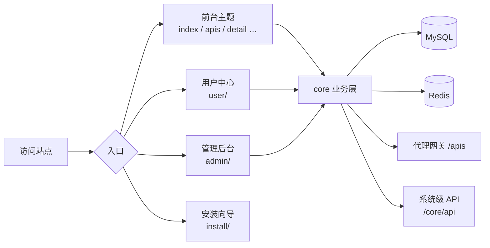

<div align="center">
  <h1>APINEXUS</h1>
</div>

<p align="center">
  <strong>开放接口平台 · 自部署管理 · 云端在线更新</strong>
</p>

<p align="center">
  
  
  <a href="https://gitee.com/xunjinlu/apinexus"></a>
  <a href="https://gitcode.com/xunjinlu/apinexus"></a>
  <a href="https://github.com/whr884657/apinexus"></a>
  
  
</p>

---

## 项目简介

**ApiNexus** 是可自部署的开放 API 接口平台：前台目录与在线调试、后台审核与分类、用户令牌与积分、双主题与云端在线更新。基于 PHP + MySQL，无重型框架依赖。

**主要能力：**

- 六步 Web 安装；管理员 / 用户双端登录（含邮箱验证码与 QQ、Gitee）
- 接口审核、分类、代理网关、调用统计与令牌
- 积分充值与订单；前台双主题；后台控制台与数据大屏
- 行为验证、AI 文档辅助、云端在线更新

**交流群（ApiNexus）：** 可扫码进群，或 [点击加入 QQ 群【ApiNexus】](https://qun.qq.com/universal-share/share?ac=1&authKey=yhMY3qiE6Ufjv88K9x%2FF8P5v31Z1opjuObsuYaBnlcOvBxAHjxYD7nUbgnoZiuo3&busi_data=eyJncm91cENvZGUiOiIxMDQ1MDQzOTEyIiwidG9rZW4iOiJpYUpvZ1I0eFErUnUzV1lWSjhRa3lVdDV3azdWRDZIRlNmb2tSemNMaWZGN2pNb0J0MkpQRWVkZXFPclVnTEhPIiwidWluIjoiMjEwMzUzMzI0MiJ9&data=7K-u63-GNFAvGtgmEUXX5j9cR9CkAwohTEEJ9d8h_mLV7LKKXbuU5b7CaK_8WuaZLVWvO63Ptl4-MGbqaFvo2A&svctype=4&tempid=h5_group_info)。

<p align="center">
  <a href="https://qun.qq.com/universal-share/share?ac=1&authKey=yhMY3qiE6Ufjv88K9x%2FF8P5v31Z1opjuObsuYaBnlcOvBxAHjxYD7nUbgnoZiuo3&busi_data=eyJncm91cENvZGUiOiIxMDQ1MDQzOTEyIiwidG9rZW4iOiJpYUpvZ1I0eFErUnUzV1lWSjhRa3lVdDV3azdWRDZIRlNmb2tSemNMaWZGN2pNb0J0MkpQRWVkZXFPclVnTEhPIiwidWluIjoiMjEwMzUzMzI0MiJ9&data=7K-u63-GNFAvGtgmEUXX5j9cR9CkAwohTEEJ9d8h_mLV7LKKXbuU5b7CaK_8WuaZLVWvO63Ptl4-MGbqaFvo2A&svctype=4&tempid=h5_group_info" title="点击加入 QQ 群【ApiNexus】">
    
  </a>
</p>

---

## 代码仓库与下载

| 平台 | 链接 | 说明 |
|------|------|------|
| **Gitee** | [xunjinlu/apinexus](https://gitee.com/xunjinlu/apinexus) | 主仓库 |
| **GitCode** | [xunjinlu/apinexus](https://gitcode.com/xunjinlu/apinexus) | 同步仓库 |
| **GitHub** | [whr884657/apinexus](https://github.com/whr884657/apinexus) | 同步仓库 |
| **发行版下载** | [Gitee Releases](https://gitee.com/xunjinlu/apinexus/releases) | 完整安装包 |

压缩包命名：`apinexus{版本号}.zip`（如 `apinexus13.26.29.zip`）。完整版本历史见 **[更新记录.md](更新记录.md)**。

---

## 后台框架特性

- 自定义 PHP 架构，无 Laravel / ThinkPHP 等重型依赖
- 白色后台：顶栏 + 可收缩分组侧边栏；电脑端可收起，手机端侧滑
- 统一大弹窗与 Toast；会话超时可配置
- 系统名称、Logo、站点信息等可在后台配置；源码可二次开发

---

## 环境要求

- **PHP** 7.4 / 8.0 / 8.2 / 8.5（推荐 8.0+）
- **MySQL** 5.7+ 或 MariaDB 10.3+
- **PHP 扩展**：pdo、pdo_mysql、**redis**、mbstring、json、session、curl、openssl、zip
- **目录权限**：`config/`、`data/` 可写；安装后自动生成 `config/database.php`

---

## 结构示意

不在此展开逐文件清单。文档怎么选：

| 你想做什么 | 看哪里 |
|------------|--------|
| 自研 / 改装**前台主题**（目录、配置落盘、取数例子） | **[主题开发对接说明.md](主题开发对接说明.md)** |
| 核心模块职责 / 与主题的基础边界 | [CORE模块说明.md](CORE模块说明.md) |
| 对接**系统级外部 API**（卡密、签到、排行等，系统密钥） | **[core/api/README.md](core/api/README.md)** |



---

## 安装说明

1. 上传代码到 Web 服务器（或 `git clone` 后部署）
2. 确保 `config/` 目录可写
3. 创建 MySQL 空数据库
4. 访问 `https://你的域名/install/` 完成六步安装（先配 Nginx 伪静态）
5. 安装完成后访问 `/admin/login.php` 登录后台

---

## 伪静态 / URL 重写

> **权威规则以根目录 [`nginx伪静态配置.md`](nginx伪静态配置.md) 情况 A 为准**，须与安装向导、根目录 `.htaccess`、本段保持一致。改规则时四处同步（含 `/sitemap.xml`）。根目录**不再提供** `robots.txt`（避免 Disallow 暴露目录结构）。

### Apache

项目根目录 `.htaccess` 已含：禁止直链 `config/`、`data/`、`core/data/`；`/apis/{短码}` 代理；`/sitemap.xml`；通用 `/{页面}/{数字ID}` → `/{页面}.php?id=`。启用 `mod_rewrite` 即可。

### Nginx（宝塔「伪静态」请只粘贴英文规则，不要带中文注释）

**推荐整段粘贴（情况 A，与安装向导默认一致）：**

```nginx
location ^~ /assets/js/sysapi-catalog/ {
    deny all;
    return 403;
}
location ~ ^/(config|data|core/data)/ {
    deny all;
    return 403;
}
location ~ ^/apis/([a-z0-9]+)/?$ {
    rewrite ^/apis/([a-z0-9]+)/?$ /apis.php?_vs_slug=$1 last;
}
location = /sitemap.xml {
    rewrite ^ /sitemap.php last;
}
location ~ ^/([a-z0-9_-]+)/([0-9]+)/?$ {
    rewrite ^/([a-z0-9_-]+)/([0-9]+)/?$ /$1.php?id=$2 last;
}
location / {
    try_files $uri $uri/ $uri.php$is_args$args;
}
```

| 顺序 | 规则 | 作用 |
|------|------|------|
| 1 | `config` + `data` + `core/data` 合并 deny | 禁止直链配置、运行时目录与主题本地库 |
| 2 | `/apis/{短码}` | 代理网关 |
| 3 | `/sitemap.xml` | 站点地图 |
| 4 | `/{页面}/{数字}` | 路径式资源 → `?id=` |
| 5 | `location /` | 去 `.php` |

若站点已有 `location /`，可只追加上表 1～4 段并放在其**上面**。

> **注意：** 不要写 `[a-z0-9]{3,64}` 等带花括号量词（宝塔可能吞掉 `{…}`）。  
> **注意：** 必须 rewrite 到 `/$1.php?id=$2`，不要 PATH_INFO。  
> **勿伪静态：** 码支付回调 `core/play/codeplay/notify.php` / `return.php` 须直访。

完整说明见 [`nginx伪静态配置.md`](nginx伪静态配置.md)。

---

## 在线更新

登录后台后会向云端检测最新版本。若本地低于云端，可在「系统升级」中安装。

**更新过程（分步）：** 下载 → 解压 → 覆盖系统文件（**不替换**数据库配置与安装锁定、**不覆盖**运行时数据目录）→ 如有则执行增量库结构 → 清理临时文件。

**服务器要求：** 支持解压的 PHP 扩展、可写项目目录、可访问云端。

---

## 接口失败码

- **公开接口**：**11xxx**
- **系统级外部 API**：**12xxx**

| 公开接口 | 含义 |  | 系统级外部 API | 含义 |
|----------|------|--|----------------|------|
| 11001 | 未提供调用密钥 |  | 12001 | 系统密钥无效或未提供 |
| 11002 | 密钥错误 |  | 12002 | 该系统 API 未启用 |
| 11003 | 密钥已禁用 |  | 12003 | 参数错误 |
| 11004 | 积分余额不足 |  | 12004 | 参数重复且冲突 |
| 11005 | 请求过于频繁（QPM） |  | 12005 | 请求过于频繁 |
| 11006 | 接口维护中 |  | 12006 | 请求体过大 |
| 11007 | 接口已禁用 |  | 12007 | 不支持 JSONP |
| 11008 | 接口不可用（审核等） |  | 12008 | 系统未安装 |
| 11009 | 密钥校验暂不可用 |  | 12009 | 依赖未就绪 |
| 11010 | 积分系统暂不可用 |  | 12010 | 目标不存在或不可用 |
| 11011 | 收费接口须有效密钥 |  | 12011 | 业务处理失败 |
| 11012 | 鉴权方式错误 |  | 12012 | 用户未注册 |
| 11013 | 接口不存在 |  | 12013 | 账户已封禁 |
| 11014 | 上游地址无效 |  | 12014 | 业务功能未开启 |
| 11015 | 上游地址不允许 |  | 12015 | 已完成或请勿重复操作 |
| 11016 | 上游请求失败 |  |  |  |
| 11017 | 服务暂不可用 |  |  |  |
| 11018 | 请求方式不允许 |  |  |  |
| 11019 | 当前 IP 不在白名单 |  |  |  |
| 11020 | 启用出口代理须有效密钥 |  |  |  |
| 11021 | 未配置可用出口代理 |  |  |  |
| 11022 | 出口代理不可用 |  |  |  |
| 11023 | 密钥已过期 |  |  |  |
| 11024 | 令牌分配积分不足 |  |  |  |
| 11025 | 该密钥无权调用此接口 |  |  |  |

---

## 版本记录

> 此处**仅保留最新一条**；完整历史见 **[更新记录.md](更新记录.md)**。

### v13.26.46（2026-10-07）

- 新增：令牌可限制允许调用的接口（全选表示不限制；后台只读）[E378][E379]
- 新增：运营中心（邮件群发、站内私信筹备）与系统「邮箱模板」（多 SMTP、占位符、筛选发送、发送记录与模板预览等）[E380][E414][E432][E442]～[E465]
- 新增：站内公告并入公告管理（站外/站内与受众；用户中心弹窗确认后红点消失）[E441]
- 新增：用户激励「积分赠送」与「全站优惠」（分片真实进度；折扣/全免互斥；队列签名与写操作更稳妥）[E436]～[E440]
- 新增：系统级外部 API（卡密、日志、接口查询、排行、签到、用户信息、全站概况）与文档页（Query 传钥；请求示例三 Tab）[E382]～[E403][E412][E419][E428]
- 新增：Cloudflare Turnstile；可自定义出站 User-Agent 品牌（人机验证提示更准确）[E418][E391][E429]
- 新增：账号设置顶卡+Tab、申请开发者、开发审核三 Tab，及申请邮件通知开关（申请迁入反馈表；解绑更稳妥）[E424][E426][E431]
- 新增：根目录《主题开发对接说明》；CORE 模块说明按「模块名 + 一模块一表」重排
- 修复：安全修补——公告 Markdown/短码 XSS 纵深消毒；邮件 HTML 消毒与群发队列签名、假完成/漏发防护、SMTP 校验；激励赠送 HMAC、折扣不舍成 0、写操作须管理员登录；广告上传鉴权 [E438]～[E457]
- 修复：结构升级半就绪假绿；友链列表去外套大白底；后台友链与接口列表排序等问题 [E425][E377]
- 优化：主题3接口详情两侧留白与信息着色；文章封面/正文图恢复 16:9 比例 [E325][E364]
- 优化：数据大屏首屏改为轻量壳 + 异步拉全量，避免同步扫表导致进页空白卡顿；中国/世界地图切换自动归位 [E466][E467]
- 优化：系统/主题设置与主题3展示；调用日志热冷翻页；前台与控制台缓存及底部分页 [E404]～[E423][E417][E257][E390]
- 优化：内容运营电脑端表格化、开发审核手机卡与主题切换画廊体验 [E427][E433][E430]
- 调整：友链表仅保留友链/伙伴/赞助；开源许可改为 AGPL-3.0 [E426]
- 本版含数据库升级，请按「系统升级」完成；升级后建议在服务器面板重载一次网站服务


- 完整历史见 [`更新记录.md`](更新记录.md)

---

## 赞助支持

本项目开源维护。若对你有帮助，可自愿扫码赞赏（非必须）。

| 支付宝 | 微信 | QQ |
|:------:|:----:|:--:|
|  |  |  |

<br>

### 赞助致谢

| 头像 | 赞助方 | 金额 |
|:----:|--------|-----:|
|  | [Tmini - 在线API](https://api.tmini.net/) | 18.8 元 |
|  | [bbbcode](https://bbbcode.com/) | 9.9 元 |
|  | [纽扣网络](https://www.nkwl.net/) | 9.9 元 |

---

## 开源协议

本项目采用 **[GNU Affero GPL v3.0（AGPL-3.0）](LICENSE)**。中文部署条款见 **[LICENSE.zh-CN.md](LICENSE.zh-CN.md)**（安装向导首次进入时须阅读确认）。

### 您可以

- 免费学习、部署与使用（含商业环境）
- 二次开发并追加自己的署名（**须保留原作者署名**）
- 分发改装版并可收费，但**必须开源完整对应源码**（含仅作网络服务提供的情形）

### 您不得

- 移除、篡改或遮盖原作者版权与署名
- 将衍生作品闭源销售或闭源提供服务
- 未经书面授权，以作者名义宣发、担保您自行增加的功能

### 作者声明（免责）

- 本项目按 **「原样（AS IS）」** 提供，**不提供任何明示或暗示的担保**
- 因使用、篡改或部署产生的数据泄露、业务纠纷与赔偿等，**作者不承担责任**，风险由使用者自担
- 详细条款以 **[LICENSE](LICENSE)** 与 **[LICENSE.zh-CN.md](LICENSE.zh-CN.md)** 为准

---

## 作者与仓库

- 开发者个人站：[www.xunjinlu.fun](https://www.xunjinlu.fun/)
- Gitee：[https://gitee.com/xunjinlu/apinexus](https://gitee.com/xunjinlu/apinexus)
- GitCode：[https://gitcode.com/xunjinlu/apinexus](https://gitcode.com/xunjinlu/apinexus)
- GitHub：[https://github.com/whr884657/apinexus](https://github.com/whr884657/apinexus)
- 问题反馈：可通过任一仓库 Issues 提交

---

> 维护者本地文档（README 编写要点、发版检查清单等）不随仓库发布，请在本地查阅。
