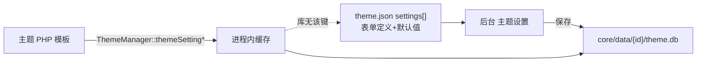

# ApiNexus · 主题开发对接说明

> **路径：** 项目根目录 `主题开发对接说明.md`  
> **版本：** 与 `core/version.php` 中 `VS_VERSION` 一致（当前 **13.26.48**）  
> **读者：** 自研 / 二开主题作者（只关心「主题包怎么写、数据从哪来、配置存在哪」）  

---

## 0. 本文与其它文档怎么分工

| 文档 | 讲什么 | 不讲什么 |
|------|--------|----------|
| **本文** | 主题包目录、`theme.json`、配置落盘、页面怎么取数、大量「我想要 X → 写什么」例子 | 核心类内部实现、迁移 SQL、管理后台 UI |
| [`CORE模块说明.md`](CORE模块说明.md) | `core/` 各模块职责、分层铁律、附录模块表 | 某一主题的视觉皮面 |
| [`开发规范/主题通用规范.md`](开发规范/主题通用规范.md) | 全主题共用强制规则（资源隔离、DOM id、禁止互抄） | 手把手搭新主题教程 |
| `core/theme/{id}/主题规范.md` | **某一个**主题自己的界面约定 | 跨主题通用对接 |

**一句话：** 核心管规则与数据；主题只管展示。本文教你把展示接对。

### 怎么读

| 你想… | 跳到 |
|--------|------|
| 新建一个主题目录 | [第 1～2 节](#1-主题放哪系统怎么发现) |
| 后台「主题设置」里的开关存在哪 | [第 3 节](#3-主题配置存在哪两层别混) |
| 模板里读站点名 / 接口列表 / 友链 | [第 5～6 节](#5-数据调用速查我想要--写什么) |
| 首页目录用 AJAX 还是 PHP | [第 7 节](#7-公开目录与友链方法一--方法二) |
| CSS/JS 放哪、哪些脚本禁止拷贝 | [第 8 节](#8-资源-cssjs-怎么写) |
| 用户中心 / 登录页 | [第 9 节](#9-用户中心与认证页) |

---

## 1. 主题放哪、系统怎么发现

| 项 | 约定 |
|----|------|
| 根目录 | `core/theme/{主题ID}/` |
| 发现方式 | 扫描一级子目录；存在合法 `theme.json` 即出现在后台「主题设置」 |
| 主题 ID | **必须**与目录名一致，且与 `theme.json` 的 `"id"` 一致 |
| 内置主题 | `default` · `slate` · `three` · `docs` · `muming`（互为独立产品，**禁止**整包互抄皮面） |

```text
core/theme/
├── default/          ← 主题一
├── slate/            ← 主题二
├── three/            ← 主题三
├── docs/             ← 主题四
└── muming/           ← 主题六「慕名」
```

复制官方主题改皮肤时：**先改 `id` / 目录名 / `theme.json` 名称**，再改 HTML/CSS；数据契约（`Frontend*`）可对齐，视觉 class 不要整段搬。

---

## 2. 标准目录（每个文件干什么）

```text
core/theme/{id}/
├── theme.json                 # 必填：元数据 + 后台设置表单 schema（默认值）
├── preview.png                # 推荐：后台预览图
├── 主题规范.md                # 推荐：本包界面约定（随安装包给二开者）
├── layout/
│   ├── header.php             # 前台顶栏 / 导航 / 抽屉
│   └── footer.php             # 前台页脚
├── pages/                     # 公开页模板（见第 4 节映射表）
│   ├── home.php
│   ├── apis.php
│   ├── detail.php
│   └── …
├── assets/
│   ├── theme.css / theme.js   # 前台主样式/脚本（非 default 必有 css）
│   ├── user.css / user.js     # 用户中心
│   ├── auth.css / auth.js     # 登录注册等认证页
│   ├── shell/                 # 壳层样式/小脚本（勿放 common.js）
│   ├── css/ · js/ · img/      # 按页拆分的资源（推荐）
│   └── …                      # 仅本包资源；禁止引用其它主题路径
├── user/
│   ├── layout.php             # 用户中心壳（侧栏+顶栏）
│   ├── auth/                  # login / register / forgot / bind
│   └── pages/                 # dashboard / keys / account / …
├── partials/                  # 可选：可复用片段
├── api/                       # 可选：主题私有端点（禁止替代 core/front 目录/友链）
└── data/                      # 废弃：旧 settings.json，勿再写
```

| 必填（最小可切换） | 强烈建议 |
|--------------------|----------|
| `theme.json` · `layout/header.php` · `layout/footer.php` · `pages/home.php` · `assets/theme.css`（非 default）· `assets/user.css` · `assets/auth.css` · `user/layout.php` · `user/auth/*` | `preview.png` · `主题规范.md` · 用户中心 `user/pages/*` |

---

## 3. 主题配置：存在哪？（两层别混）

后台「主题设置」里改的开关 / 文案，**不是**写回 `theme.json`。

| 层级 | 路径 / 载体 | 存什么 | 谁写 |
|------|-------------|--------|------|
| **Schema（表单定义）** | `core/theme/{id}/theme.json` → `"settings": [...]` | 字段 key、label、type、default、options | 主题作者随包发布 |
| **运行时取值（权威）** | `core/data/{id}/theme.db`（SQLite） | 站长在后台保存后的实际值 | 系统 `ThemeSettingsStore` |
| **禁止再写** | `core/theme/{id}/data/settings.json` | 旧方案，已废弃 | — |



### 3.1 `theme.json` 最小骨架

```json
{
  "id": "mytheme",
  "name": "我的主题",
  "version": "1.0.0",
  "developer": "你的名字",
  "author": "你的名字",
  "description": "一句话介绍",
  "preview": "preview.png",
  "settings": [
    {
      "key": "hero_title",
      "label": "首页主标题",
      "type": "text",
      "placeholder": "留空则用站点名称"
    },
    {
      "key": "show_partners",
      "label": "显示合作伙伴区",
      "type": "checkbox",
      "default": true
    }
  ]
}
```

| `type` | 后台控件 | 模板读取建议 |
|--------|----------|--------------|
| `text` / `textarea` | 文本 | `ThemeManager::themeSettingStr('key', '')` |
| `checkbox` | 开关 | `ThemeManager::themeSettingBool('key', true)` |
| `select` | 下拉（须 `options`） | `themeSettingStr` 或按选项自己映射 |
| `number`（若用） | 数字 | `ThemeManager::themeSettingInt('key', 0, $min, $max)` |

### 3.2 模板里怎么读配置（例子）

```php
<?php
if (!defined('VS_THEME_RENDER')) {
    exit; // 禁止直接浏览器打开主题文件
}

// 字符串（trim；空则回落 default）
$heroTitle = ThemeManager::themeSettingStr('hero_title', '');

// 布尔
$showPartners = ThemeManager::themeSettingBool('show_partners', true);

// 整数（可夹逼）
$limit = ThemeManager::themeSettingInt('some_limit', 8, 1, 50);

// 原始值（少用；优先上面三个）
$raw = ThemeManager::themeSetting('hero_title', '');
```

| 想做的事 | 写法 | 说明 |
|----------|------|------|
| 读本主题配置 | `ThemeManager::themeSetting*` | 自动对应当前启用主题 |
| 读站点名 / Logo / 备案 | `SiteContext::siteName()` 等 | **不是**主题配置 |
| 主题里 `Config::set` | **禁止** | 配置只许后台/核心写 |
| 主题直读 `theme.db` / SQL | **禁止** | 只经 ThemeManager |

---

## 4. 入口脚本 → 页面文件

根目录 PHP 入口加载引导后，调用 `vs_frontend_page($pageKey, $title, $pageData)`，再由 `ThemeManager` 渲染：

`layout/header.php` → `pages/{pageKey}.php` → `layout/footer.php`。

| 入口脚本（站点根） | `$pageKey` | 主题文件 |
|--------------------|------------|----------|
| `index.php` | `home` | `pages/home.php` |
| `apis.php` | `apis` | `pages/apis.php` |
| `detail.php` | `detail` | `pages/detail.php` |
| `articles.php` | `articles` | `pages/articles.php` |
| `about.php` | `about` | `pages/about.php` |
| `links.php` | `links` | `pages/links.php` |
| `applylink.php` | `applylink` | `pages/applylink.php` |
| `sponsor.php` | `sponsor` | `pages/sponsor.php` |
| `contributors.php` | `contributors` | `pages/contributors.php` |
| `profile.php` | `profile` | `pages/profile.php` |

用户中心 / 认证不走上表，见 [第 9 节](#9-用户中心与认证页)。

### 4.1 页面文件开头铁律

```php
<?php
if (!defined('VS_THEME_RENDER')) {
    exit;
}
// 下面才能写 HTML / 取数
```

---

## 5. 数据调用速查（我想要… → 写什么）

> **铁律：** 主题内禁止 `Database::`、SQL、表名、以及用 `*Manager` 取前台展示数据。  
> 合法路径：`Frontend*` / `SiteContext` / `ThemeManager` / `SiteMedia` / `UserAuth` / 入口注入变量 / 约定 HTTP。

### 5.1 站点与主题壳

| 我想要 | 怎么取 | 示例 |
|--------|--------|------|
| 站点名称 | `SiteContext::siteName()` | `$name = SiteContext::siteName();` |
| 站点 Logo URL | `SiteContext::siteLogo()` | — |
| 备案 / 页脚文案块 | `SiteContext::*` 对应方法 | 见 CORE 附录 / `SiteContext` |
| 导航菜单项 | `ThemeManager::navItems()` | 受 `nav_show_*` 配置过滤 |
| 本主题资源 URL | `ThemeManager::assetUrl($id, 'assets/theme.css')` 或壳内已注入链接 | 勿手写绝对盘路径 |
| 同站路径前缀 | `vs_site_base_path()` / `vs_site_path('/apis')` | 禁止对路径前缀 `parse_url` 取 host |
| HTML 转义 | `vs_e($str)` | 用户可控内容必转义 |
| 内置图（QQ.svg 等） | `SiteMedia::imgUrl('QQ.svg')` | 不要写死 `/assets/...` 旁路 |

### 5.2 接口 / 分类 / 统计

| 我想要 | 怎么取 | 备注 |
|--------|--------|------|
| 分类标签 | `FrontendCategory::listTags()` | 首页筛选 chips |
| 公开接口列表（PHP） | `FrontendApi::listForTheme()` | **方法一**；官方多改方法二 |
| 接口详情 | 入口注入 `$api`，或 `FrontendApi::findForThemeById($id)` | 详情页优先用入口 `$api` |
| 接口积分 / 活动价 | 用系统返回的 `base_points` / 活动标签字段 | **禁止**主题自算折扣或改展示价；全站优惠由 `IncentiveManager`/`FrontendApi` 叠层（E437 / E439）。**E439：** 服务端折扣实扣向上对齐万分之一（最小 0.0001），禁止 round 成 0；全免可为 0。主题只展示系统字段，实扣以 `ApiStats` 调用链为准 |
| 首页 KPI（接口数/调用量） | `FrontendStats::approvedApiCount()` · `totalCallCount()` | — |
| OpenAPI 派生 | `OpenApiBuilder::*` | 详情页/文档页 |
| 快速上手代码块 | `ApiQuickstart::qsBundleFromAidoc(...)` | 详情页 |

### 5.3 内容：公告 / 文章 / 关于 / 评论

| 我想要 | 怎么取 |
|--------|--------|
| 公告列表 / 弹窗 | `FrontendAnnouncement::listForTheme()` · `listPopups()` |
| 文章列表 / 详情 | `FrontendArticle::listForTheme()` · `listPaged` · `findById`（含 `body_html`） |
| 关于页绑定文章 | `FrontendAbout::getBoundArticle()` |
| 文章评论列表 / 提交 | `FrontendComment::listByContentId` · `submit`（须 CSRF） |

### 5.4 友链 / 伙伴 / 赞助

| 我想要 | 怎么取 |
|--------|--------|
| 友链（PHP） | `FrontendLink::listForThemePage()` / `pickForFooter(8)` | **方法一** |
| 友链（AJAX） | `VS.fetchFrontLinks` → `core/front/links.php` | **方法二**（官方推荐） |
| 合作伙伴 | `FrontendPartner::listForTheme()` 或目录 JSON 带 `partners=1` |
| 赞助列表 / 收款码 | `FrontendSponsor::listForTheme()` · `paymentQrs()` |

### 5.5 用户 / 贡献者 / 反馈

| 我想要 | 怎么取 | 禁止 |
|--------|--------|------|
| 当前登录用户展示 | `FrontendUser::current()` / `UserAuth::check()` | 主题拼 Session 当权威 |
| 贡献者墙 / 主页 | `FrontendContributor::listForTheme()` · `findProfile` | — |
| 接口反馈提交 | `FrontendFeedback::submit($apiid, $content)` | 主题 INSERT `feedback` 表 |
| 申请转开发者 | **不要**在主题里调 Manager；走用户中心 `user/account.php` 已接好的表单 | 主题自造申请接口 |

### 5.6 详情页在线测试（Playground）

| 我想要 | 怎么取 |
|--------|--------|
| 是否登录、密钥数量、跳转 URL | `vs_playground_session_context()`（**不含**明文 KEY） |
| 真正拉取 API KEY | 前端 `POST` `core/front/playground-key.php`（CSRF + 登录） |

```php
// 详情页：上下文（无 KEY）
$playCtx = vs_playground_session_context();
// JS 侧再按需请求 playground-key.php
```

---

## 6. 完整页面例子（首页骨架）

```php
<?php
if (!defined('VS_THEME_RENDER')) {
    exit;
}

$siteName   = SiteContext::siteName();
$tags       = FrontendCategory::listTags();
$apiCount   = FrontendStats::approvedApiCount();
$totalCalls = FrontendStats::totalCallCount();
$announces  = FrontendAnnouncement::listForTheme();
$heroTitle  = ThemeManager::themeSettingStr('hero_title', '');
if ($heroTitle === '') {
    $heroTitle = $siteName;
}
$showPartners = ThemeManager::themeSettingBool('show_partners', true);
$qqIcon       = SiteMedia::imgUrl('QQ.svg');
?>
<section class="hero">
    <h1><?php echo vs_e($heroTitle); ?></h1>
    <p>已上线 <?php echo (int) $apiCount; ?> 个接口 · 累计调用 <?php echo vs_e((string) $totalCalls); ?></p>
</section>

<?php /* 方法二：目录交给 JS；壳里需有 CSRF 与 VS_FRONT_CATALOG（footer 注入） */ ?>
<div id="apiCatalogMount"
     data-partners="<?php echo $showPartners ? '1' : '0'; ?>"></div>

<script>
// 官方 common.js 已提供 VS.fetchFrontCatalog
if (window.VS && VS.fetchFrontCatalog) {
    VS.fetchFrontCatalog({ partners: <?php echo $showPartners ? 'true' : 'false'; ?> })
        .then(function (data) { /* 渲染卡片 */ });
}
</script>
```

---

## 7. 公开目录与友链：方法一 / 方法二

| | 方法一（PHP 直调） | 方法二（HTTP JSON · 官方推荐） |
|--|-------------------|--------------------------------|
| 目录 | `FrontendApi::listForTheme()` | `POST core/front/catalog.php` ← `VS.fetchFrontCatalog` |
| 友链 | `FrontendLink::*` | `POST core/front/links.php` ← `VS.fetchFrontLinks` |
| 首屏 | 服务端已有 HTML | 先出壳再填充（须处理 loading/空态） |
| 注意 | 勿再自造 `/theme/api/*` | 须 CSRF；禁止 GET 当业务入口 |

**同一主题对同一能力只选一种**，不要 PHP 渲一份又 AJAX 拉一份重复。

---

## 8. 资源（CSS/JS）怎么写

| 规则 | 说明 |
|------|------|
| 只出本包 | 样式/脚本放 `core/theme/{id}/assets/` |
| 系统级脚本 | 根目录 `assets/js/common.js`、`captcha.js`、`auth-csrf.js`、部分 `user-*.js` 由核心注入；**主题禁止自带 common.js / captcha.js / auth-csrf.js 副本** |
| 验证码 | `vs_captcha_field` / `vs_captcha_js`；Turnstile/极验见《CORE模块说明》第 16.2 节；认证提交须走 `VsAuthCsrf.postForm`（E429：业务失败提示原样 `msg`，勿自写「有 csrf 就重试」） |
| 禁止 | 引用 `core/theme/其它id/`；把 `admin.css` 当皮；主题内再起打包 HTTP 入口 |

前台资源通常由 `ThemeManager` / `vs_frontend_page` 按约定挂 `<link>` / `<script>`；按页拆分的文件放在 `assets/css/pages/`、`assets/js/pages/` 并在主题或核心映射里登记（对齐官方主题写法）。

---

## 9. 用户中心与认证页

| 区域 | 入口方式 | 主题文件 |
|------|----------|----------|
| 用户中心壳 | `ThemeManager::renderUserLayoutStart/End` | `user/layout.php` |
| 用户页 | `ThemeManager::renderUserPage` | `user/pages/{key}.php`（如 `account.php`、`keys.php`） |
| 认证页 | `ThemeManager::renderAuthPage` / `renderThemeAuthHead` | `user/auth/layout.php` + `login.php` 等 |

| 注意 | 说明 |
|------|------|
| 注册策略 | 尊重入口注入的 `$registerOpen` / `$showRoleSegment` / `$registerRole`；登录页「立即注册」仅在开放注册时显示 |
| 账号设置 / 申请开发者 | 官方主题已接好；二开时保持 POST `action=apply_developer` + CSRF，勿改调内部 Manager。订阅标签用入口注入的开关，POST `action=save_subscribe` |
| 认证提交 | 登录/注册/忘记密码用系统 `VsAuthCsrf.postForm`；失败展示服务端 `msg` 并 `VsCaptcha.reset`；**禁止**主题再写一套「响应含 csrf 就自动重试」（E429） |
| 样式 | `assets/user.css`、`assets/auth.css` 与壳分离，避免串前台 `theme.css` |

---

## 10. 安全与禁止清单（主题作者）

| # | 禁止 | 正确做法 |
|---|------|----------|
| 1 | 主题内 SQL / `Database::` / Redis 业务键 | 只调 `Frontend*` 等 |
| 2 | 主题调 `ApiManager` / `LinkManager` / `ApiFeedbackManager` 取展示 | 对应 `Frontend*` 或用户中心入口 |
| 3 | Playground 把 API KEY 写进 HTML | `vs_playground_session_context` + `playground-key.php` |
| 4 | 自造目录/友链 JSON URL | 只用 `core/front/catalog.php` / `links.php` |
| 5 | 跨主题引用 CSS/JS | 只引用本包 `assets/` |
| 6 | 未转义输出用户内容 | `vs_e()` |
| 7 | 写操作无 CSRF | `vs_require_secure_post()` / 表单带 token |
| 8 | 主题 `Config::set` / 直写 `theme.db` | 配置只走后台主题设置 |

---

## 11. 新建主题检查清单

- [ ] 目录名 = `theme.json` 的 `id`
- [ ] 有 `preview.png`、`layout/header.php`、`footer.php`、`pages/home.php`
- [ ] `settings` 里需要的 key 都有 `default` 或模板侧有回落
- [ ] 前台 / 用户中心 / 认证三套 CSS 齐全
- [ ] 无 `Database` / `*Manager` 展示取数
- [ ] 目录与友链方法一或二只选一种
- [ ] 详情无 KEY SSR；注册/登录策略 UI 正确
- [ ] 后台启用本主题后，手机+桌面走通首页、详情、登录、用户中心
- [ ] 本包 `主题规范.md` 写清本皮面约定（勿抄其它主题 HTML）

---

## 12. 与核心文档的交叉索引

| 主题侧问题 | 核心侧细读 |
|------------|------------|
| 某个 `Frontend*` 有哪些方法 | [`CORE模块说明.md`](CORE模块说明.md) 附录 B |
| 申请开发者 / Turnstile | CORE 第 16 节 |
| 强制 DOM id（playground / 反馈 / 评论） | 《主题通用规范》 |
| POST / CSRF / AJAX | 《请求与表单规范》 |
| 某一官方主题长什么样 | `开发规范/主题N规范.md` + `core/theme/{id}/主题规范.md` |

---

## 13. 维护约定

1. 主题包新增「可配置项」：先改 `theme.json` 的 `settings`，再在模板用 `themeSetting*` 读取；说明写进本包 `主题规范.md`。  
2. 主题包新增「业务取数」：若 `Frontend*` 没有能力，**先提核心加门面**，禁止主题直连库。  
3. 本文只维护「怎么对接」；皮面差异不写进本文。

**文档版本标注：** 13.26.48


## 业务邮件与主题边界（E432 / v13.26.46；占位符 E468 / v13.26.47）

- 业务邮件**唯一**实现：`core/MailNotify.php`（SMTP：`core/Mailer.php`；场景/占位符：`MailChannels`，全局英文短连写见《邮箱发信规范》第4.13节）。
- 运营群发 / 批次记录：`OpsMailManager` / `MailLogManager`（仅后台 `admin/ops/mail.php`）；主题**禁止**调用。
- 主题**只调** `Frontend*` 与正式前台入口；**禁止**调用 `MailNotify` / `Mailer` / `MailChannels` / `OpsMailManager` / `MailLogManager`，也**禁止**再引用已删除的 `ApiNotify` / `LinkNotify` / `FeedbackNotify` / `CommentNotify` / `PointsNotify` / `DevApplyNotify`。
- 升级后旧站残留上述六个文件由 `install/obsolete-files.json` 清理。
- 主题自有上传 API（如主题六 `api/ad-upload.php`）：**必须** `Auth::check()` 管理员鉴权 + 安全 POST；**禁止**注释掉鉴权（E455）。

详见根目录 `CORE模块说明.md` 第16.3节 / 附录 B · M081b / M081c；《邮箱发信规范》第4.12节 / 第4.13节。

